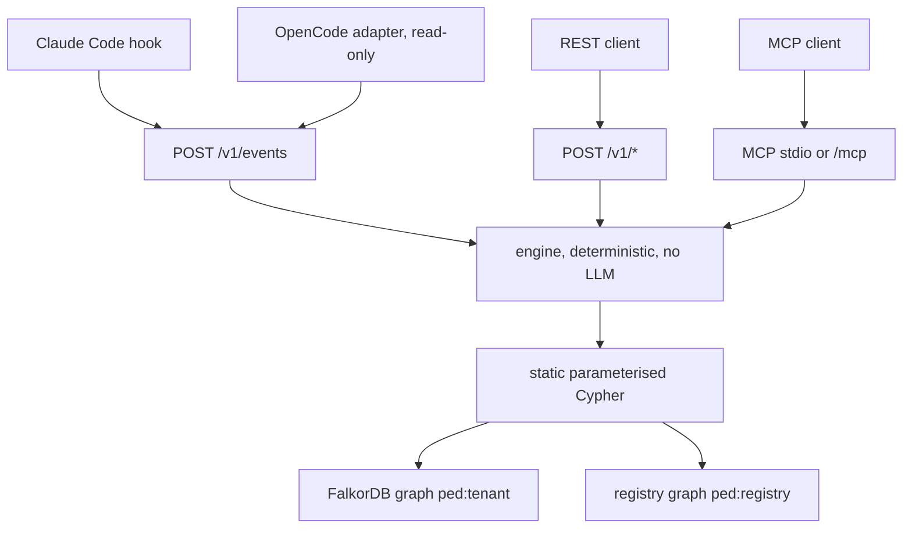
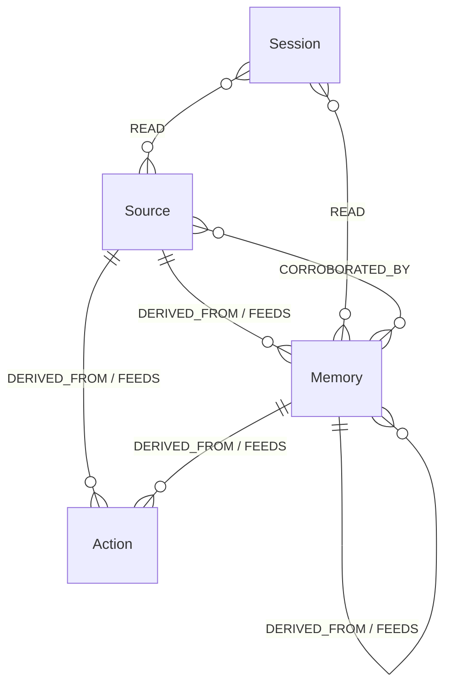

# Pedigree

**git blame and git revert for what an AI agent believes.**

[CI workflow](.github/workflows/ci.yml). The workflow file is in this repo. This page does not claim a successful hosted run.

A 20-second GIF is not in this repository. A human recording would go under `docs/assets/`. The video is still pending (F-23).

Three measurements from [`docs/NUMBERS.md`](docs/NUMBERS.md) (E1, generated DAGs, the engine's `compute_final`): recall **1.0**, over-invalidation **0.0**, explicit preservation-status sensitivity **1.0**. Intervals and the other rows are in [Evaluation](#evaluation).

Three Compose commands. Read the quick-start notes before using the credential file:

```bash
git clone https://github.com/Vedant817/pedigree.git && cd pedigree
docker compose up --build --wait
mkdir -p scratch && docker compose cp pedigree:/data/credentials/demo-demo.json scratch/demo-demo.json
```

No Docker on Linux: `make quickstart` (or `bash scripts/quickstart.sh`). Windows Python with a Docker database: `make quickstart-windows`.

Coding agents remember things and act on them: prompt files, rule files, MCP tool
descriptions, web pages they read, memories they write. When one of those sources turns out to be
wrong or malicious, nobody can answer *"what did the agent already believe and do because of it?"*

Pedigree answers that out-of-band:

- it **records** observed or reported lineage through the Claude Code hook, REST API and MCP;
  agent-reported dependencies remain distinct from runtime observations,
- stores the lineage in **FalkorDB**, one graph per tenant, as fixed parameterised Cypher,
- **revokes** a bad source and shows what it contaminated down to the commit,
- **keeps what is independently supported** instead of cascading blindly,
- **gates** risky actions with the lineage path as evidence, and says
  *not in the graph* rather than "safe" about unknown ids.

> Built for the WeMakeDevs × FalkorDB **Graph Hacks: Context for AI Agents** hackathon
> (Oct 15-18 2026). The status table below is kept in sync with `docs/FEATURES.md`: a feature
> counts as done only when its tests and its QA evidence exist in this repository.

## Problem & why a graph

FalkorDB is the database this product runs on, not a diagram decoration.

Every question Pedigree answers is a graph question:

| Question | What it needs |
|---|---|
| What did this belief come from? | multi-hop ancestor traversal (`algo.BFS` over `DERIVED_FROM`) |
| What depends on this source? | descendants over the mirrored `FEEDS` edges, chunked |
| Is this action safe to run? | the status labels the revoke fixpoint already computed, plus one `taint_parent` hop chain as the reason path |
| Which sources carry the most weight? | `algo.pageRank` over `Node`/`DERIVED_FROM` |
| What would revoking this do? | `GRAPH.COPY` of the tenant graph, the real revoke on the copy, diff, delete |

If you remove FalkorDB, none of those stay: the product stops working. There is no
database-agnostic fallback, and the isolation story (one graph per tenant) *is* the multi-graph
story. A recursive SQL CTE can compute a closure - we measured that comparison honestly
(`evals/run_e4b_sqlite.py`): for the traversal primitives alone, at every size we tested, the
stdlib `sqlite3` recursive CTE is **faster** than `algo.BFS` (the graph query pays a round-trip),
and we report that rather than hide it. What FalkorDB buys is not the closure: it is the
per-tenant graph namespace, `GRAPH.COPY` for an isolated what-if, and the
per-graph ACL mechanism. SQLite can also implement logical isolation; this comparison measures
traversal primitives, not isolation architectures. The service ACL credential wiring remains open.

## Quick start (local Docker Compose)

Prerequisites: Git and Docker Compose. The API binds to loopback; the database
stays inside the Compose network. No model provider or API key is needed.

```bash
git clone https://github.com/Vedant817/pedigree.git && cd pedigree
docker compose up --build --wait
mkdir -p scratch && docker compose cp pedigree:/data/credentials/demo-demo.json scratch/demo-demo.json
```

Open `http://localhost:8000` in a browser. Read `operator_token` from the private local
`scratch/demo-demo.json` file and paste it into the workspace. On this machine,
`PEDIGREE_DEMO_LOGIN=1` enables **Open the local demo**, which asks the server for
the agent credential in that private file. Revocation still needs `operator_token`.
Keep that file out of Git and agent configuration. Previewing a revocation changes nothing until you
confirm it. The local demo has operator powers; deployment-admin HTTP routes are
disabled in demo mode. This is not a public read-only deployment.

Compose preserves the graph and credential volumes across `docker compose down`
and later startup. Do not delete volumes to repair a credential problem: restore
the original private file, or select a new dedicated `PEDIGREE_DEMO_TENANT`.
Seeding errors stop startup. Readiness is at `http://localhost:8000/readyz`.

### Setup without Docker on Linux

Use Python `3.12` or newer, Git, curl and a Linux distribution compatible with the
locked local database wheel. The pinned module also needs the OpenMP runtime; where
the distribution does not ship it, install it first:
`sudo apt-get install -y libgomp1` (Debian/Ubuntu) or `sudo dnf install libgomp`
(Fedora). The quickstart preflights the module's libraries and names any that are
missing. It installs the locked environment, fetches the pinned module, seeds and
serves in the foreground:

```bash
make quickstart
# without make:
bash scripts/quickstart.sh
```

The default DB/API ports must be free. Set `FALKOR_PORT`, `PEDIGREE_PORT` and
`DATA_DIR` for a separate local instance. Ctrl-C stops only the processes started
by this quickstart. Credentials live under `DATA_DIR/credentials`; their path is
printed without their contents. Native macOS acceptance has not been run.

### Windows PowerShell

Compose is the primary path; use PowerShell to copy the private credential file:

```powershell
docker compose up --build --wait
New-Item -ItemType Directory -Force scratch | Out-Null
docker compose cp pedigree:/data/credentials/demo-demo.json scratch/demo-demo.json
```

For development with a Windows Python environment and a Docker DB, use
`make quickstart-windows`. Python `3.12` and the pinned uv tool are required;
see the command output for the private credentials path. POSIX file modes do not
establish Windows ACL privacy.

Docs: [quick start](#quick-start-local-docker-compose) · [data model](#graph-data-model) ·
[Cypher and algorithms](#cypher--algorithms) ·
[security model](#security-model) · [evaluation](#evaluation) ·
[limitations](#limitations) · [deploy](#deploy) ·
[guided tour](docs/WALKTHROUGH.md) · [decisions](docs/DECISIONS.md) ·
[build log](docs/PROGRESS.md) · [features](docs/FEATURES.md) · [numbers](docs/NUMBERS.md)

## Architecture diagram



```
 Claude Code hook   OpenCode adapter (read-only)   REST client   MCP client
      |                   |               |             |
      v                   v               v             v
  POST /v1/events ---- POST /v1/* ---- MCP (stdio / streamable HTTP at /mcp)
      |                   |               |             |
      +-------------------+---------------+-------------+
                          v
              service layer (engine/*.py)   <- deterministic, no LLM
      ingest -> revoke/blame/impact -> gate -> invariants
                          v
        static parameterised Cypher (db/queries.py)
                          v
   FalkorDB 4.22.1   ped:<tenant> per tenant  +  ped:registry (tokens)
```

Capture is the choke point: runtimes send evidence of what happened, `src/pedigree/adapters.py`
translates the fields we understand into engine operations, and everything else is ignored rather
than guessed. MCP/API clients can report dependencies; those reports are agent-level evidence,
not proof of complete lineage or trusted operator attestation. The OpenCode lane is an opt-in
read-only capture slice (`adapters/opencode/`, ADR-009) verified by hook replay only - it is not
verified against an installed OpenCode session and may write nothing in real work.

## Graph data model

One graph per tenant, `ped:<tenant>` (ids are `^[a-z0-9]{3,24}$`, so the ACL pattern
`~ped:abc` can never match tenant `abcd`). The registry graph `ped:registry` holds
`Tenant` rows (`id`, `status`, `node_cap`, `created_at`, and the credential digests).
Legacy `token_sha256` remains agent-only; bearer values are never stored in the graph.

Nodes (`all :Node` + a type label): `Source` (a prompt, a file, a web page, a tool output, an MCP
tool description), `Memory` (a belief), `Action` (a tool call with `effect`/`risk`/`artifacts`),
`Session`, `Agent`, `Revocation` (whose lifecycle property is `state`, ADR-006).



A `Revocation` points at a Source or Memory root through `root_id`. A `READ` can target any `:Node`; the diagram shows the two common targets.

Edges: `(child)-[:DERIVED_FROM {rel, via}]->(parent)` mirrored by `(parent)-[:FEEDS]->(child)`
(the mirror is what `algo.BFS` follows - it only traverses one relationship type),
`(Memory)-[:CORROBORATED_BY {by}]->(Source)` for independent support, and
`(Session)-[:READ {at}]->(Node)` for a recorded read. `Agent` is a reserved type label.
No shipped writer creates `Agent` nodes.

| Label | Fields writers can set |
|---|---|
| `Source` | `id`, `tenant`, `uri`, `content_hash`, `integrity`, `kind`, `status` |
| `Memory` | `id`, `tenant`, `status`, optional `text` only when `pedigree_store_text` is on (default off), optional `artifact` / `artifact_key` |
| `Action` | `tool`, `summary`, `effect`, `risk`, `artifacts`, `status` |
| `Session` | `id`, `tenant`, `runtime`, `agent_id`, `status`, `started_at` |
| `Agent` | none in the shipped writers |
| `Revocation` | `id`, `tenant`, `root_id`, `reason`, `kind`, `state`, `started_at`; finish fields when the job completes |

`:Node(id)` has a unique constraint and `Q_INDEX_NODE_ID`. Lookups anchor on `:Node`, then filter the type label. Anchoring the same lookup on the type label alone plans as a label scan. The registry graph is separate and stores tenant rows and credential digests, not lineage.

Properties that carry the semantics:

| Property | Meaning |
|---|---|
| `status` | `ok \| quarantined \| tainted \| preserved \| revoked` - the materialised containment decision |
| `taint_parent` | for a `tainted` node, the parent that explains it (the path you show the user) |
| `low_integrity` | OR over parents at write time; the gate's "untrusted influence" input |
| `conf` / `conf_eff` | confidentiality tags, unioned over parents at write time, immutable afterwards |
| `artifact_key` | `path@sha256` for a write - how a later session links to what an earlier one wrote |
| `integrity`, `content_hash`, `uri` | Source identity: `(uri, content_hash)` names one node (ADR-008) |

**Born-quarantined:** a child of a `revoked|tainted|quarantined` parent is created `quarantined`.
**Preservation:** after a revoke, a dependent with a healthy independent corroborating source is
`preserved`, and a node whose only bad parent became `preserved` is `ok` - which is why the status
must be computed in topological order (`src/pedigree/engine/compute.py`, cross-checked against an
independent oracle on generated DAGs).

## Cypher & algorithms

All of it lives in `src/pedigree/db/queries.py` as constants with parameters only; a lint test
(`tests/unit/test_queries_static.py`) fails the build on any interpolated value.

| Purpose | Shape (abridged) |
|---|---|
| Descendants (impact) | `MATCH (r:Node {id:$id}) CALL algo.BFS(r, $depth, 'FEEDS') YIELD nodes UNWIND nodes AS n RETURN n.id, n.status` |
| Ancestors (blame) | same over `'DERIVED_FROM'` |
| Reason path | `MATCH (n:Node {id:$id}) RETURN n.taint_parent` walked until the next parent is missing or the chain repeats. `max_depth` caps the ancestor fetch, not this walk |
| Revoke barrier | `MATCH (r:Node) WHERE r.id = $id` plus `SET` and `CREATE` of the `:Revocation` row in the same query, then chunked `SET n.status='quarantined'` over the discovered closure |
| Final statuses | read `Q_PARENTS_OF` + `Q_SUPPORT_OF`, compute in topological order in Python, chunked `UNWIND $b ... SET n.status = b[1][0], n.taint_parent = b[1][1]` |
| One atomic ingest with parents | `CREATE (c:Node:{label}) ... WITH c UNWIND $parents AS pid MATCH (p:Node {id:pid}) MERGE (c)-[:DERIVED_FROM]->(p) ... DERIVED_FROM/FEEDS mirror + label inheritance in one query` |
| Source identity | `MERGE (n:Node:Source {tenant:$tenant, uri:$uri, content_hash:$hash}) ON CREATE SET ...` under a composite unique constraint `Source(uri, content_hash)` |
| Corroboration (write-once-then-upgrade) | `MERGE (m)-[r:CORROBORATED_BY]->(s) SET r.by = CASE WHEN r.by IS NULL THEN $by WHEN $by IN ['human','scanner'] THEN $by ELSE r.by END` |
| Read window | `MATCH (se:Node {id:$sess})-[r:READ]->(n:Node) WHERE se:Session WITH n, max(r.at) AS at ORDER BY at DESC LIMIT $k` |
| Gate input | one chunked read of the anchor ids returning `status`, `low_integrity`, `conf_eff`, `taint_parent` |
| Load-bearing sources | `CALL algo.pageRank('Node','DERIVED_FROM') YIELD node, score WHERE 'Source' IN labels(node)` + exact descendant counts by BFS |
| What-if | `g.copy('ped:<tenant>:wi:<hex>')`, the real revoke on the copy, diff, `delete()` |
| Invariants | a family of `count(*)` probes (missing status, bad taint parent, `ok` node under a bad parent, missing mirror, foreign tenant, ...) |

Revoke-root CAS. `Q_REVOKE_ROOT` matches one `:Node` that is a Source or Memory and is not already revoked, sets it revoked, and creates the `:Revocation` row in the same query. With the `:Node(id)` index that match is one point lookup. A repeat on an already-revoked root does not create a second running revocation.

```cypher
MATCH (r:Node) WHERE r.id = $id AND r.status <> 'revoked'
  AND ('Source' IN labels(r) OR 'Memory' IN labels(r))
SET r.status = 'revoked', r.revoked_at = $now, r.reason = $why, r.taint_parent = NULL
WITH r CREATE (v:Node:Revocation {id:$rid, tenant:$tenant, root_id:$id, reason:$why,
    kind:$kind, state:'running', started_at:$now, created_at:$now})
RETURN r.id
```

Quarantine fixpoint. `resolve` discovers descendants, then `Q_QUARANTINE_CHUNK` sets members that are still `ok` or `preserved` to `quarantined`, and repeats until a discovery finds nothing left to quarantine. The iteration cap is `MAX_FIXPOINT_ITERS` in `src/pedigree/engine/revoke.py`. Cost follows the closure that was touched, because each id lookup anchors on `:Node(id)`, not the whole tenant. A crash leaves those nodes quarantined and the revocation `running`; resume finishes the same job.

```cypher
UNWIND $ids AS i MATCH (n:Node {id:i}) WHERE n.status IN ['ok','preserved']
SET n.status = 'quarantined' RETURN count(n) AS n
```

`compute_final` is Python, not a Cypher procedure. In topological order over the closure, a parent is bad when it is revoked, tainted, or still quarantined. A node with no bad parent becomes `ok`. A node that still has one is `preserved` when a healthy `CORROBORATED_BY` source exists, and `tainted` otherwise. A parent that itself became `preserved` is not a bad parent, which is why the order matters. `Q_PARENTS_OF` and `Q_SUPPORT_OF` are the reads. `Q_WRITE_FINAL` writes the result in chunks, and a short verify loop repeats until no member is still quarantined. The work is linear in the closure's nodes and edges, plus one write per member.

Blame. The product does not call Cypher `shortestPath`. The stored explanation is the `taint_parent` chain (`Q_TAINT_PARENT`): one indexed read per hop, stopping when the next parent is missing or the chain repeats. That walk does not consult `max_depth`. The ancestor set is `algo.BFS` on `DERIVED_FROM`, and `bfs_paths` returns the shortest hop path in that parent map, bounded by `max_depth`.

```cypher
MATCH (n:Node {id:$id}) RETURN n.taint_parent
```

Gate. `check_action` classifies the command locally, then reads the named `relied_on` nodes with `Q_GATE_NODES`. An empty `relied_on` plus a session id still fills that list from `Q_READ_WINDOW` (ADR-007). A node on that list that is revoked, tainted, quarantined, or `preserved` without trusted support is `block` when the classified risk is medium or high, and `warn` at low risk. That `warn` becomes `reverify` only when the list came from the read window. An explicit `relied_on` at low risk stays `warn`. If the list is still empty, the decision is `allow` with reason `warning:no_lineage`; effect and risk stay whatever the classifier returned. When the effect is irreversible or the risk is high, the gate also runs `algo.BFS` over ancestors (`Q_ANCESTORS`), bounded by the depth limit.

`docs/WALKTHROUGH.md` explains each of these with the product question it answers and a runnable
command against a seeded tenant.

## Interfaces

### REST (`/v1/*`, bearer token per tenant)

`POST /v1/events` (capture adapters) · `/v1/sources` · `/v1/memories` · `/v1/actions` ·
`/v1/corroborate` · `/v1/sessions` · `/v1/sessions/read` · `/v1/revoke` (dry-run first) ·
`/v1/reinstate` · `GET /v1/blame/{id}` · `/v1/impact/{id}` · `/v1/gate` · `/v1/graph` ·
`/v1/stats` · `/v1/artifacts/lookup` · `/v1/invariants` · `/` (static workspace) ·
`/healthz` `/readyz` `/metrics` `/docs` · `POST /admin/tenants` (deployment admin credential).

Typed errors use the mapping below. Unexpected errors return a fixed internal code
and a generated correlation ID; diagnostics retain safe class/frame metadata without
raw exception text or inputs. The
mapping (also in `docs/01-IDEA.md`, the interface section):

```
invalid_argument 422 | unauthorized 401 | forbidden 403 | not_in_graph 404 | conflict 409
too_large 413 | rate_limited 429 (+ Retry-After) | quota_exceeded 429 | timeout 504 | internal 500
```

### MCP (server name `pedigree`)

Streamable HTTP at `/mcp` and stdio. Tools: `pedigree_health`, `pedigree_record_source`,
`pedigree_remember`, `pedigree_record_action`, `pedigree_corroborate`,
`pedigree_revoke`, `pedigree_reinstate`, `pedigree_blame`, `pedigree_impact`,
`pedigree_whatif`, `pedigree_check_action`, `pedigree_audit_sources`, `pedigree_report`.
The tenant and role are determined by the bearer header on HTTP, the in-band `token`
tool argument, or (stdio only) the
`PEDIGREE_MCP_TENANT` + `PEDIGREE_MCP_TOKEN` environment pair, which must resolve together —
never by the `tenant_id` argument alone; the LLM never writes Cypher.

```json
// .opencode/opencode.json or Claude Code MCP config
{ "mcpServers": { "pedigree": { "type": "http",
    "url": "http://127.0.0.1:8000/mcp",
    "headers": { "Authorization": "Bearer <agent-token>" } } } }
```

MCP defaults and hooks use agent credentials. Operators may explicitly invoke MCP tools
with their own operator credential; never put that credential in an agent configuration.
An invalid HTTP bearer cannot fall back to another credential, and conflicting header/tool
credentials are rejected. Revoke/reinstate and human/scanner attestations require operator.

Tenant creation returns `agent_token` and `operator_token` once; `token` is the agent
compatibility alias. Keep both private and supply only the agent value to adapters.
For an existing tenant, use `pedigree admin issue-operator --id <tenant>` in a local
deployment-admin environment. It refuses to replace an existing operator credential
unless `--rotate` is explicit. Hashes cannot recover a lost bearer. `make demo` preserves
existing credential files; older files need explicit operator issuance for UI actions.

### Claude Code hook

`adapters/claude/` ships a stdlib-only hook (`pedigree_hook.py`) driven by
`settings.example.json`: `UserPromptSubmit`, `PreToolUse` (matcher `Bash|Write|Edit|MultiEdit|
mcp__.*`) and `PostToolUse` (`*`). On `PreToolUse` it asks `/v1/gate` and prints the
`permissionDecision` JSON (`deny` for a block, `ask` for a reverify). Hook failures fail **open**
documented (a stalled hook must not block the tool unless the matcher sets
`"onFailure":"block"`).

### OpenCode plugin

`adapters/opencode/` implements an **opt-in, read-only** capture slice (ADR-009). With
`PEDIGREE_OPENCODE_ENABLED=1` the native `read` tool is validated (project containment, credential
exclusions, symlink escapes, Windows stream/drive-relative forms), gated via `/v1/gate`, and
captured as an observed read view via `/v1/events`; every other tool is denied before execution and
any capture gap latches the session (fail-closed). Unset or any value other than `1` disables it
entirely. Verified by hook replay of the genuine 1.19.0 payload (Node suites, live API/FalkorDB
integration, `docs/qa/F-08.md`, `docs/qa/redteam-F-08.md`); **not** verified against an installed
OpenCode session, and write/edit/shell coverage plus real-session gate friction remain unmeasured
(`docs/consults/opencode-recheck-2026-10-16.md`, `docs/features/F-08-opencode.md`).

## Security model

- **Identity:** independent agent (`ped_a_…`) and operator (`ped_o_…`) credentials resolve
  to one tenant graph and a stored role. Legacy `ped_<tenant>_…` credentials remain agent-only; the
  tenant never comes from a body field, a query parameter or a tool argument.
- **Isolation:** one graph per tenant; every query is scoped to `graph_name(tenant)`. Cross-tenant
  ids return `not_in_graph` (or `reverify` from the gate - unknown lineage is never "safe").
  Per-tenant DB ACL users are **verified** (a test provisions real ACL users scoped to
  `~ped:<tenant>` and proves cross-namespace denial on v4.22.1) but the shipped service still
  connects with the shared credentials - documented as an open item, not claimed.
- **Authority:** agent bearers ingest untrusted evidence, read and gate. Explicit trusted
  claims, human/scanner attestations and revoke/reinstate require the tenant operator bearer.
  The deployment admin header does not elevate an agent. Captured files remain untrusted;
  `CORROBORATED_BY` never lets an agent overwrite a human/scanner attestation (ADR-011). The
  gate's "independent support" trust therefore rests on a human or scanner signal, not on anything
  the agent can write.
- **Input surface:** static parameterised Cypher with a lint gate, id/URI/artifact validation,
  body-size and array caps, per-tenant rate limits and node quotas, bounded query timeouts, and
  the registry tenant id reserved.
  Event batches validate all fields before writing; unknown operations, extras and conflicting
  aliases reject. Actual HTTP bytes are bounded, including chunked REST/MCP requests.
  Authentication uses one indexed live digest lookup. Read and write budgets are separate,
  shared across REST/MCP and agent/operator credentials within one service instance.
  Limits reset or multiply across instances/restarts. Failed-auth backoff can temporarily
  deny valid users sharing a peer IP. Shipped servers ignore proxy-header rewriting;
  custom proxy deployments must establish a trustworthy peer boundary. See
  [the rate contract](docs/fixes/P-020.md) and [trust model](SECURITY.md).
- **Quota admission:** public creators share a request-wide owner-token mutex and count
  new identities before writing. Quota overflow leaves an events batch unchanged; other
  errors can leave earlier events committed. This requires a stable Redis primary with
  coordination keys protected from eviction. A crash or uncertain write can strand the
  mutex and block later writes; recovery requires stopping writers and confirming DB
  work is quiescent. See [P-014](docs/fixes/P-014.md) for the exact recovery boundary.
- **Secret checks:** `.env` is ignored and `.env.example` is committed. `make check` scans
  tracked files; `python scripts/secret_scan.py --history` also scans Git history and is
  run explicitly at release checkpoints. Pattern scanning is not a proof of absence.

## Evaluation

Local measurements are produced by scripts (`make eval`) and regenerated into
`docs/NUMBERS.md`; the numeric-reference check is separate from statistical signoff.
E1/E2, local E3 S1/S6/S8, E4 and E4b have measurement evidence; the repaired F-14
publication pipeline has scoped statistical signoff (`docs/qa/F-14.md`). E3b/E6 are NOT MEASURED.

**E1 - contamination semantics** (`evals/run_e1.py`; generated lineage DAGs, one revoked source,
ground truth from an *independent* oracle; Pedigree's column is the engine's real `compute_final`,
cross-checked against a real FalkorDB revoke; baselines are documented emulations of the
semantics in the literature, not the vendors' products):

| system | recall | over-invalidation | explicit preservation-status sensitivity |
|---|---|---|---|
| Pedigree | 1.0 | 0.0 | 1.0 |
| B4 full cascade (no support check) | 1.0 | 0.0493 pooled, **0.2777** in the deepest cell | 0.0 |
| B2 flat 1-hop | 0.1862 | 0.0036 | 0.0 |
| B1 first-provenance | 0.3546 | 0.0181 | 0.0 |
| B0 TF-IDF similarity (theta 0.475, calibrated on disjoint seeds) | 0.4714 | 0.0334 | 0.0 |
| B5 time-travel rewind | 1.0 | 0.9557 | 0.0 |

The preservation column measures explicit `preserved` status. Baselines do not emit that
status; their zero does not mean they discard every independently supported item. Retention
precision is not measured here. Intervals resample whole DAG seeds within the fixed generator
grid; they do not establish performance on real sessions.

Every value carries a confidence interval in `evals/REPORT.md`; the deep-cell B4 number is the
cost of a cascade that does not check support, and the B2 number is the cost of only looking one
hop.

**E2 - capture fidelity** (`evals/run_e2.py`; a model of capture error, not a measurement of a
real runtime): dropping `1%` of lineage edges leaves `0.012` of contamination undetected, `2%`
leaves `0.0434`, `5%` leaves `0.1414`, `10%` leaves `0.2412`; the conservative read window never
misses but flags extra items equal to `4.4628`-`5.7193` times the truly-affected item count,
and extra actions equal to about `3.3` times the truly-affected action count. These are
extra-to-true ratios, excluding the correctly flagged items/actions from the numerator.

**Isolation / concurrency** (`tests/integration/test_isolation_concurrency.py`): an isolation
matrix plus `20` tenants x `8` writer threads, after which every graph passes the invariant
checker, holds exactly what its own writers wrote, and contains zero foreign-tenant nodes; a
revoke racing two ingest writers leaves a consistent graph.

**E4 - latency** (`evals/run_e4.py`; real engine calls, one throwaway graph per size, median over
five rounds, the real revoke measured on a different root per round because a repeat revoke is
idempotent by design). The measured table for this machine is regenerated by `make eval` into
`evals/results/e4_latency.csv` and `evals/REPORT.md`, so it is not copied here - latency varies
per run and per host. The shape of it is the interesting part: the revoke cost grows with the
closure it touches (every descendant is read and written, in chunks), blame and impact stay in the
tens of milliseconds, and the gate is a single bounded read - which is the point of materialising
status at revoke time. `build_ms` in the CSV is the per-node write path through the engine, not a
bulk loader.

Reproduce: `make eval` (full grid) or `make eval-quick` (one cell).

## Limitations

Aligned manually with `docs/03-EVAL-AND-DEMO.md` section 7; that document is the source of truth:

- Pedigree **contains, explains and reverts**; it does not detect bad sources and does not prevent
  prompt injection.
- E1 has built-in ground truth: it quantifies baseline *semantics*, not lineage discovery. E2 is
  a *model* of capture error. E3 replays published attack *patterns*, not the papers' experiments.
- Session read-window capture over-approximates influence on purpose (the ratio is measured in E2).
- `preserved` is only as good as the corroboration signal, and after ADR-008 only a human or
  scanner can produce the trusted kind of that signal.
  The lifecycle label alone is descriptive: agent support can also yield `preserved`;
  the gate separately requires trusted attestation before treating it as containment.
- Hooks see only what the runtime exposes; paraphrase through an unhooked channel is invisible.
- Bash risk classification is a documented regex heuristic, not a sandbox. External effects
  (pushes already pulled, emails sent) are listed, not undone.
- The OpenCode adapter covers one genuine read-hook shape as an opt-in read-only slice
  (hook-replay verified, not installed-session verified); write/edit/shell payload shapes and E6
  real-session coverage/friction remain unmeasured. Claude hook capture is verified against the
  real HTTP API, not against an installed runtime.
- Per-tenant ACL users are verified but not wired into the service; a single-host deployment where
  the operator token is pasted into an agent's environment still has one principal.
- Cloud Free has no TLS and no persistence; any hosted demo holds synthetic data only.

`docs/KNOWN_ISSUES.md` is the live list, with severities and owners.

## Deploy

The API image uses `python:3.12-slim`, a non-root user and the factory Uvicorn
entrypoint with proxy-header rewriting disabled. Compose runs the pinned FalkorDB
service separately with persistence and bounded query settings. The API image
connects to an external DB through `FALKOR_HOST` and `FALKOR_PORT`; it does not
start a bundled DB. Dependency installation uses the committed `uv.lock`.

For a non-demo deployment, configure a strong `PEDIGREE_ADMIN_TOKEN`, disable demo
mode explicitly and provide the DB connection configuration. Keep DB credentials
and tenant operator credentials outside Git and agents. Establish an explicit
trusted proxy boundary before changing peer handling; see [SECURITY.md](SECURITY.md).
No hosted URL, public demo or production deployment is claimed.

[CI workflow](.github/workflows/ci.yml) runs the locked check and clean-clone gates.
Local execution and hosted CI results are separate evidence; adding the workflow
does not establish a successful hosted run.

## Tracks entered

- **Track 2 - Agent Memory and Coordination** (primary)
- **Track 1 - Agents That Act on Connected Data** (secondary)

Rationale and the track-count ambiguity: `docs/DECISIONS.md` ADR-000.

## Status

This table is maintained manually alongside `docs/FEATURES.md`; it is not generated.
`done` applies to the named tested subset, with local/runtime/deployment limits in the evidence.

| ID | Feature | Status | Tests | QA |
|---|---|---|---|---|
| F-01 | skeleton, config, FalkorDB pin, schema, secret scan | done | `tests/unit/test_config.py`, `tests/integration/test_schema.py`, ... | `docs/qa/F-01.md` PASS (round 2) |
| F-02 | ingest engine (record_source/remember/record_action/corroborate) | done | `tests/integration/test_core_scenario.py` | `docs/qa/F-02.md` PASS |
| F-03 | revoke engine (barrier -> fixpoint -> compute -> write -> verify, dry-run, reinstate, resume) | done | `tests/unit/test_compute.py`, ... | `docs/qa/F-03.md` PASS |
| F-04 | blame + impact | done | `tests/unit/test_blame.py`, `tests/integration/test_blame_impact.py` | `docs/qa/F-04.md` PASS |
| F-05 | REST API + registry + auth + limits | done | `tests/integration/test_api.py`, `tests/security/test_security_F05.py` | `docs/qa/F-05.md` PASS |
| F-06 | MCP server (stdio + streamable HTTP) | done | `tests/integration/test_mcp.py` | `docs/qa/F-06.md` PASS |
| F-07 | `/v1/events` capture mapping + artifact links | done | `tests/integration/test_events.py` | `docs/qa/F-07.md` PASS |
| F-08 | OpenCode plugin | implementing | `adapters/opencode/`, Node suites, `tests/integration/test_opencode_plugin.py`, `tests/security/test_security_F08.py` | opt-in read-only slice (ADR-009), hook-replay verified; not verified in an installed session; `docs/qa/F-08.md`, `docs/qa/redteam-F-08.md` |
| F-09 | lineage workspace (graph view, revoke preview/confirm, gate form) | done | `tests/integration/test_ui_api.py`, `tests/security/test_ui_boundary.py` | `docs/qa/F-09.md` PASS |
| F-10 | scenario JSON + `make demo` | done | `tests/integration/test_demo_seed.py`, `test_demo_qa.py` | `docs/qa/F-10.md` PASS |
| F-11 | gate (`check_action`, `/v1/gate`, hook deny/ask, policy.yaml) | done | `tests/unit/test_gate.py`, `tests/integration/test_gate_*.py` | `docs/qa/F-11.md` PASS |
| F-12 | confidentiality labels + scenario S6 | done | `tests/integration/test_confidentiality.py` | `docs/qa/F-12.md` PASS |
| F-13 | isolation hardening | implementing | `tests/security/test_capture_trust.py`, `test_acl_mechanism.py` | capture trust closed (ADR-008); ACL wiring open |
| F-14 | evaluation harness + NUMBERS pipeline | done | `tests/evals/*` | local E1/E2, E3 S1/S6/S8, E4/E4b measured; scoped statistical signoff PASS; E3b/E6 NOT MEASURED |
| F-15 | isolation/concurrency suite | implementing | `tests/integration/test_isolation_concurrency.py` | stress + ACL mechanism green; ACL wiring open |
| F-16 | deployment (local container; hosted deployment open) | done | `Dockerfile`, `scripts/entrypoint.sh`, `docker-compose.yml` | container verified end-to-end; Render is a human step |
| F-17 | what-if (`GRAPH.COPY`); checkpoint/restore unbuilt | done | `tests/integration/test_whatif.py`, `tests/security/test_whatif_audit_review.py` | independent QA/red-team PASS for local subset; concurrency cap is process-local |
| F-18 | `audit_sources` (PageRank + exact descendant counts); WCC unbuilt | done | `tests/integration/test_audit.py`, `tests/security/test_whatif_audit_review.py` | independent QA/red-team PASS for local subset |
| F-19 | `supersede` (decision rot) | todo | - | - |
| F-20 | eval publication and remaining real-session experiments | implementing | `tests/evals/*` | local E3 S1/S6/S8, E4/E4b measured; scoped signoff PASS; E3b/E6 NOT MEASURED |
| F-21 | workspace polish | todo | - | - |
| F-22 | hook spool/replay when the server is down | todo | - | - |
| F-23 | README/blog/video/submission pack | implementing | `scripts/check_readme.py` | required headings and the checker landed; video and final publication still pending |

## AI disclosure

Tools, what was generated, and the fields the human author still has to fill are in
[`AI_DISCLOSURE.md`](AI_DISCLOSURE.md). This page does not invent those fields.

## License

MIT. See [LICENSE](LICENSE).
