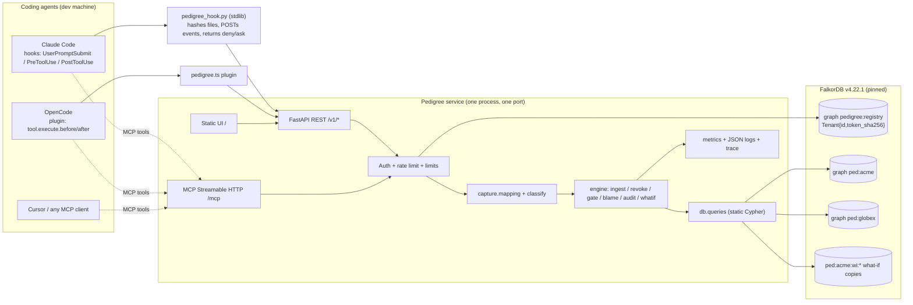

# 02 - ARCHITECTURE

## 1. Components


## 2. Technology choices (with reasons)
| Choice | Why | Alternative rejected |
|---|---|---|
| **Python 3.11+** (box has 3.13) | `falkordb` 1.8.0 client and `mcp` 2.x SDK both [V]; fastest for a solo 3-day build; strong test tooling (pytest, hypothesis) | TypeScript: client + MCP v1 work [V] but splitting hook (Python) and service languages adds friction; plugin for OpenCode must be TS anyway but is tiny |
| **FastAPI + uvicorn**, sync endpoints | auto OpenAPI, pydantic v2 validation (limits as schema), simple auth dependencies; sync FalkorDB client runs in the thread pool | Flask (less typing), Starlette raw (more boilerplate) |
| **MCP**: official `mcp` SDK `MCPServer` (`from mcp.server.mcpserver import MCPServer`), `streamable-http` [V in tech/examples/mcp] | reference implementation; works with OpenCode remote servers | FastMCP v1 (`mcp<2`) only as a fallback |
| **Mounting MCP in the same ASGI app** | one port/one deploy (Render free = 1 web service). **[V]** `MCPServer.streamable_http_app()` mounts in FastAPI (needs `lifespan` running `mcp.session_manager.run()`; mount at `/` LAST) - working spike `tech/examples/mcp/mount_in_fastapi.py` incl. bearer middleware, mcp 2.3.0. Fallback if it breaks: second process on another port (local) or path-based reverse proxy | |
| **UI: static HTML + vanilla JS + Cytoscape.js (vendored file)** | no build step, no node_modules (disk), works offline for the video, graph animation is easy | React/Vite: more moving parts for no judging gain |
| **pydantic-settings** config, **stdlib logging JSON**, **prometheus_client** metrics | small deps | OpenTelemetry (overkill) |
| Tests: **pytest**, **hypothesis**, **httpx TestClient**, real FalkorDB (no mocks for graph logic) | graph semantics are the product; mocking would hide the bugs | |
| No torch/transformers. Baseline B0 uses a pure-Python hashing TF-IDF; `fastembed` (bge-small, 384-d, ~65 MB model [V]) is optional | disk limits | |
Pinned: FalkorDB **v4.22.1** `.so` loaded into the wheel's redis-server (no Docker) or `falkordb/falkordb:v4.22.1` image; `falkordb==1.8.0`; `mcp>=2,<3`; `falkordblite==0.10.0` only to obtain `redis-server` [V]. Never `latest` (now the Rust 6.0.x engine, not run here) [D].

## 3. Directory layout (the repo the agent creates)
```
pedigree/
  README.md  LICENSE(MIT)  AI_DISCLOSURE.md  SECURITY.md
  pyproject.toml  Makefile  .env.example  .gitignore  Dockerfile  docker-compose.yml  render.yaml(optional)
  opencode.json                       # MCP registration + agent permission defaults
  .opencode/agents/*.md               # role agents (copied from pack/opencode-agents)
  .opencode/plugins/pedigree.ts       # capture plugin
  .claude/settings.example.json       # hook config (copy to .claude/settings.json to enable)
  adapters/claude/pedigree_hook.py    # stdlib-only
  scripts/ start-falkordb.sh fetch-falkordb.sh seed_demo.py record_trace.py run_evals.sh check_secrets.sh extract_numbers.py check_numbers.py clean_clone_check.sh
  src/pedigree/
    config.py errors.py models.py     # pydantic request/response models, enums, limits
    db/ client.py schema.py queries.py acl.py
    engine/ ingest.py revoke.py compute.py gate.py blame.py audit.py whatif.py policy.py
    capture/ mapping.py classify.py
    api/ app.py routes.py auth.py ratelimit.py metrics.py deps.py
    mcp_server.py  cli.py
    ui/ index.html app.js style.css vendor/cytoscape.min.js
  evals/ gen.py baselines.py run_e1.py run_e2.py run_e3.py run_e4.py run_e5.py run_e6.py stats.py results/*.csv REPORT.md
  tests/ unit/ integration/ property/ e2e/ fixtures/(recorded hook payloads) conftest.py
  demo/ scenarios/*.json  script.md  shotlist.md
  docs/ PROGRESS.md DECISIONS.md NUMBERS.md WALKTHROUGH.md FEATURES.md KNOWN_ISSUES.md consults/ qa/ + pack docs (01-IDEA.md ...)
  research/ tech/                     # pack copies for reference
```
`compute.py` holds the **pure** `compute_final(...)` function (no I/O) - the oracle for property tests and for baselines/E1.

## 4. Concurrency and consistency strategy
Facts [V]: one query is atomic (UNWIND batches, multi-clause writes, constraint violations roll back); **MULTI/EXEC is not atomic** (earlier commands persisted when a later one failed) - never use it; writes serialize per graph (~5.3k/s) and run concurrently across graphs (~9-10k/s over several graphs); a 0.5-0.7 s write stalled same-graph readers (p95 5->452 ms) and also stalled a reader on another graph in one run (mechanism unverified); reads scale to ~1.6k q/s at 8 readers.
Strategy:
1. **Every graph mutation is one query** whose internal consistency does not depend on other statements (ingest inherits flags atomically; root revoke is a CAS).
2. **Multi-step operations are idempotent state machines** (`Revocation.state`), safe to retry/resume; crash leaves nodes `quarantined` (fail-safe).
3. **Barrier + fixpoint** instead of locks for the ingest/revoke race (see 01 §6.3); verified by an injected-interleaving test.
4. **Chunking:** write queries touch <= 2000 nodes (~16 ms at ~8 us/node [V]); the cascade is therefore many short writes, not one long stall. UI/read paths use timeouts and tolerate transient slowness.
5. **Per-tenant in-process lock** for revoke/reinstate/whatif (one at a time per tenant) - run the service with a single worker process for the hackathon. P2: DB lease (`MERGE (:Lock) ... WHERE l.until < timestamp()` CAS) for multi-worker.
6. **Isolation by graph**: different tenants never contend on the same graph; evaluated in E4/E5.
7. **Back-pressure:** per-tenant rate limits, node caps, request-size caps; revoke > 5000 nodes returns `202` + polling.
8. **Reads** use `ro_query`; the registry graph is read-mostly and cached for 30 s (token hash -> tenant) with explicit invalidation on rotate.

## 5. Observability
- JSON logs (stdlib `logging` + custom formatter): `ts, level, request_id, tenant, route, status, ms, tool, rows, op` - never tokens or text bodies.
- `GET /metrics` (admin token): `pedigree_requests_total{route,status}`, `pedigree_request_seconds{route}`, `pedigree_query_seconds{op}` (histogram), `pedigree_gate_decisions_total{decision}`, `pedigree_revocations_total{state}`, `pedigree_nodes{tenant}` (gauge, top-N), `pedigree_rate_limited_total`.
- Per-request **trace** (`[{op, ms, rows}]`) returned in API/MCP responses (and rendered in the UI strip) - mirrors the organizer's recommended "tool/args/ms/rows" trace.
- Slow-query log (> 250 ms) with `op` name (not params). FalkorDB side: `GRAPH.SLOWLOG`, `GRAPH.MEMORY USAGE` in the `/v1/stats` admin view.
- `/healthz` (process up), `/readyz` (DB ping + `CALL db.indexes()` operational for the registry graph).

## 6. Configuration (env; `.env.example` committed, `.env` ignored)
`FALKOR_HOST FALKOR_PORT FALKOR_PASSWORD FALKOR_USERNAME` (admin/registry connection) | `PEDIGREE_ADMIN_TOKEN` | `PEDIGREE_SECRET`(HMAC for fingerprints) | `PEDIGREE_NODE_CAP` (200000; 20000 on Cloud Free) | `PEDIGREE_STORE_TEXT` (false) | `PEDIGREE_READ_WINDOW` (50) | `PEDIGREE_PUBLIC_URL` | `PEDIGREE_POLICY_FILE` (policy.yaml: tool->risk/effect/audience, memory globs, untrusted kinds) | `PEDIGREE_DB_ACL` (true locally, false when the DB forbids ACL) | `LLM_PROVIDER/GEMINI_API_KEY/GROQ_API_KEY` (demo agent only). FalkorDB server must start with `TIMEOUT_MAX 60000 TIMEOUT_DEFAULT 20000 QUERY_MEM_CAPACITY 1073741824`.

## 7. Deploy topology
| Mode | Topology | Notes |
|---|---|---|
| **Local (mandatory, always works)** | `scripts/start-falkordb.sh` (pinned `.so` in the falkordblite redis-server) **or** `docker compose up` -> `pedigree serve` on :8000 (UI + REST + `/mcp`) | rules accept complete local instructions; record the video here |
| **Live, preferred (single container) [J, untested here: no Docker on the box]** | Render free **Docker** web service (512 MB, 0.1 CPU, sleeps after 15 min idle, ephemeral disk) running one container = FalkorDB (redis-server + `.so` from the wheel, bound to 127.0.0.1) + Pedigree; Ubuntu 24.04 base (glibc >= 2.39 required by the wheel [V]); demo tenant seeded on boot; keep-alive ping only while judging | avoids public plaintext DB, the 100 MB cap and Cloud Free's 1-day idle stop; risk: image build untested -> verify on Render early (Fri) |
| **Live, fallback** | Render free web service + **FalkorDB Cloud Free** (100 MB, no card, **no TLS**, no persistence, stopped after 1 day idle / deleted after 7 [D]) | synthetic data only; set `PEDIGREE_NODE_CAP=20000`; seed on boot; ACL users may be unavailable -> `PEDIGREE_DB_ACL=false` and say so |
Never run `latest`. Secrets only in Render env settings.

## 8. Threat model (STRIDE-lite)
| Asset | Threat | Mitigation | Test |
|---|---|---|---|
| Tenant lineage | cross-tenant read/write (confused deputy, race, bug) | token->tenant only; `graph_name()` single choke point; per-tenant ACL user; graph-per-tenant | E5 property test + ACL test + `test_no_tenant_in_body` |
| Cypher | injection via ids/text/labels | static queries + params; label allow-list; lint test forbids f-strings in `queries.py` | `test_queries_static.py` |
| DoS | huge payloads, unbounded traversals, cascade stalls | size/array caps, depth caps, BFS, chunking, TIMEOUT/MEM caps, rate limits, node cap | `tests/test_limits.py`, load test |
| Lineage forgery | injected agent lies via MCP | hook-captured edges authoritative; `agent_reported` tagged; gate uses read window | scenario S5 |
| Token theft | leaked token | hash at rest, constant-time compare, rotation, never logged | `test_auth.py`, secret scan |
| Hook bypass | agent disables hooks | document: hooks configured by user/org policy (Claude Code managed settings) [D]; detect session with no events (heartbeat) | `session_gap` metric |
| Gate evasion via paraphrase/untracked channel | unhooked memory path | coverage = what hooks see; stated limitation | E6 |
| Info leak via errors/metrics | stack traces, graph names | generic errors, correlation ids, admin-only metrics, no `GRAPH.LIST` for tenants | `test_errors.py` |
| Supply chain | deps | minimal pinned deps, `pip-audit` if available offline [U] | CI |
| Plaintext DB link (Cloud Free) | sniffing | synthetic data only; single-container topology preferred | README note |
