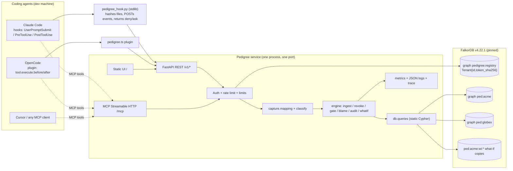

<!-- ======================= 00-HUMAN-CHECKLIST.md ======================= -->

# 00 - HUMAN CHECKLIST (only things the agent cannot do for you)
All times IST. Event: Oct 15 12:01 AM -> **Oct 18 11:59 PM**. Feature freeze Sun 3 PM. Aim to submit **Sun 9 PM**. Tags: **[V]** verified page exists/behaves as stated; **[U]** unverified - confirm yourself.
Total human time over the weekend: ~4-5 hours, mostly Sunday.

## Step 1 - Register on WeMakeDevs (5 min) - DO FIRST, tonight
- Open https://www.wemakedevs.org/hackathons/falkordb -> Sign in / create a free account -> **Register now** (solo is fine). The team and the submission are managed from the same panel [V per FAQ]. You cannot submit without registering.
- While there, open https://www.wemakedevs.org/hackathons/falkordb/submit (signed in) and screenshot the fields: the public fetch only shows a loading screen, so the exact fields are **[U]**. Save the screenshot into `docs/submission/form-fields.png` (do not commit anything private).

## Step 2 - Ask organizers on Discord (10 min) - tonight
Join the FalkorDB Discord (https://discord.com/invite/Y2mMT9VdMy [V link responds]; the event page says it is open all event) and, if you like, the WeMakeDevs Discord (https://discord.gg/wemakedevs). Post this in the hackathon / help channel (exact text):
```
Hi organizers! Solo participant here, a few quick clarifications for Graph Hacks:

1) Tracks: the launch blog says "You enter one track, and one submission is judged in it", but Rules #5 and the FAQ say we may enter one, two or all three tracks and must name each. Which is correct? If multiple tracks are allowed, is the same repo judged separately in each?

2) Blog side prize (AirPods 5): where should the post be published (dev.to, the WeMakeDevs blog, anywhere public?) and how do we submit the link (a field on the submit form, or in Discord)? Any deadline other than Oct 18, 11:59 PM IST?

3) Is there a maximum demo video length or preferred hosting (YouTube unlisted OK)?

Thanks!
```
Record the answers in `docs/DECISIONS.md` (ADR-000 / ADR-001). Until answered, the default is: enter **Track 2 (primary) + Track 1 (secondary)**, skip Track 3.

## Step 3 - GitHub repo (10 min) - tonight
- Create an **empty public repo** under your account (https://github.com/new, no README/license: the agent creates them). GitHub names only collide per owner, so `pedigree` is available on your account. Name check (GitHub search 2026-10-15): `pedigree-agent` (SHAI-gautam-upadhyay, 2025, no description), `agentic-ai-pedigree`, `PedigreeAI` (rmkanderson) exist elsewhere but are unrelated; PyPI `pedigree` is taken (we do not publish to PyPI); `pedigree-ledger`, `pedigree-memory`, `beliefblame` were free on PyPI/npm and had no GitHub hits. Nearby but different project: `mesa-dot-dev/agentblame` (AI-line attribution for git; 102 stars) - mention it in the README as related, not as a competitor.
- **Recommended name:** `pedigree`. **Alternates:** `pedigree-ledger`, `beliefblame`.
- Make it public from the first push (the first-commit timestamp is your evidence for the "new work" rule). 
- Give the agent push rights **without pasting tokens into chat**: run `gh auth login` once on the machine (https://cli.github.com) or set up an SSH key; then tell the agent the remote URL. If you prefer, tell the agent not to push and push yourself at checkpoints.

## Step 4 - API keys (optional; 10 min) - the Pedigree core needs NO LLM
Only needed for a live LLM-driven demo agent. No card required [D]:
- Gemini: https://aistudio.google.com/apikey [V page responds]. Free tier; limits visible in AI Studio; **free-tier data may be used to improve Google products** - never send private data.
- Groq: https://console.groq.com/keys [V]. Free: gpt-oss-120b/20b, qwen: 30 RPM, 1K RPD, 8K TPM, 200K TPD (https://console.groq.com/docs/rate-limits).
Put them **only** in `.env` (Step 7). Do not paste keys in chat.

## Step 5 - FalkorDB Cloud Free (fallback only; 10 min, Saturday)
Only if the single-container Render deploy fails. https://app.falkordb.cloud/signup [V]: free tier, no card, 100 MB, AWS/GCP, **no TLS, no persistence**, stops after 1 day inactive, deleted after 7 [D https://docs.falkordb.com/cloud/tiers/free]. Create an instance, copy host/port/password into Render env vars (not into the repo).

## Step 6 - Render account (5 min, Friday)
https://dashboard.render.com [V responds]: sign up with GitHub. Free web service, no card [D https://render.com/docs/free]: 512 MB, sleeps after 15 min idle (~1 min cold start). When the agent says the Dockerfile is ready: New -> Web Service -> connect the repo -> Runtime **Docker** -> instance type **Free** -> add env vars from `.env.example` (values only in Render's dashboard) -> Deploy. Open `/readyz`.

## Step 7 - Keep secrets safe (5 min)
`cp .env.example .env && chmod 600 .env`; put keys there only; confirm `.env` is in `.gitignore`; run `bash scripts/check_secrets.sh`; never screenshot or screen-record `.env`/terminals with tokens; Render keys live in its dashboard. If a key leaks (even in a commit), **revoke it immediately** at the provider and rotate; then ask the agent to purge it from history before submission. Rotate all keys after the hackathon.

## Step 8 - Decide before Friday (5 min)
Tracks (default T2 + T1) | repo name | blog platform (default dev.to) | video host (YouTube unlisted) | whether you personally record voice-over (recommended: yes, your own words) | which runtime you dogfood (OpenCode, and Claude Code if installed).

## Step 9 - Understand your own project (Sat/Sun, 90 min total) - this is rule #12
Rules #12-13: you must be able to explain the graph model, queries, architecture and decisions; fully AI-generated work without human understanding may be rejected. Read `docs/WALKTHROUGH.md` (the agent writes it), run each query once yourself, and rehearse the Q&A in `03-EVAL-AND-DEMO.md` section 10. Write 3-5 sentences in your own words in `AI_DISCLOSURE.md` about what you decided and verified.

## Step 10 - Submission form (Sun, 20 min)
Rules #10 require: public repo, README (setup + data model + queries/algorithms), demo video, live deployment or complete local instructions, the track(s). Likely fields **[U]**: project name, tagline/description, repo URL, demo video URL, deployment URL, tracks, team, maybe blog link. Use `docs/submission/SUBMISSION.md` (agent-written text). Open the form early (Sat) to see the real fields; submit by **Sun 9 PM**; re-open after submitting to confirm it saved; screenshot the confirmation.

## Step 11 - Blog post (Sun, 60 min)
Rules do not say where or how to submit the blog **[U - answered by Discord question 2]**; the main page only says "Write a blog post about your project. The best post wins a pair of AirPods 5." Default: publish on **dev.to** (https://dev.to, free, no card) with the draft from `docs/blog/`, add the repo + video links, tag `#hackathon #ai #graphdb #security`; post the link in Discord and in the form if a field exists; mention it in the README. Publish **before 5:30 PM Sunday**. (The organizers' own blog lives at https://www.wemakedevs.org/blogs - submitting there is **[U]**.)

## Step 12 - Demo video (Sun 3:00-4:30 PM, 90 min)
Use OBS Studio (https://obsproject.com, free) or QuickTime/Game Bar. 1080p, <= 3:00, your own voice-over (clear > polished), follow `demo/script.md` + `demo/shotlist.md` (agent-written from the real UI). Tips: dark theme, browser zoom 125%, close notifications/tabs/`.env`, test mic first, record in 2 segments, read numbers only from the NUMBERS screen, show the live URL **and** the local run, end with repo URL. Upload to YouTube (unlisted OK), open the link logged-out to confirm it plays, keep the mp4 as a backup.

## Step 13 - AI-use disclosure (paste into `AI_DISCLOSURE.md` and the form)
```
AI assistance disclosure: I built Pedigree with AI coding assistants - OpenCode (run through T3 Code) using [MODEL NAME(S) YOU ACTUALLY USED] - organised as a multi-agent workflow (orchestrator, builder, QA, security red-team, domain researcher, architect, eval statistician, technical writer). The assistants wrote most of the code, tests and first drafts of the docs under specifications and acceptance tests that [EDIT: describe what you personally designed]. I reviewed and verified [EDIT: what you personally verified - e.g. ran the test suite, ran the benchmarks, reviewed every Cypher query, ran the demo end-to-end]. Every benchmark number in the README and blog is produced by committed scripts (make eval) and listed in docs/NUMBERS.md. I can explain the graph model, the queries and the architecture; docs/WALKTHROUGH.md and docs/DECISIONS.md record them in plain language.
```
Edit the bracketed parts so every statement is true.

## Step 14 - T-minus schedule to the deadline
| When (IST) | T-minus to Oct 18 11:59 PM | You do |
|---|---|---|
| Thu Oct 15 7:00 PM | T-76h | Steps 1-3; start the agent with `06-MASTER-PROMPT.md`; answer its first batched message (<= 20 min) |
| Thu ~11:30 PM | T-72h | Checkpoint 0: confirm repo is receiving pushes; go to sleep |
| Fri 9:00 AM | T-63h | Read PROGRESS; unblock anything in the batch; Step 8 decisions |
| Fri ~9 PM | T-51h | Checkpoint 1: look at the UI; go/no-go on scope; Step 6 (Render) |
| Sat 9:00 AM | T-39h | Read Discord answers; Step 10 dry look at the form |
| Sat ~9 PM | T-27h | Checkpoint 2: open the deploy URL; confirm tracks |
| Sun 11:00 AM | T-13h | Read README and the draft blog; Step 9 rehearsal |
| Sun 1:00 PM | T-11h | Checkpoint 4: sanity-check every claim you cannot explain |
| **Sun 3:00 PM** | **T-9h** | **FEATURE FREEZE** (agent: bug-fixes + docs only) |
| 3:00-4:30 PM | T-9h..T-7.5h | Record the video (Step 12) |
| 4:30-5:30 PM | | Publish blog (Step 11) |
| 5:30-6:30 PM | | Fill the form (Step 10) |
| **9:00 PM** | **T-3h** | **Be submitted.** Screenshot confirmation |
| 9:00-11:59 PM | | Buffer: link checks only; do not merge features |
**Final checklist (tick all):** repo public + README renders | LICENSE | AI_DISCLOSURE.md | demo video public/unlisted link plays logged-out | live URL `/readyz` OK (or local setup verified from a clean clone) | tracks named | blog published and linked | NUMBERS.md matches README/blog (`python scripts/check_numbers.py`) | secret scan clean on history | form submitted + confirmation screenshot | Discord post with links.

## Step 15 - What to do if the agent gets stuck
| Symptom | Do this |
|---|---|
| Repeats the same failing step / apologises in loops | Paste: `STOP. Write the exact error, what you tried (commands + outputs) to docs/consults/NNN/question.md, launch the three consultants per docs/04 section 4, then follow decision.md. If still failing after that, log in KNOWN_ISSUES and apply the cut order.` |
| Context huge / forgets the plan | Paste: `Compact. Then follow the resume protocol in docs/04 section 10: read docs/PROGRESS.md CURRENT STATE, docs/05-PHASES.md, git log -20, run make test-quick, check TZ=Asia/Calcutta date, continue.` |
| Subagents unavailable / `@orchestrator` missing in T3 Code | Use docs/04 section 12: either role-switch ritual in one session, or open one chat per role with the role prompt from `.opencode/agents/<role>.md` |
| FalkorDB will not start | `redis-cli -p PORT PING`; `redis-cli -p PORT MODULE LIST` (expect `graph ... ver 42201`); check `ls -l bin/*.so` (needs `chmod +x`); port busy (`lsof -i :PORT`); glibc >= 2.39 required by the wheel (Ubuntu 24.04+); two servers must not share `DATA_DIR`. Fallback: the wheel's bundled 4.18.3 `.so` or Docker image `falkordb/falkordb:v4.22.1` |
| Scope creep (new features, LLM dependence) | Paste: `Out of scope. Re-read docs/05-PHASES.md; do only the next unfinished item on the ladder. Core must work with no LLM.` |
| Suspected fabricated numbers/claims | Paste: `Run python scripts/check_numbers.py and show the output. Remove every number not in docs/NUMBERS.md. Re-run make eval-quick and show the CSV paths.` |
| Free LLM rate limits (429) | Switch provider in `.env` (`LLM_PROVIDER=groq` <-> `gemini`); demo works without an LLM using recorded scenarios |
| Agent asks you questions mid-run | Answer once; remind it: `Batch all human questions into one message per docs/04 section 8.` |
| Behind schedule at Sun 11 AM | **Minimum Viable Submission:** freeze whatever P0+gate works; README honest about what is missing (Status table from FEATURES.md); record the video of what works; local setup instructions verified from a clean clone; submit by 9 PM. A working small thing beats a broken big thing (the organizers' own "one feature that runs beats five that almost do" philosophy appears in their AWS event criteria: https://www.wemakedevs.org/aws/first-commit). |


<!-- ======================= 01-IDEA.md ======================= -->

# 01 - PEDIGREE: product specification

> **One-liner:** git blame and git revert for what an AI agent believes. Pedigree records, out-of-band, where every memory, rule and action of a coding agent came from, stores that lineage in FalkorDB (one graph per tenant), and lets you revoke a bad source, see exactly what it contaminated (down to the commit), keep what is independently supported, and gate risky actions before they run.

Tags used in this pack: **[V]** verified by running it on 2026-10-15; **[D]** from official docs only; **[J]** judgement; **[U]** unverified, test first.

## 1. Problem (with sources)
1. Agents now keep persistent memory and read rules/skills/MCP tool descriptions that steer later behaviour. Poisoned or wrong content in any of these persists across sessions.
   - OWASP Top 10 for Agentic Applications 2026 lists *Memory & Context Poisoning* (ASI06): https://genai.owasp.org/download/52117/
   - Rehberger: a malicious document plants conditional instructions; a later "yes" makes Gemini write attacker-chosen entries to long-term memory: https://embracethered.com/blog/posts/2025/gemini-memory-persistence-prompt-injection/ ; ChatGPT SpAIware persistent exfiltration: https://embracethered.com/blog/posts/2024/chatgpt-macos-app-persistent-data-exfiltration/
   - MINJA: query-only memory injection, paper reports 98.2% injection / 76.8% attack success in its setting: https://arxiv.org/abs/2503.03704 ; AgentPoison: https://arxiv.org/html/2407.12784
   - Coding-agent supply chain: Rules File Backdoor (hidden Unicode in Cursor/Copilot rules): https://www.pillar.security/blog/new-vulnerability-in-github-copilot-and-cursor-how-hackers-can-weaponize-code-agents ; MCP tool poisoning / rug pulls: https://invariantlabs.ai/blog/mcp-security-notification-tool-poisoning-attacks
2. Defences are mostly *write-time detection* (e.g. OWASP Agent Memory Guard https://owasp.org/projects/agent-memory-guard, MCP-Scan https://invariantlabs.ai/blog/introducing-mcp-scan). Detection eventually fails or arrives late. Then the question is **"what did we already believe, and do, because of it?"** Nobody can answer it today: vector stores keep no derivation, and Graphiti's `remove_episode` only removes edges whose first provenance is that episode (https://github.com/getzep/graphiti/blob/main/graphiti_core/graphiti.py, https://github.com/getzep/graphiti/pull/261).
3. Multi-tenant agent memory fails silently under concurrency: Graphiti issues #1331 (open) and #1676 (closed 2026-09-08) on FalkorDB cross-group contamination: https://github.com/getzep/graphiti/issues/1331 , https://github.com/getzep/graphiti/issues/1676
**Who suffers:** engineers and teams running Claude Code / OpenCode / Cursor with persistent memory files, rules, skills and MCP servers; platform teams hosting shared agent memory for many tenants.

## 2. What Pedigree IS and IS NOT
**IS**
- A **lineage ledger** (source -> session -> memory -> action -> artifact/commit) captured by hooks/plugins **outside the model's control**.
- A **containment engine**: revoke a source/memory, quarantine first (barrier), compute the final tainted set with **independent-support preservation**, list affected actions and **irreversible** external effects, never hard-delete.
- A **pre-action gate** (allow / reverify / block, with the lineage path as the reason) exposed as an MCP tool and a hook.
- **Integrity + confidentiality labels** propagated along derivation edges (information-flow control for persistent memory).
- A **tenant-isolated service**: one FalkorDB graph per tenant, bearer-token auth, per-tenant DB ACL users as defence in depth, input limits, query timeouts, parameterised Cypher only.
- A **reproducible evaluation harness** (committed scripts, seeded) and an attack-scenario suite.
**IS NOT**
- Not a prompt-injection *preventer* or a detector. "Which source is bad" is an input (human, scanner, alert). We contain, explain, revert.
- Not a sandbox. The bash-command risk classifier is a heuristic.
- Not an undo for external effects already taken (a push that others pulled). We **list** them.
- Not a general RAG/chat memory. Retrieval quality is out of scope (we expose `status` so retrievers can exclude quarantined/tainted nodes).
- Not novel as an algorithm (see section 3).

## 3. Honest differentiation
| Work | Overlap | What Pedigree adds (as a shipped system) |
|---|---|---|
| PACMI https://arxiv.org/html/2610.05732v1 | typed dependency graph + cascading invalidation, validity states, history preserved | real capture (edges are not hand-annotated), live adapters, gate, multi-tenant service, measured baselines |
| MemoRepair https://arxiv.org/abs/2605.07242 | barrier-first withdrawal, repair of stale memory; shows 1% dropped edges -> 17.7% leak (https://arxiv.org/pdf/2605.07242v1/__stdout.txt) | we **measure capture fidelity** (E2), choose conservative session-window capture, report over-approximation; barrier + fixpoint is implemented on a real graph DB |
| MAP-Graph https://arxiv.org/abs/2608.10509 | typed execution graph, ancestry trust, action gate with Allow/Block/Reverify/Redact/AskUser | research prototype; we ship MCP + hooks + service + eval, add independent-support preservation and per-tenant isolation tests |
| CaMeL https://arxiv.org/abs/2503.18813 / FIDES https://arxiv.org/abs/2505.23643 | information-flow labels (integrity + confidentiality), block violating tool calls | they are per-run and in-process; we persist the flow graph across sessions/agents as queryable infrastructure |
| Graphiti/Zep https://github.com/getzep/graphiti | temporal edges, `remove_episode`, `group_id` tenancy, FalkorDB backend | we trace *derived beliefs and actions* and have a tenant-isolation conformance suite motivated by its FalkorDB bugs |
| Neo4j Agent Memory https://neo4j.com/labs/agent-memory/ | reasoning traces, `:TOUCHED` audit edges | audit is read-only there; we revoke, contain, gate |
| mesa-dot-dev/agentblame https://github.com/mesa-dot-dev/agentblame | "which lines were written by AI" attribution for git | different object: they attribute *code lines to AI*, we track *beliefs/rules/sources -> actions* |
| In-event: kintsugi (Itz-Agasta), undograph (Tejas-Sands), lineage (Vaibhaav-Tiwari) | same family (provenance + undo/repair on FalkorDB) | as above; **be generous and factual about them**. See research/06-competitor-census.md. Re-read their repos on Sat/Sun morning. |
**Claimed novelty (and only this):** engineering + evaluation: out-of-band capture from real coding-agent runtimes; independent-support preservation measured against baselines; joint integrity/confidentiality labels; tenant-isolation/concurrency suite on FalkorDB; reproducible attack zoo.

## 4. User stories
1. *Contain:* "A web page I let the agent read was malicious. Show everything it influenced and revert it." -> `revoke` dry-run shows 31 nodes incl. 2 file edits, 1 commit, 1 push; confirm; quarantine is instant; revert list printed.
2. *Keep what's solid:* "Two memories came from that page but are also supported by our docs. Don't throw them away." -> status `preserved` with the supporting source shown.
3. *Gate:* "Before the agent runs `git push`, check whether anything it relied on is tainted or confidential." -> `check_action` returns `block` + path.
4. *Blame:* "Why does the agent believe X?" -> `blame` returns the ancestry graph and the shortest path to each root.
5. *Isolation:* "Tenant A's agent must never read or write tenant B's lineage, even under concurrent load."
6. *Audit:* "Which sources are load-bearing (most things derive from them)?" -> PageRank/descendant counts.
7. *What-if:* "If I revoke these three sources, what breaks?" -> simulate on a `GRAPH.COPY`.
8. *Honesty:* "Does anything depend on id Z?" for an id never recorded -> `not_in_graph` (not "no impact").

## 5. Data model (per-tenant graph)
**Graph name:** `ped:<tenant>` with tenant id `^[a-z0-9]{3,24}$`. What-if copies: `ped:<tenant>:wi:<8 hex>`. Checkpoints: `ped:<tenant>:ck:<name>`. [V: names with `:` work; ACL patterns `~ped:abc` and `~ped:abc:wi:*` isolate `abc` from `abcd` (examples/py/13_acl_tenant_isolation.py, bench/acl_tenant_isolation_v4221.txt)]. Do **not** use underscore/`*` prefix patterns like `ped_a*` (they also match tenant `ab`).
**Labels:** every node has `:Node` plus one of `:Source :Memory :Action :Session :Agent :Revocation`. One index + one unique constraint on `Node.id` serve all lookups (multi-label create/match verified [V]).
```cypher
CREATE INDEX FOR (n:Node) ON (n.id)                     -- async: poll CALL db.indexes() until OPERATIONAL
GRAPH.CONSTRAINT CREATE ped:<t> UNIQUE NODE Node PROPERTIES 1 id   -- needs the exact-match index first; starts PENDING; NEVER DROP that index afterwards (GOTCHAS #2)
CREATE INDEX FOR (n:Memory) ON (n.artifact_key)  CREATE INDEX FOR (n:Action) ON (n.artifact_key)   -- cross-session file lineage lookup
CREATE INDEX FOR (n:Revocation) ON (n.state)   -- optional
```
**Node properties** (no map properties allowed; arrays of primitives only; store JSON as string via `tojson`):
| Label | Properties |
|---|---|
| all | `id` (string, unique, <=128 chars), `tenant` (denormalised for the isolation audit), `status`, `created_at` (ms, `timestamp()`) |
| Source | `kind` in `user_prompt|file|web|tool_output|rules_file|mcp_tool_desc|human|other`, `uri` (<=512), `content_hash` (sha256 hex), `title` (<=160), `integrity` (`trusted|untrusted`), `low_integrity` (bool; true iff untrusted), `conf` (array of tags), `conf_eff` (= `conf` for sources), `status` in `ok|revoked`, `revoked_at`, `reason` |
| Memory | `mkind` in `fact|summary|decision|preference|procedure|rule`, `text` (<=2000 chars; **hash-only mode** stores `''` + `content_hash`), `artifact` (path), `artifact_key` (`<path>@<sha256 after write>`), `content_hash`, `conf`, `conf_eff`, `low_integrity`, `unanchored` (bool), `status` in `ok|quarantined|tainted|preserved|revoked`, `taint_parent` (id of one tainted parent = blame pointer), `agent_id`, `session_id` |
| Action | `tool`, `summary` (<=300), `args_hash`, `effect` in `reversible|irreversible|unknown`, `risk` in `low|medium|high`, `artifacts` (array: paths/commit shas/URLs), `artifact_key` (for write/edit: `<path>@<sha256 after write>`), `decision` (last gate verdict), `status` in `ok|quarantined|tainted`, `taint_parent`, `session_id` |
| Session | `runtime` in `claude_code|opencode|mcp|other`, `started_at`, `agent_id` |
| Revocation | `root_id`, `reason`, `kind` in `revoke|supersede`, `state` in `running|done|failed`, `n_tainted`, `n_preserved`, `n_actions`, `started_at`, `finished_at` |
**Edges**
| Edge | Meaning | Props |
|---|---|---|
| `(child:Memory|Action)-[:DERIVED_FROM]->(parent:Source|Memory|Action)` | child was derived from / relied on parent. An **Action may be a parent** only through the artifact-hash link (a later read of a file whose `path@sha256` equals an earlier write Action's `artifact_key`), which is how taint flows through code edits across sessions. | `rel` (`derive|rely`), `via` (`cite|session_read|agent_reported|hook`) |
| `(parent)-[:FEEDS]->(child)` | **mirror of DERIVED_FROM** so `algo.BFS` (outgoing, one type) can walk descendants. Always written in the same query. | - |
| `(m:Memory)-[:CORROBORATED_BY]->(s:Source)` | independent support (targets are Sources only, so no cycles) | `by` (`agent|human|scanner`) |
| `(a:Agent)-[:WROTE]->(m:Memory)`, `(sess:Session)-[:READ]->(n:Source|Memory)`, `(sess)-[:PERFORMED]->(a:Action)` | context / read window | `at` |
| `(new:Memory)-[:SUPERSEDES]->(old:Memory)` | versioning (P2) | - |
Rules: DAG by construction (edges only to already-existing nodes at creation time); nodes are never hard-deleted (except tenant wipe); `status` is the only mutable lifecycle field.
**Why mirror edges:** `algo.BFS` follows only outgoing edges of ONE type, excludes the start node, returns unordered node lists [V, GOTCHAS #6]; var-length `*1..k` enumerates *paths* and blows up on dense DAGs (k=8 2.1 s, k=10 timeout on 105k nodes) [V]. BFS: 12 ms for ~65k affected nodes [V].

## 6. Algorithms and Cypher (all patterns verified in `tech/examples/py/12_pedigree_core.py` on 4.18.3 and 4.22.1 [V])
All Cypher lives in `src/pedigree/db/queries.py` as module-level constant strings with `$params`. **Never** build Cypher with f-strings from user input. The only interpolated token is the node label from a fixed allow-list constant.

### 6.1 Ingest (each op = ONE atomic query; never MULTI/EXEC)
Validate parents first (a missing parent is silently dropped by `MATCH` [V] and an empty `UNWIND` skips the `SET` [V]):
```cypher
// Q_FIND_IDS (read)
MATCH (n:Node) WHERE n.id IN $ids RETURN n.id, n.status
```
If `len(found) != len(set(parents))` -> error `not_in_graph` listing missing ids. Then:
```cypher
// Q_CREATE_MEMORY_WITH_PARENTS (>=1 parent) -- inherits flags atomically
CREATE (c:Node:Memory {id:$id, tenant:$tenant, text:$text, mkind:$mkind, artifact:$artifact, content_hash:$hash,
        agent_id:$agent, session_id:$session, conf:$conf, status:'ok', unanchored:false, created_at:timestamp()})
WITH c UNWIND $parents AS pid MATCH (p:Node {id:pid})
MERGE (c)-[d:DERIVED_FROM]->(p) SET d.rel=$rel, d.via=$via
MERGE (p)-[:FEEDS]->(c)
WITH c, collect(p) AS ps
SET c.low_integrity = any(p IN ps WHERE p.low_integrity = true),
    c.conf_eff = reduce(acc = c.conf, p IN ps | acc + [t IN coalesce(p.conf_eff, []) WHERE NOT t IN acc]),
    c.status   = CASE WHEN any(p IN ps WHERE p.status IN ['revoked','tainted','quarantined']) THEN 'quarantined' ELSE 'ok' END
RETURN c.status, c.low_integrity, c.conf_eff, size(ps)
// Q_CREATE_MEMORY_ORPHAN (0 parents): same CREATE with unanchored:true, low_integrity:true, conf_eff:$conf, no UNWIND
```
A child created under a quarantined/tainted/revoked parent is **born quarantined** (race-safe barrier, see 6.3). Actions use the same pattern with label `Action` and `rel='rely'`. `CORROBORATED_BY`:
```cypher
MATCH (m:Memory {id:$m}), (s:Source {id:$s}) MERGE (m)-[r:CORROBORATED_BY]->(s) SET r.by=$by RETURN m.id, s.id
```
Session read window: `MATCH (se:Session {id:$sess}), (n:Node {id:$n}) CREATE (se)-[:READ {at:timestamp()}]->(n)`; read-window lookup for actions: last K (default 50) distinct READ targets, `ORDER BY r.at DESC LIMIT $k`.

### 6.2 Impact preview (read-only) and discovery
```cypher
// Q_DESCENDANTS: BFS over FEEDS; excludes the start node; unordered
MATCH (r:Node {id:$id}) CALL algo.BFS(r, $depth, 'FEEDS') YIELD nodes UNWIND nodes AS n RETURN n.id, labels(n), n.status
// Q_ANCESTORS
MATCH (r:Node {id:$id}) CALL algo.BFS(r, $depth, 'DERIVED_FROM') YIELD nodes UNWIND nodes AS n RETURN n.id, labels(n), n.status
```
`depth=-1` is unbounded [V]; use 12 as the product default and report `truncated` if the frontier is non-empty at the limit.

### 6.3 Revoke: barrier -> fixpoint -> support-preserving final status -> verify (the core algorithm)
Semantics. Let R be the set of revoked roots (Sources or Memories). Let C = descendants of R via FEEDS. For m in C processed in topological order:
`bad(m)` = any DERIVED_FROM parent that is in R or finally `tainted`. If `bad(m)` is empty -> `ok`. Else if m has a **healthy** CORROBORATED_BY source (status `ok`) -> `preserved` (retrievable, flagged with the supporting source). Else -> `tainted` with `taint_parent` = one bad parent. Note a node whose only bad parent became `preserved` is simply `ok`.
Steps (per tenant, under an in-process per-tenant lock; **idempotent and crash-recoverable**):
1. **Barrier (one atomic query):**
```cypher
// Q_REVOKE_ROOT -- CAS: only flips if not already revoked; empty result => idempotent no-op
MATCH (r:Node) WHERE r.id=$id AND r.status <> 'revoked' AND (r:Source OR r:Memory)
SET r.status='revoked', r.revoked_at=timestamp(), r.reason=$why RETURN r.id
CREATE (:Node:Revocation {id:$rid, tenant:$tenant, root_id:$id, reason:$why, kind:$kind, state:'running', started_at:timestamp()})
```
2. **Quarantine fixpoint:** loop (max 10): `roots = MATCH (r:Node {status:'revoked'}) RETURN r.id`; discover C by `Q_DESCENDANTS` from each root; `todo` = members with status `ok|preserved`; if none -> break; else write in chunks of <= 2000 ids: `UNWIND $ids AS i MATCH (n:Node {id:i}) SET n.status='quarantined'`. Once the loop sees no `ok|preserved` member, every new child will be born quarantined (6.1), so the barrier holds. Safe-by-default: if the process dies here, everything stays `quarantined` (excluded from retrieval).
3. **Read structure (chunked):** `UNWIND $ids AS i MATCH (c:Node {id:i})-[:DERIVED_FROM]->(p:Node) RETURN c.id, p.id` and `UNWIND $ids AS i MATCH (m:Memory {id:i})-[:CORROBORATED_BY]->(s:Source) RETURN m.id, s.id, s.status`.
4. **Compute in Python** (Kahn topological order; assert no cycle) -> `{id: (status, taint_parent)}`. Pure function `compute_final(...)` = the unit-testable oracle used by property tests.
5. **Write final statuses (chunks):** `UNWIND $b AS b MATCH (n:Node {id:b[0]}) SET n.status=b[1][0], n.taint_parent=b[1][1]`.
6. **Verify loop:** re-discover; if any member is still `quarantined` (a node created mid-flight) repeat 3-5 (max 5).
7. **Finish:** set `Revocation.state='done'` with counts; return affected actions (`MATCH (a:Action {id:i}) WHERE a.status='tainted'`), **irreversible ones first**, plus `affected_artifacts` (files/commits). On startup `resume_incomplete()` re-runs steps 2-7 for `Revocation {state:'running'}`.
**Dry run** = steps 2(discover only), 3, 4 with **no writes** -> returns the same counts (`would_taint`, `would_preserve`, `would_keep_ok`).
**Reinstate(root):** BFS descendants of root *before* flipping; set root `ok`; reset those descendants to `ok`; then re-run steps 2-7 for the remaining revoked roots (idempotent).
**Verified behaviour [V]:** `12_pedigree_core.py` asserts: tainted/preserved/ok mix, idempotent re-revoke, blame chain via `taint_parent`, race (child inserted between discovery and quarantine ends `tainted`), late child born `quarantined`. Cascade cost ~8 us/node [V scale bench]; chunk size 2000 keeps each write ~16 ms.

### 6.4 Blame
Fast path: follow `taint_parent` pointers (`MATCH (n:Node {id:$i}) RETURN n.taint_parent`) to the revoked root. Full path: fetch ancestors by `Q_ANCESTORS` then edges `UNWIND $ids AS i MATCH (c:Node {id:i})-[d:DERIVED_FROM]->(p:Node) RETURN c.id, p.id, d.rel, d.via`; compute BFS parent pointers in Python for the shortest path to each `Source` and to each revoked/untrusted root. (`shortestPath` is allowed only in `WITH/RETURN` with bound endpoints [V]; not needed.) Return `{node, status, roots:[{id, kind, status, path:[ids]}], graph:{nodes,edges}, truncated}`.

### 6.5 Integrity and confidentiality labels
- `low_integrity` (bool, OR over parents) and `conf_eff` (union of tags) are **computed at write time** (6.1); labels are immutable (a "declassify" is a new Memory with an explicit human source). `integrity` of a Source defaults by kind (config): user_prompt/human/file/rules_file = trusted; web/tool_output/mcp_tool_desc = untrusted. Adapters may override.
- Confidentiality check query: `MATCH (m:Node) WHERE m.id IN $ids WITH m WHERE any(t IN coalesce(m.conf_eff, []) WHERE NOT t IN $audience) RETURN m.id, m.conf_eff` [V].

### 6.6 Pre-action gate (deterministic; no LLM)
Input: tool, summary, relied_on ids (explicit) + optional session read-window, `risk`/`effect` (else from the classifier table 7.3), `audience` tags (destination clearance; default `['public']` for network/push/publish tools, `['local']` otherwise).
Decision order (first match wins; every verdict carries `reasons[{code,node_id,path,detail}]`):
1. any relied node or ancestor status in `revoked|tainted|quarantined` -> **block** if risk >= medium else **warn** (allow + reason) [`code: tainted_ancestor`].
2. confidentiality: any tag in union `conf_eff` not in `audience` -> **block** [`code: confidentiality_violation`].
3. `low_integrity` and (`effect='irreversible'` or `risk='high'`) -> **reverify** (human confirmation needed) [`code: untrusted_influence`].
4. any relied id missing in the graph -> **reverify** [`code: not_in_graph`] (we refuse to claim "safe" about unknown lineage). Unanchored actions (no read-window/relied_on at all) -> **allow** with `warning: no_lineage`, because blocking every new session would make the tool unusable [J].
5. else **allow**.
`record=true` stores the Action node with `decision`. Fail-open vs fail-closed is a deployment choice: hooks fail-open by default (a stalled hook does not block in Claude Code unless `onFailure:"block"`), configurable per matcher [D].

### 6.7 What-if and checkpoints with GRAPH.COPY
`whatif(roots[])`: `g.copy('ped:<t>:wi:<hex>')` (atomic, keeps indexes; 20k nodes ~165 ms [V]), run the *real* revoke engine on the copy for each root, diff statuses vs the original, `delete()` the copy in `finally`; cap 2 concurrent what-ifs per tenant; auto-delete copies older than 10 minutes. **Checkpoint/restore (P2):** `copy` to `ped:<t>:ck:<name>`; restore = delete + copy back; demo reset ~170-190 ms [V]. Never use `DUMP/RESTORE` on 4.18.3 (crash) [V].

### 6.8 Load-bearing sources and contamination islands
```cypher
// Q_PAGERANK: DERIVED_FROM points child->parent so rank accumulates on sources/hub memories
CALL algo.pageRank('Node','DERIVED_FROM') YIELD node, score
WHERE 'Source' IN labels(node) AND node.status = 'ok' RETURN node.id, node.kind, score ORDER BY score DESC LIMIT $k   -- [V]
```
Also report exact descendant counts for the top-k by BFS (`Q_DESCENDANTS`) because PageRank is a heuristic ranking, not a count. WCC (`algo.WCC({nodeLabels:['Node'], relationshipTypes:['FEEDS']})`) is optional for a "contamination islands" view [V procedure exists].

## 7. Interfaces
### 7.1 MCP server (name `pedigree`; Streamable HTTP at `/mcp`; also stdio for local)
Tools (tenant comes from the bearer token / env, **never** from a tool argument). OpenCode shows them as `pedigree_<tool>`; Claude Code as `mcp__pedigree__<tool>`. All arguments are validated (pydantic) with the limits in 8.2. All responses are JSON text with `ok`, `trace` (`[{op,ms,rows}]`).
| Tool | Input (JSON schema, abbreviated) | Output |
|---|---|---|
| `record_source` | `{kind: enum, uri?: str<=512, title?: str<=160, content_hash?: hex64, integrity?: enum, conf?: str[]<=8}` | `{source_id}` |
| `remember` | `{text: str<=2000, mkind?: enum, derived_from: str[]<=64, corroborated_by?: str[]<=16, conf?: str[]<=8, artifact?: str, content_hash?: hex64}` | `{memory_id, status, low_integrity, conf_eff, warnings[]}` |
| `record_action` | `{tool: str, summary: str<=300, relied_on: str[]<=64, effect?: enum, risk?: enum, artifacts?: str[]<=16, session_id?: str}` | `{action_id, status}` |
| `check_action` | `{tool, summary, relied_on?: str[], effect?, risk?, audience?: str[], session_id?, record?: bool}` | `{decision: allow|warn|reverify|block, reasons[], checked: int}` |
| `revoke` | `{node_id: str, reason: str<=300, dry_run?: bool=true}` | dry: `{would_taint, would_preserve, actions[], irreversible[], artifacts[]}`; real: `{revocation_id, counts, actions[], irreversible[], artifacts[], state}` |
| `reinstate` | `{node_id}` | `{revocation_id, counts}` |
| `blame` | `{node_id, max_depth?: int<=12}` | `{node, status, roots[], graph, truncated}` |
| `impact` | `{node_id, max_depth?}` | read-only descendants grouped by label/status; irreversible actions flagged |
| `audit_sources` | `{limit?: int<=50}` | `[{id, kind, pagerank, descendants, status}]` |
| `whatif` | `{roots: str[]<=5}` | `{diff: {tainted[], preserved[], actions[]}, ms}` |
**Error model.** Tool errors return `isError:true` with JSON `{"error":{"code","message","detail"}}`; REST maps to HTTP: `invalid_argument` 422, `unauthorized` 401, `forbidden` 403, `not_in_graph` 404, `conflict` 409, `too_large` 413, `rate_limited` 429 (+`Retry-After`), `quota_exceeded` 429, `timeout` 504, `internal` 500 (no stack traces to clients; correlation id logged).
### 7.2 REST API (same service layer; FastAPI; OpenAPI at `/docs`)
`POST /v1/events` (capture adapters), `POST /v1/sources|memories|actions`, `POST /v1/gate`, `POST /v1/revoke`, `POST /v1/reinstate`, `GET /v1/blame/{id}`, `GET /v1/impact/{id}`, `GET /v1/audit/sources`, `POST /v1/whatif`, `GET /v1/graph?limit=800&center=id` (UI subgraph), `GET /v1/stats`, `GET /healthz` (process), `GET /readyz` (DB reachable + index operational), `GET /metrics` (admin token), `POST /admin/tenants` (admin token; returns the one-time tenant token), `GET /` (UI).
### 7.3 Event ingestion and risk classification (capture mapping, deterministic)
`POST /v1/events` body: `{runtime, session_id, event: prompt|tool_pre|tool_post|session_start|session_end, tool?, tool_input_summary?, tool_response_digest?, artifacts?: [{path, sha256, op: read|write}], urls?: [..], cwd?, ts}`. Mapping rules (unit-tested with recorded payload fixtures):
| Event/tool | Graph effect |
|---|---|
| `prompt` | `Source{kind:user_prompt, integrity:trusted, content_hash}` + `Session-READ->`; text stored only if `store_text=true` |
| read of local file (Read/Glob/Grep, opencode `read`) | look up `artifact_key = path@sha256` on Memory, then on Action (`MATCH (n:Memory {artifact_key:$k}) RETURN n.id` / same for Action) -> `Session-READ->` that node (**cross-session link**: taint flows through rules files and code edits); else `Source{kind:file|rules_file, uri, content_hash}` |
| web (WebFetch/WebSearch/opencode `webfetch`) | `Source{kind:web, integrity:untrusted, uri, content_hash}` |
| MCP tool output (`mcp__s__t`, `s_t`) | `Source{kind:tool_output, uri:mcp://s/t, integrity:untrusted}`; tool *descriptions* hashed at session start as `mcp_tool_desc` (rug-pull detection: hash change = new Source) |
| write/edit of path matching `memory_globs` (default: `CLAUDE.md`, `AGENTS.md`, `MEMORY.md`, `.claude/**`, `.cursor/rules/**`, `.opencode/**`, `docs/memory/**`) | `Memory{artifact, content_hash(after write), mkind:rule|procedure}` derived from the read window (`via:session_read`) **and** an Action |
| other write/edit | `Action{effect:reversible, artifacts:[path]}` with `RELIED_ON` the read window |
| bash | classify: `git commit` -> Action(reversible, medium, artifacts:[sha]); `git push|npm publish|cargo publish|docker push|kubectl apply|terraform apply|curl/wget with -X POST/-d/-F|ssh|scp|rm -rf|chmod -R|sudo` -> Action(irreversible or unknown, high); other -> low. Heuristic [J], documented, configurable in `policy.yaml` |
Read window: per session, last K=50 distinct READ targets (`via:session_read`) - a **conservative over-approximation**; agent-supplied `cite` ids (via MCP `record_action.relied_on`) tighten it (`via:cite`). Both are measured in E2/E6.

## 8. Capture adapters (verified config formats)
### 8.1 Claude Code (hooks) [D from https://docs.claude.com/en/docs/claude-code/hooks, read 2026-10-15]
- Hook events used: `UserPromptSubmit` (input has `prompt`), `PreToolUse` (input `tool_name`, `tool_input`, `tool_use_id`; can deny), `PostToolUse` (input adds `tool_response`, `duration_ms`). Common fields include `session_id`, `transcript_path`, `cwd`, `permission_mode`, `hook_event_name`.
- Block by printing JSON to stdout with exit 0: `{"hookSpecificOutput":{"hookEventName":"PreToolUse","permissionDecision":"deny","permissionDecisionReason":"..."}}`.
- **Fail-open caveat:** a timed-out `command`/`http` hook does **not** block the tool call; to block on failure set `"onFailure":"block"` (needs Claude Code >= v2.1.295, per docs).
- Config (`.claude/settings.json`, committed example `adapters/claude/settings.example.json`):
```json
{ "hooks": {
  "UserPromptSubmit": [ { "hooks": [ { "type": "command", "command": "python3 \"$CLAUDE_PROJECT_DIR/adapters/claude/pedigree_hook.py\" prompt", "timeout": 10 } ] } ],
  "PreToolUse":  [ { "matcher": "Bash|Write|Edit|MultiEdit|mcp__.*", "hooks": [ { "type": "command", "command": "python3 \"$CLAUDE_PROJECT_DIR/adapters/claude/pedigree_hook.py\" pre",  "timeout": 10 } ] } ],
  "PostToolUse": [ { "matcher": "*", "hooks": [ { "type": "command", "command": "python3 \"$CLAUDE_PROJECT_DIR/adapters/claude/pedigree_hook.py\" post", "timeout": 10 } ] } ]
} }
```
(Matcher semantics for `*` and regex alternation: **[U] confirm with the docs "Matcher patterns" section and a local test**; `${CLAUDE_PROJECT_DIR}` appears in the official example.) `pedigree_hook.py` = stdlib-only (urllib), reads stdin JSON, computes sha256 of files read/written (it runs on the same machine), POSTs to `PEDIGREE_URL/v1/events` with `Authorization: Bearer $PEDIGREE_TOKEN`, and on `pre` returns the deny JSON when `/v1/gate` says `block` (and `reverify` -> `"permissionDecision":"ask"` [D: verify value in docs "PreToolUse decision control"]). Alternative without file hashing: native `{"type":"http","url":...,"headers":{"Authorization":"Bearer $PEDIGREE_TOKEN"},"allowedEnvVars":["PEDIGREE_TOKEN"]}` hooks [D].
### 8.2 OpenCode (plugin) [D from https://opencode.ai/docs/plugins, read 2026-10-15]
- Project plugins in `.opencode/plugins/*.{js,ts}` are auto-loaded; a plugin exports an async function receiving `{project, client, $, directory, worktree}` and returns hooks. Documented hooks include `"tool.execute.before"(input, output)` (`input.tool`, `output.args`; **throwing blocks**, per the official `.env` protection example) and `"tool.execute.after"`; events include `session.created`, `session.idle`, `session.updated`, `file.edited`, `message.updated`. Exact shape of the `after` payload is **[U]**: Phase 0 task = log `input`/`output` of a real session to `docs/consults/opencode-after-shape.json`, then write the mapping against the real shape.
```ts
// .opencode/plugins/pedigree.ts  (sketch; finalise against the logged real payloads)
import type { Plugin } from "@opencode-ai/plugin"
export const Pedigree: Plugin = async ({ directory }) => {
  const url = process.env.PEDIGREE_URL ?? "http://127.0.0.1:8000"; const tok = process.env.PEDIGREE_TOKEN
  const post = (p: string, b: unknown) => fetch(url + p, { method: "POST", headers: { "content-type": "application/json", authorization: `Bearer ${tok}` }, body: JSON.stringify(b), signal: AbortSignal.timeout(3000) })
  return {
    "tool.execute.before": async (input, output) => { const r = await (await post("/v1/gate", { runtime: "opencode", tool: input.tool, args: output.args })).json(); if (r.decision === "block") throw new Error("Pedigree blocked: " + r.reasons?.[0]?.detail) },
    "tool.execute.after":  async (input, output) => { await post("/v1/events", { runtime: "opencode", event: "tool_post", tool: input.tool, /* map output */ }) },
  }
}
```
MCP registration for OpenCode (`opencode.json`; `type`, `command` array, `environment`, `enabled`, `timeout` ms default 5000; remote: `type:"remote"`, `url`, `headers`, `oauth:false`) [D: https://opencode.ai/docs/mcp-servers]:
```json
{ "$schema": "https://opencode.ai/config.json",
  "mcp": { "pedigree": { "type": "remote", "url": "http://127.0.0.1:8000/mcp", "oauth": false,
           "headers": { "Authorization": "Bearer {env:PEDIGREE_TOKEN}" }, "enabled": true, "timeout": 10000 } } }
```
### 8.3 Cursor / others
Via MCP only (agent-reported edges, `via:agent_reported`, lower weight, labelled in the UI). Cursor hooks are out of scope for the hackathon.

## 9. Security model
- **Tenant isolation, 3 layers:** (1) tenant id validated by regex and derived **only** from the bearer token lookup in the registry (never from request bodies/args); (2) graph name built by one function `graph_name(tenant)`; no tenant-controlled string reaches Cypher text (labels/types are constants); (3) defence in depth: a FalkorDB ACL user per tenant (`~ped:<t> ~ped:<t>:wi:* ~ped:<t>:ck:*`, `-@all` + the minimal command list; `+info` is required by the python client [V]); the API opens the tenant connection with that user. Verified: cross-tenant read/write/copy denied [V examples/py/13]. Residual: `GRAPH.LIST` exposes all graph names to any user holding `+graph.list` [V] - omit it for tenant users. ACL availability on FalkorDB Cloud Free: **[U]**.
- **AuthN:** bearer tokens `ped_<tenant>_<32 random bytes b64url>`; only `sha256(token)` stored in the registry graph; `hmac.compare_digest`; admin token from env for `/admin/*` and `/metrics`; tokens shown once; rotation = new token + revoke old. MCP endpoint validates the same bearer (verified spike `tech/examples/mcp/mount_in_fastapi.py`: ASGI bearer middleware around `streamable_http_app()`; per-request tenant must be passed via a contextvar set in the middleware; SDK `TokenVerifier`/`AuthSettings` exist in `mcp` 2.3.0 but are **[U]** - not needed).
- **Input limits:** body <= 256 KB; per-field limits in 7.1; arrays capped; ids `^[A-Za-z0-9._:/@#-]{1,128}$`; per-tenant node cap (default 200k; 20k on Cloud Free) -> `quota_exceeded`; rate limit 120 req/min/token (in-memory bucket) + stricter 10/min for `revoke`/`whatif`.
- **Query safety:** parameterised static queries only; read queries via `ro_query`; per-query timeout (reads 5 s, writes 15 s; server `TIMEOUT_MAX 60000`); `QUERY_MEM_CAPACITY 1 GiB` and `TIMEOUT_MAX` are **mandatory** server config [V, GOTCHAS #1]; var-length traversals only with BFS or depth <= 3; chunked writes (<= 2000 ids).
- **Secrets:** `.env` git-ignored; `.env.example` committed; tokens never logged (log only the tenant id and a token fingerprint = first 8 hex of sha256); repo secret scan in CI (`gitleaks`-style regex test in `tests/test_no_secrets.py`).
- **Data hygiene:** hash-only mode default for prompts/file contents (store hash + short title); demo uses synthetic or own data only (rules #6).
- **Capture integrity:** lineage is written by hooks/plugins, not by the model. MCP `remember`/`record_action` edges are tagged `via:agent_reported` and shown differently; an injected agent can lie through MCP, so the gate also uses hook-captured read windows.
- **Not covered / residual:** a compromised host can forge hook payloads; plaintext link app<->DB on Cloud Free (no TLS, [D docs.falkordb.com/cloud/tiers/free]); heuristic bash classifier; no encryption at rest.

## 10. Failure modes and responses
| Failure | Behaviour |
|---|---|
| FalkorDB down/slow | `/readyz` 503; API returns 503 `internal` with retry hint; **hooks fail open** (agent keeps working; events are spooled to `~/.pedigree/spool.jsonl` and replayed - P2) except configured fail-closed matchers |
| Hook times out / server cold (Render sleeps 15 min, ~1 min wake) | fail-open by default; demo pre-warms; spool |
| Revoke crashes mid-way | nodes remain `quarantined` (safe); `Revocation.state='running'`; startup `resume_incomplete()` finishes (idempotent) |
| Race: ingest during revoke | child born `quarantined` if any parent quarantined/tainted/revoked; fixpoint + verify loop; tested with an injected hook |
| Cascade > 50k nodes | chunked writes; async mode: `202 {revocation_id}` + poll; readers may see stalls (measured p95 5->452 ms during a 0.5 s write [V]) |
| Unknown ids | `not_in_graph` (never "no impact") |
| Duplicate ids / retries | unique constraint -> `conflict`; ingest is idempotent by client-provided or content-derived ids |
| Poisoned lineage (agent lies via MCP) | edges flagged `agent_reported`; hook-derived read window still applies; documented limitation |
| Over-approximation (session window) | reported ratio; `cite` tightens; `preserved` only when explicit independent support exists |
| Cloud Free stopped after 1 day idle / deleted after 7, no persistence | seed demo tenant on boot; local setup is the mandatory fallback |
| Disk/RAM limits | node caps per tenant; E4 benchmark capped at 1e6 nodes |


<!-- ======================= 02-ARCHITECTURE.md ======================= -->

# 02 - ARCHITECTURE

## 1. Components


## 2. Technology choices (with reasons)
| Choice | Why | Alternative rejected |
|---|---|---|
| **Python 3.11+** (box has 3.13) | `falkordb` 1.8.0 client and `mcp` 2.x SDK both [V]; fastest for a solo 3-day build; strong test tooling (pytest, hypothesis) | TypeScript: client + MCP v1 work [V] but splitting hook (Python) and service languages adds friction; plugin for OpenCode must be TS anyway but is tiny |
| **FastAPI + uvicorn**, sync endpoints | auto OpenAPI, pydantic v2 validation (limits as schema), simple auth dependencies; sync FalkorDB client runs in the thread pool | Flask (less typing), Starlette raw (more boilerplate) |
| **MCP**: official `mcp` SDK `MCPServer` (`from mcp.server.mcpserver import MCPServer`), `streamable-http` [V in tech/examples/mcp] | reference implementation; works with OpenCode remote servers | FastMCP v1 (`mcp<2`) only as a fallback |
| **Mounting MCP in the same ASGI app** | one port/one deploy (Render free = 1 web service). **[V]** `MCPServer.streamable_http_app()` mounts in FastAPI (needs `lifespan` running `mcp.session_manager.run()`; mount at `/` LAST) - working spike `tech/examples/mcp/mount_in_fastapi.py` incl. bearer middleware, mcp 2.3.0. Fallback if it breaks: second process on another port (local) or path-based reverse proxy | |
| **UI: static HTML + vanilla JS + Cytoscape.js (vendored file)** | no build step, no node_modules (disk), works offline for the video, graph animation is easy | React/Vite: more moving parts for no judging gain |
| **pydantic-settings** config, **stdlib logging JSON**, **prometheus_client** metrics | small deps | OpenTelemetry (overkill) |
| Tests: **pytest**, **hypothesis**, **httpx TestClient**, real FalkorDB (no mocks for graph logic) | graph semantics are the product; mocking would hide the bugs | |
| No torch/transformers. Baseline B0 uses a pure-Python hashing TF-IDF; `fastembed` (bge-small, 384-d, ~65 MB model [V]) is optional | disk limits | |
Pinned: FalkorDB **v4.22.1** `.so` loaded into the wheel's redis-server (no Docker) or `falkordb/falkordb:v4.22.1` image; `falkordb==1.8.0`; `mcp>=2,<3`; `falkordblite==0.10.0` only to obtain `redis-server` [V]. Never `latest` (now the Rust 6.0.x engine, not run here) [D].

## 3. Directory layout (the repo the agent creates)
```
pedigree/
  README.md  LICENSE(MIT)  AI_DISCLOSURE.md  SECURITY.md
  pyproject.toml  Makefile  .env.example  .gitignore  Dockerfile  docker-compose.yml  render.yaml(optional)
  opencode.json                       # MCP registration + agent permission defaults
  .opencode/agents/*.md               # role agents (copied from pack/opencode-agents)
  .opencode/plugins/pedigree.ts       # capture plugin
  .claude/settings.example.json       # hook config (copy to .claude/settings.json to enable)
  adapters/claude/pedigree_hook.py    # stdlib-only
  scripts/ start-falkordb.sh fetch-falkordb.sh seed_demo.py record_trace.py run_evals.sh check_secrets.sh extract_numbers.py check_numbers.py clean_clone_check.sh
  src/pedigree/
    config.py errors.py models.py     # pydantic request/response models, enums, limits
    db/ client.py schema.py queries.py acl.py
    engine/ ingest.py revoke.py compute.py gate.py blame.py audit.py whatif.py policy.py
    capture/ mapping.py classify.py
    api/ app.py routes.py auth.py ratelimit.py metrics.py deps.py
    mcp_server.py  cli.py
    ui/ index.html app.js style.css vendor/cytoscape.min.js
  evals/ gen.py baselines.py run_e1.py run_e2.py run_e3.py run_e4.py run_e5.py run_e6.py stats.py results/*.csv REPORT.md
  tests/ unit/ integration/ property/ e2e/ fixtures/(recorded hook payloads) conftest.py
  demo/ scenarios/*.json  script.md  shotlist.md
  docs/ PROGRESS.md DECISIONS.md NUMBERS.md WALKTHROUGH.md FEATURES.md KNOWN_ISSUES.md consults/ qa/ + pack docs (01-IDEA.md ...)
  research/ tech/                     # pack copies for reference
```
`compute.py` holds the **pure** `compute_final(...)` function (no I/O) - the oracle for property tests and for baselines/E1.

## 4. Concurrency and consistency strategy
Facts [V]: one query is atomic (UNWIND batches, multi-clause writes, constraint violations roll back); **MULTI/EXEC is not atomic** (earlier commands persisted when a later one failed) - never use it; writes serialize per graph (~5.3k/s) and run concurrently across graphs (~9-10k/s over several graphs); a 0.5-0.7 s write stalled same-graph readers (p95 5->452 ms) and also stalled a reader on another graph in one run (mechanism unverified); reads scale to ~1.6k q/s at 8 readers.
Strategy:
1. **Every graph mutation is one query** whose internal consistency does not depend on other statements (ingest inherits flags atomically; root revoke is a CAS).
2. **Multi-step operations are idempotent state machines** (`Revocation.state`), safe to retry/resume; crash leaves nodes `quarantined` (fail-safe).
3. **Barrier + fixpoint** instead of locks for the ingest/revoke race (see 01 §6.3); verified by an injected-interleaving test.
4. **Chunking:** write queries touch <= 2000 nodes (~16 ms at ~8 us/node [V]); the cascade is therefore many short writes, not one long stall. UI/read paths use timeouts and tolerate transient slowness.
5. **Per-tenant in-process lock** for revoke/reinstate/whatif (one at a time per tenant) - run the service with a single worker process for the hackathon. P2: DB lease (`MERGE (:Lock) ... WHERE l.until < timestamp()` CAS) for multi-worker.
6. **Isolation by graph**: different tenants never contend on the same graph; evaluated in E4/E5.
7. **Back-pressure:** per-tenant rate limits, node caps, request-size caps; revoke > 5000 nodes returns `202` + polling.
8. **Reads** use `ro_query`; the registry graph is read-mostly and cached for 30 s (token hash -> tenant) with explicit invalidation on rotate.

## 5. Observability
- JSON logs (stdlib `logging` + custom formatter): `ts, level, request_id, tenant, route, status, ms, tool, rows, op` - never tokens or text bodies.
- `GET /metrics` (admin token): `pedigree_requests_total{route,status}`, `pedigree_request_seconds{route}`, `pedigree_query_seconds{op}` (histogram), `pedigree_gate_decisions_total{decision}`, `pedigree_revocations_total{state}`, `pedigree_nodes{tenant}` (gauge, top-N), `pedigree_rate_limited_total`.
- Per-request **trace** (`[{op, ms, rows}]`) returned in API/MCP responses (and rendered in the UI strip) - mirrors the organizer's recommended "tool/args/ms/rows" trace.
- Slow-query log (> 250 ms) with `op` name (not params). FalkorDB side: `GRAPH.SLOWLOG`, `GRAPH.MEMORY USAGE` in the `/v1/stats` admin view.
- `/healthz` (process up), `/readyz` (DB ping + `CALL db.indexes()` operational for the registry graph).

## 6. Configuration (env; `.env.example` committed, `.env` ignored)
`FALKOR_HOST FALKOR_PORT FALKOR_PASSWORD FALKOR_USERNAME` (admin/registry connection) | `PEDIGREE_ADMIN_TOKEN` | `PEDIGREE_SECRET`(HMAC for fingerprints) | `PEDIGREE_NODE_CAP` (200000; 20000 on Cloud Free) | `PEDIGREE_STORE_TEXT` (false) | `PEDIGREE_READ_WINDOW` (50) | `PEDIGREE_PUBLIC_URL` | `PEDIGREE_POLICY_FILE` (policy.yaml: tool->risk/effect/audience, memory globs, untrusted kinds) | `PEDIGREE_DB_ACL` (true locally, false when the DB forbids ACL) | `LLM_PROVIDER/GEMINI_API_KEY/GROQ_API_KEY` (demo agent only). FalkorDB server must start with `TIMEOUT_MAX 60000 TIMEOUT_DEFAULT 20000 QUERY_MEM_CAPACITY 1073741824`.

## 7. Deploy topology
| Mode | Topology | Notes |
|---|---|---|
| **Local (mandatory, always works)** | `scripts/start-falkordb.sh` (pinned `.so` in the falkordblite redis-server) **or** `docker compose up` -> `pedigree serve` on :8000 (UI + REST + `/mcp`) | rules accept complete local instructions; record the video here |
| **Live, preferred (single container) [J, untested here: no Docker on the box]** | Render free **Docker** web service (512 MB, 0.1 CPU, sleeps after 15 min idle, ephemeral disk) running one container = FalkorDB (redis-server + `.so` from the wheel, bound to 127.0.0.1) + Pedigree; Ubuntu 24.04 base (glibc >= 2.39 required by the wheel [V]); demo tenant seeded on boot; keep-alive ping only while judging | avoids public plaintext DB, the 100 MB cap and Cloud Free's 1-day idle stop; risk: image build untested -> verify on Render early (Fri) |
| **Live, fallback** | Render free web service + **FalkorDB Cloud Free** (100 MB, no card, **no TLS**, no persistence, stopped after 1 day idle / deleted after 7 [D]) | synthetic data only; set `PEDIGREE_NODE_CAP=20000`; seed on boot; ACL users may be unavailable -> `PEDIGREE_DB_ACL=false` and say so |
Never run `latest`. Secrets only in Render env settings.

## 8. Threat model (STRIDE-lite)
| Asset | Threat | Mitigation | Test |
|---|---|---|---|
| Tenant lineage | cross-tenant read/write (confused deputy, race, bug) | token->tenant only; `graph_name()` single choke point; per-tenant ACL user; graph-per-tenant | E5 property test + ACL test + `test_no_tenant_in_body` |
| Cypher | injection via ids/text/labels | static queries + params; label allow-list; lint test forbids f-strings in `queries.py` | `test_queries_static.py` |
| DoS | huge payloads, unbounded traversals, cascade stalls | size/array caps, depth caps, BFS, chunking, TIMEOUT/MEM caps, rate limits, node cap | `tests/test_limits.py`, load test |
| Lineage forgery | injected agent lies via MCP | hook-captured edges authoritative; `agent_reported` tagged; gate uses read window | scenario S5 |
| Token theft | leaked token | hash at rest, constant-time compare, rotation, never logged | `test_auth.py`, secret scan |
| Hook bypass | agent disables hooks | document: hooks configured by user/org policy (Claude Code managed settings) [D]; detect session with no events (heartbeat) | `session_gap` metric |
| Gate evasion via paraphrase/untracked channel | unhooked memory path | coverage = what hooks see; stated limitation | E6 |
| Info leak via errors/metrics | stack traces, graph names | generic errors, correlation ids, admin-only metrics, no `GRAPH.LIST` for tenants | `test_errors.py` |
| Supply chain | deps | minimal pinned deps, `pip-audit` if available offline [U] | CI |
| Plaintext DB link (Cloud Free) | sniffing | synthetic data only; single-container topology preferred | README note |


<!-- ======================= 03-EVAL-AND-DEMO.md ======================= -->

# 03 - EVALUATION, DEMO, JUDGE PREP

**Rule zero: every number in README, blog, video and slides must come from a committed script that regenerates it (`make eval` -> `evals/results/*.csv` -> `scripts/extract_numbers.py` -> `docs/NUMBERS.md`).** No script, no number. Placeholders in this pack look like `⟦MEASURED: what⟧` and must be replaced from `docs/NUMBERS.md`, never typed by hand.
Machine/versions are recorded automatically in every results file (CPU, RAM, OS, FalkorDB module version, python, commit sha, seed).

## 1. What we evaluate and what each experiment can/cannot show
| ID | Question | Method | Cannot show |
|---|---|---|---|
| E1 | How much residual contamination / over-invalidation do common memory-repair semantics leave vs Pedigree? | Seeded synthetic lineage DAGs with built-in ground truth; 6 systems | End-to-end discovery of lineage (ground truth is built in) -> measures the **cost of the semantics**, not capture |
| E2 | How does capture fidelity change leakage and over-flagging? | Same DAGs; (a) precise capture with edge drop rate d in {0,1,2,5,10}%; (b) conservative read-window capture with K in {5,10,25,50,100} | Real-world window coverage (that is E6) - E2 is a model, say so |
| E3 | Do the 7 attack scenarios yield the exact expected contamination set, gate verdicts and revert lists? | Deterministic scripted scenarios replayed through the real API | Real attack success rates of the cited papers (we replay **patterns**, not their experiments); LLM-agent behaviour |
| E3b | **Gate friction on benign work** (false-block / reverify rate) | Replay recorded real sessions (E6 corpus) with no attack | Generalisation beyond the recorded sessions |
| E4 | Latency/throughput on FalkorDB: closure, revoke, blame, gate, what-if; tenants; concurrency | Sizes 1e3-1e6 nodes (cap by local disk/RAM), depth 2-12, K clients | Cloud Free performance (100 MB cap) |
| E4b | Is FalkorDB actually needed? | Same closure/revoke on SQLite recursive CTE (stdlib) vs FalkorDB BFS | Superiority at small scale (honest: SQLite may tie); report crossover |
| E5 | Tenant isolation and concurrency correctness | Property tests (hypothesis) + threaded stress + ACL test + invariant checker | Absence of all bugs |
| E6 | Real-trace case study (dogfooding) | Capture your own OpenCode/Claude Code sessions while building Pedigree; inject a planted canary source; hand-label 20 flagged actions | Statistical generalisation (n is small; report n) |

## 2. Baselines (implemented in `evals/baselines.py`; each is a documented emulation, not the vendor product)
| ID | Semantics | Basis |
|---|---|---|
| B0 | **Vector memory, delete-by-similarity:** delete items whose TF-IDF cosine to the bad source's text >= theta (theta calibrated on separate seeds; report the sweep) | typical vector store with no lineage |
| B1 | **First-provenance deletion** (Graphiti `remove_episode` semantics): remove items whose *first* provenance is the source; keep shared/derived items | https://github.com/getzep/graphiti/blob/main/graphiti_core/graphiti.py (re-read before quoting) |
| B2 | **Flat 1-hop:** invalidate direct children only | simplest provenance |
| B4 | **Full cascade without support check** (PACMI/MemoRepair-style withdraw all descendants) | https://arxiv.org/html/2610.05732v1 , https://arxiv.org/abs/2605.07242 |
| B5 | **Time-travel rewind:** invalidate everything created after the bad source (LangGraph-style checkpoint rewind) | recall 1.0 by construction, shows cost |
| P | **Pedigree:** cascade + independent-support preservation (+ barrier/fixpoint) | this repo |
(B3 temporal-only invalidation is omitted on purpose: with no supersession edges it detects nothing - including it would be a straw man.)

## 3. Metrics (definitions fixed before running)
Let G = items truly dependent on the bad source **without** independent support, H = all other items, A = affected actions.
`recall = |pred∩G|/|G|`, `residual = 1-recall`, `over_invalidation = |pred∩H|/|H|`, `precision`, `F1`, `action_recall = |pred∩A|/|A|`, `irreversible_recall`, `preserved_correct = |preserved ∩ should_preserve|/|should_preserve|`, `latency p50/p95/p99`, `throughput`, `friction = benign actions with verdict reverify|block / benign actions`.
**Statistics:** seeds `0..N-1` fixed in the repo (N>=30 per cell for E1/E2); report mean +- 95% CI (Wilson for proportions, bootstrap 10k resamples for means/percentiles); no seed cherry-picking; calibration (theta for B0) on disjoint seeds; report n for every cell; if variance is high, say so. The Eval Statistician agent signs off on `evals/REPORT.md`.

## 4. Generator spec (`evals/gen.py`)
Parameters: `S` sources (10-1000), `M` memories (100-100k) in `L` levels (1-8), fan-in `f` in 1..4, `p_corr` in {0,.1,.3} (probability a memory has an independent corroborating source), `A` actions (relying on 1-5 memories each, 20% irreversible), bad source chosen uniformly among sources with >= 1 descendant. Ground truth by the same recurrence as 01 §6.3 **implemented independently** in `evals/oracle.py` (brute-force fixpoint, different code from `engine/compute.py`; a test asserts both agree on small random DAGs).

## 5. Scenario suite (E3) - `demo/scenarios/*.json`, mapped to published classes
Each scenario file = ordered events + `bad_source` + `expected`: `{tainted:[...], preserved:[...], ok:[...], actions_affected:[...], irreversible:[...], gate:{step:verdict}}`.
| # | Scenario (pattern replayed, **not** the paper's experiment) | Source |
|---|---|---|
| S1 | Poisoned web page -> summary memory -> later commit + push | delayed-invocation memory poisoning https://embracethered.com/blog/posts/2025/gemini-memory-persistence-prompt-injection/ |
| S2 | Another user plants a bridging record in shared memory; victim task later relies on it | MINJA class https://arxiv.org/abs/2503.03704 |
| S3 | Rules file with hidden-Unicode instruction; code generated under it; rules file revoked | https://www.pillar.security/blog/new-vulnerability-in-github-copilot-and-cursor-how-hackers-can-weaponize-code-agents |
| S4 | MCP tool description changes after approval (hash differs) -> new Source -> outputs tainted | https://invariantlabs.ai/blog/mcp-security-notification-tool-poisoning-attacks |
| S5 | Sleeper memory: benign-looking memory written Monday (session A), triggers Friday (session B); cross-session link by `artifact_key`; plus an agent that **lies** via MCP (edge `agent_reported`) while the hook-captured window still catches it | AgentPoison, https://arxiv.org/abs/2407.12784 (memory-backdoor threat model; our scenario is a synthetic re-creation, not a reproduction) |
| S6 | **Confidentiality:** HR file -> summary memory -> asked to put it in a public README (`audience:['public']`) -> gate `block` with path | confused-deputy / FIDES-style labels https://arxiv.org/abs/2505.23643 |
| S7 | Stale decision: superseded source still driving a recommendation; revoke(kind=supersede) lists decisions to revisit | decision rot |
| S8 | **Independent support:** two memories from the bad page, one corroborated by a trusted doc -> `preserved`; its dependent stays `ok` | our contribution |
Also: invariant checker runs after each scenario (`check_invariants`).

## 6. Scripts to commit (each prints a one-line summary and writes CSV)
`evals/run_e1.py` (grid over L, f, p_corr, S, M; 6 systems) | `run_e2.py` | `run_e3.py` (replays scenarios through the HTTP API with a test tenant; asserts expected sets) | `run_e3b.py` (friction on recorded traces) | `run_e4.py` (+ `run_e4b_sqlite.py`) | `run_e5.py` (stress; also pytest-marked `slow`) | `run_e6.py` (ingest recorded sessions, canary injection, produces a hand-label sheet) | `evals/stats.py` (Wilson, bootstrap) | `evals/REPORT.md` (generated tables + plots + limitations; plots via matplotlib only if installed, else CSV + markdown tables) | `scripts/extract_numbers.py` -> `docs/NUMBERS.md` (each number lives under a heading `## <key>`; README/blog cite `⟦NUM:<key>⟧` and `scripts/check_numbers.py` fails if a cited key is missing or a number in README/blog is not in NUMBERS.md) (the **only** source for README/blog numbers) | `make eval` runs all with fixed seeds; `make eval-quick` runs a 2-minute subset for CI.
Disk-light: results are CSV/MD; no dumps committed; cap E4 at 1e6 nodes and record RSS.

## 7. Honest limitations (paste into README "Limitations")
- Pedigree **contains, explains and reverts**; it does not detect bad sources or prevent prompt injection.
- E1 has built-in ground truth: it quantifies baseline semantics, not lineage discovery. E2 is a model of capture error. E3 replays patterns, not the cited papers' experiments. E6 has small n.
- Session read-window capture over-approximates influence (ratio reported); `cite` edges tighten it but depend on agent cooperation (tagged `agent_reported`).
- `preserved` is only as good as the corroboration signal (explicit independent source asserted by agent/human/scanner).
- Hooks see only what the runtime exposes; paraphrase laundering through an unhooked channel is invisible.
- Bash risk classification is heuristic. External effects (pushes already pulled, emails sent) are listed, not undone.
- Cloud Free: 100 MB, no TLS, no persistence - hosted demo uses synthetic data only; benchmarks ran locally.
- B0-B5 are emulations of semantics described in public docs/papers, not the vendors' products.

## 8. Three-minute demo script (video; live if deployed)
Setup before recording: fresh tenant `demo`, scenario S1+S8 seeded **from a real recorded OpenCode session** (not hand-typed), UI open, terminal with the agent visible, 1440x900, font >= 16 px, captions on.
| Time | Screen | Say (own words; keep it this tight) |
|---|---|---|
| 0:00-0:20 | Agent (OpenCode or Claude Code) fixes a bug; Pedigree sidebar silently logging events | "Coding agents remember and act. When one source turns out to be bad, nobody can say what it already affected. Pedigree is git blame and git revert for what an agent believes." |
| 0:20-0:50 | Agent reads a web page and a rules file, writes a memory file, edits code, commits; graph grows live | "Hooks capture everything outside the model's control into FalkorDB: source, session, memory, action, commit. One graph per tenant." |
| 0:50-1:30 | Alert: the web page is malicious. Click **Revoke (dry run)**. Depth slider 1 -> 6: red wave; depth 1 shows 2 nodes, depth 6 shows ⟦MEASURED: N nodes incl. a commit and a push⟧ | "A join sees two things. The graph sees the commit six hops away." Click the commit -> blame path |
| 1:30-2:00 | Two memories turn green **preserved** (independently supported by the repo docs) | "Naive cascades delete these. Pedigree keeps what has independent support and shows why." Show bar chart ⟦MEASURED: over-invalidation B4 vs P⟧ |
| 2:00-2:25 | Agent attempts `git push`; gate blocks with the path. Ask `impact` on an id never recorded -> "not in the graph" | "The gate answers with evidence. Unknown is unknown, not 'safe'." |
| 2:25-2:50 | Eval table (E1/E2) + isolation test green + latency ⟦MEASURED⟧ | "Measured by committed scripts; tenant isolation tested against the failure class in Graphiti issues #1331/#1676." |
| 2:50-3:00 | Repo URL, tracks | "Tracks 2 and 1. All graph logic is Cypher on FalkorDB; remove it and nothing works." |
Record in 2 segments, rehearse 3x, keep a pre-recorded fallback clip per scene, upload to YouTube (unlisted is fine) and link in README and form.

## 9. Judge talking points
1. The graph is the product (rule 3): revoke/blame/gate/what-if are graph operations; tell them which procedures (`algo.BFS`, `algo.pageRank`, `GRAPH.COPY`, indexes, constraints, ACLs).
2. Multi-hop is visible: depth 1 vs depth N on screen (the organizer's own judging advice).
3. Fixed parameterised Cypher via MCP; the LLM never writes Cypher; `not_in_graph` is first-class.
4. Honest positioning: algorithm known (PACMI/MemoRepair/MAP-Graph); our contribution is capture, preservation, joint labels, isolation suite, measured results.
5. Production hygiene: tenant isolation (3 layers), auth, limits, timeouts, tests, metrics, resumable revocation.
6. Real data: dogfooded on the build sessions of this very repo.

## 10. Q&A prep (truthful answers)
1. **"Isn't this just a cascade delete over a DAG?"** The traversal is simple; the hard parts are capture, not over-deleting (independent support), the race between ingest and revoke, and tenant isolation. We measured each (E1, E2, E5). A recursive CTE can do the closure; E4b shows where the graph engine starts to matter [report whatever it shows].
2. **"How is it different from PACMI / MemoRepair / MAP-Graph / kintsugi / undograph / lineage?"** Same family; we credit them. Differences: out-of-band capture from real runtimes, preservation with measured over-/under-invalidation, integrity+confidentiality labels, tenant-isolation suite, resumable barrier protocol, reproducible attack scenarios. We did not claim a new algorithm.
3. **"How do you know lineage is complete?"** We don't; MemoRepair shows 1% missing edges can leak 17.7% (https://arxiv.org/pdf/2605.07242v1/__stdout.txt). E2 quantifies precise vs window capture; the window over-approximates on purpose; coverage in real sessions is E6 (small n).
4. **"Doesn't the window flag everything?"** It flags a superset; we report the over-approximation ratio ⟦MEASURED⟧ and the friction on benign sessions ⟦MEASURED⟧; `cite` edges narrow it.
5. **"Can a compromised agent forge lineage?"** Hook-captured edges are outside the model; MCP-reported edges are tagged and weighted lower; a compromised host can forge anything (stated).
6. **"Who decides a source is bad?"** A human, scanner or alert; Pedigree handles consequences.
7. **"What about effects that already left the machine?"** Listed as irreversible, not undone.
8. **"Why FalkorDB?"** Multi-graph = cheap tenant isolation (~0.4 MiB per graph [V]), BFS/PageRank procedures, `GRAPH.COPY` for atomic what-if, per-graph ACLs [V]. We tested on 4.22.1.
9. **"Who asserts independent support?"** The agent (via `corroborated_by`), a human, or a scanner; without a signal nothing is preserved (conservative).
10. **"Did AI write the code?"** Yes, assisted (AI_DISCLOSURE.md lists tools/roles). Be ready to walk every query in `queries.py`, the data model and the barrier protocol; DECISIONS.md is in your own words.
11. **"What do your evals NOT show?"** Section 7.
12. **"Cloud Free has no TLS?"** Correct (docs); hosted demo is synthetic data on loopback in a single container; local setup is the reference.
13. **"What if the hook is down?"** Fail-open by default (a stalled Claude Code hook does not block unless `onFailure:"block"`); events spool and replay; high-risk matchers can fail closed.
14. **"Why not just git?"** Git tracks files; we track beliefs, sources, confidentiality and the actions that relied on them across sessions and tools.


<!-- ======================= 04-AGENT-OPERATING-SYSTEM.md ======================= -->

# 04 - AGENT OPERATING SYSTEM (how the coding agents work)

Goal: let the coding agent (OpenCode via T3 Code, or Google Antigravity) run autonomously for 1-2 days, with **independent verification of every feature**, consultation at points of doubt, and an evidence trail that makes the final claims honest.

## 1. Roles
| Role | Mode | Writes | Purpose | Invoked when |
|---|---|---|---|---|
| **Orchestrator** | primary | everything | runs phases + loop, owns PROGRESS/DECISIONS, launches others, applies cut order | always (the session you talk to) |
| **Builder** (1..2 parallel on independent features) | subagent | src/, tests/ | test-first implementation of one spec | step 3 of the loop |
| **Senior QA** | subagent | docs/qa/, tests/ | independent verification with evidence; can add failing tests; never edits src | step 5; phase checkpoints; before release |
| **Domain Researcher** | subagent | docs/consults/ | verified answers (docs, papers, 30-second experiments on real FalkorDB) | any doubt about external facts/behaviour |
| **Senior Architect** | subagent | docs/consults/ | design choice, invariants, failure modes, feasibility | any design/schema/protocol doubt |
| **Security Red-Team** | subagent | tests/security/, docs/qa/ | attacks tenant isolation, auth, Cypher, limits, gate, forgery | features touching auth/tenancy/input/Cypher/MCP/hooks/gate; release |
| **Eval Statistician** | subagent | evals/REPORT.md, docs/qa/ | experiment honesty, CIs, sign-off of NUMBERS.md | before running/reporting any benchmark |
| **DevEx/UX Reviewer** | subagent | docs/qa/ | clean-clone test, UI clarity, judge-eyes review | after UI/README milestones; before submission |
| **Technical Writer** | subagent | README, blog, disclosure, demo | verified-facts-only docs | Phase 4 (and drafts earlier) |
Agent definitions: `opencode-agents/*.md` (copy to `.opencode/agents/`). Pattern: **one orchestrator, many stateless specialists**; only the orchestrator launches subagents; subagents return text/files.

## 2. The per-feature loop (every feature, no exceptions)
1. **SPEC** - write `docs/features/F-<nn>-<slug>.md`: behaviour, API/MCP contract, data-model/Cypher touched, invariants, acceptance tests (named), security notes, evidence needed. Ask: *is anything uncertain?* -> consult (section 4).
2. **TESTS FIRST** - builder writes failing tests (unit, integration on real FalkorDB, property where an invariant exists) and shows them failing for the right reason.
3. **IMPLEMENT** - smallest correct change; static parameterised Cypher in `db/queries.py`; no MULTI/EXEC; chunk writes; respect GOTCHAS.
4. **SELF-REVIEW** - builder reviews own diff against the checklist in section 6 and runs `make check` (ruff, mypy if configured, tests, secret scan).
5. **QA VERIFICATION** - senior-qa independently re-runs everything, runs the feature end-to-end, attempts >= 5 adversarial cases, writes `docs/qa/F-<nn>.md` with commands + real output + verdict. FAIL -> back to 3 (max 3 cycles, then consult).
6. **RED-TEAM** (if the feature touches a trust boundary) - `docs/qa/redteam-F-<nn>.md`; every finding gets a failing test then a fix.
7. **DOCS** - update README/API docs/OpenAPI examples and `docs/FEATURES.md` row (feature -> tests -> QA report).
8. **MERGE** - small commit(s) with message `F-<nn>: ...`; tests green on a clean checkout; `git push` is **allowed only at checkpoints** (human can pause pushes; pushes are `ask` in the orchestrator config).
9. **LOG** - append to `docs/PROGRESS.md` (format below); one-line status to the human at milestones.
Parallelism: independent features (e.g. UI and eval harness) may run with two builders on separate branches `feat/F-nn`; the orchestrator merges one at a time and re-runs the suite.

## 3. Definition of done
**Feature DoD:** acceptance tests pass; property/invariant tests where applicable; integration test against real FalkorDB v4.22.1; `make check` green; QA PASS with evidence file; red-team PASS if trust boundary; docs updated; no TODO/FIXME left without an issue entry in `docs/KNOWN_ISSUES.md`; no secrets (script passes); metrics/log fields present for new operations.
**Phase DoD:** the phase acceptance tests in `docs/05-PHASES.md` pass on a clean clone (`scripts/clean_clone_check.sh`); PROGRESS updated; checkpoint tag `phase-N`.
**Release DoD (submission):** all P0 (+ P1 done) features DoD; `make eval` reproduced; `docs/NUMBERS.md` regenerated; eval-statistician SIGN-OFF; devex-reviewer clean-clone PASS; red-team final PASS; README/blog/video numbers match NUMBERS.md (script `scripts/check_numbers.py` greps README/blog for numerals and verifies each appears in NUMBERS.md); AI_DISCLOSURE.md complete; demo recorded; live deploy URL tested (or local fallback documented); human-only checklist done.

## 4. Consult protocol (use at EVERY point of doubt)
**Triggers (any one):** a FalkorDB/Cypher behaviour not in `tech/TECH_REFERENCE.md`/`GOTCHAS.md` or contradicted by a test; algorithm correctness or invariant design; schema/index/constraint change; any security boundary or auth decision; eval design or interpretation; an external fact (rules, API, version, free-tier limit, competitor claim); API/MCP contract change; a flaky test; 2 failed fix attempts; estimate overrun > 1.5x; a feature that might need cutting.
**Procedure:**
1. Create `docs/consults/NNN-<topic>/question.md` using the template below.
2. Launch **three subagents in parallel**, each given only that file path plus the context links: `domain-researcher` (always), `senior-architect` (always), and ONE specialist chosen by requirement:
| Requirement type | Third specialist |
|---|---|
| auth, tenancy, input handling, Cypher, MCP, hooks, gate, secrets | `red-team` |
| README, UI, onboarding, demo story, error messages, naming | `devex-reviewer` |
| benchmark design, metrics, baselines, numbers in docs | `eval-statistician` |
3. Each writes `domain.md | architect.md | specialist.md` (<= 400 words, evidence required).
4. Orchestrator writes `decision.md`: chosen option, why, dissent noted, tests that will prove it, reversibility. Conflicts -> choose the **safer and more reversible** option; if the choice is irreversible and still unresolved -> add to the batched human question list.
5. Append an ADR to `docs/DECISIONS.md`. Then implement.
**Question template**
```
# Consult NNN: <topic>
Context: <phase/feature; 3 lines; links to files>
Question: <one precise question>
Options considered: A) ... B) ... (C)
Constraints: FalkorDB v4.22.1 pinned; no Docker on dev box; no card; disk limited; deadline <time IST>
What I already tried / verified: <commands + outputs>
Decision needed by: <time>
Answer format: <= 400 words: Answer | Evidence | Confidence V/D/U | Risks | What would change my mind
```
**Cost control:** consults are for doubt, not decoration; skip when the answer is already in the tech docs (cite the line). Cap: 4 consults per phase unless a blocker.

## 5. Evidence log formats
`docs/PROGRESS.md` - top block **CURRENT STATE** (overwritten): phase, last green commit, next 3 actions, blockers, human-pending items. Below, append-only entries:
```
### <YYYY-MM-DD HH:MM IST> | Phase P | F-nn <title> | STATUS: done|blocked|cut
- Spec: docs/features/F-nn-*.md   - Commit: <sha>
- Tests: <command> -> <pass/fail counts> (exit 0)
- QA: docs/qa/F-nn.md PASS | Red-team: docs/qa/redteam-F-nn.md PASS|n/a
- Consults: docs/consults/NNN-* (decision summary)
- Numbers produced: <csv file(s)> | none
- Next: ...
```
`docs/DECISIONS.md` ADR: `ADR-NNN | date | Title | Context | Decision | Alternatives | Consequences | Evidence (consult id / test)`. Written in plain words - the human must be able to defend each ADR to a judge.
`docs/FEATURES.md`: table feature -> status -> tests -> QA report (feeds the README "Status" table; do not claim features not listed as done).

## 6. Self-review checklist (builder) and QA checklist
- Cypher static, parameterised; labels/types constants; no f-string with user data (lint test).
- Tenant from token only; `graph_name()` single choke point; no tenant field in bodies/args.
- Limits: sizes, arrays, depth, rate, quota; timeouts on every query; `ro_query` for reads.
- Writes: one atomic query per unit; chunked <= 2000; idempotent; no MULTI/EXEC; unique ids; constraint violations handled.
- Errors: typed codes, no stack traces, correlation id; `not_in_graph` instead of silent empty.
- Logs/metrics: no tokens/text; new op has trace + metric.
- Tests: unit + integration (real DB) + property invariant (`check_invariants`) + one failure-injection test.
- Docs/contracts updated (OpenAPI example, MCP schema, README row).
**QA report template:** `Feature | Commit | Commands (verbatim) | Output excerpts | Adversarial cases (>=5, each with result) | Findings (severity) | Verdict | Residual risks`.

## 7. Stop conditions
Continue looping until one of:
1. Release DoD met and submission artifacts ready (then stop and hand the human the final checklist).
2. **Feature freeze** reached (Sun Oct 18 3:00 PM IST): after that only bug fixes, docs, video, blog, submission. Orchestrator checks `date` at each milestone.
3. A **human-only step** blocks progress: batch ALL pending human items into ONE message (format in section 8) and continue with unblocked work; if nothing is unblocked, stop and wait.
4. **3 failed fix cycles** on one issue -> consult -> still failing -> log in KNOWN_ISSUES, apply the cut order, move on.
5. Budget/time exhaustion: write CURRENT STATE precisely so a fresh session resumes (section 10).
Never stop merely because the context is long: compact, then resume from PROGRESS.md.

## 8. Human-only steps: batched message format
```
HUMAN INPUT NEEDED (batch N, <time IST>) - I am continuing with: <unblocked work>
1. <step> - why it is blocked - exact action - time estimate
2. ...
Reply format: "1: done" / "1: <value or decision>" (never paste secrets into chat; put keys in .env and say "done")
```
Human-only list: register on WeMakeDevs/submit form, Discord question, GitHub repo creation/push credentials, API keys (Gemini/Groq), FalkorDB Cloud/Render accounts and keys, recording/uploading the video, publishing the blog, final submit click, anything requiring identity or money.

## 9. Anti-fabrication rules (binding on every role)
1. Never claim a command was run or a test passed unless you ran it and have the output; paste excerpts.
2. Numbers in README/blog/video/slides come only from `docs/NUMBERS.md`; no script -> no number; no estimates dressed as measurements; `scripts/check_numbers.py` enforces.
3. Never invent URLs, versions, quotes, benchmark results, user counts, "production" claims. Verify URLs with WebFetch/curl before citing; mark [U] otherwise.
4. Third-party systems (Graphiti, Mem0, PACMI, kintsugi...) are described only from sources read and dated; baselines are labelled emulations.
5. Do not claim a feature in README unless it is in `docs/FEATURES.md` as done with tests.
6. Unflattering results are reported as is (including where SQLite ties, where over-approximation is large, where friction is high).
7. Never print or commit secrets; `.env` is git-ignored; `scripts/check_secrets.sh` runs in `make check`.
8. Disclose AI assistance accurately (tools, roles, what the human verified).
9. Hackathon rules: new work only; FalkorDB central; synthetic/own/public data; explainability for the human.
10. Recorded traces contain only your own build sessions and synthetic data; no third-party private data.

## 10. Long-run mechanics (context, resume, time)
- **Resume protocol (start of every session and after compaction):** read `docs/PROGRESS.md` CURRENT STATE and last 5 entries, `docs/05-PHASES.md` current phase, `git log --oneline -20`, run `make test-quick`, check `date` vs deadlines, then continue.
- Commit early and often; checkpoint tags per phase; never leave the tree red at the end of a work block.
- Keep each subagent task small and self-contained (spec path + acceptance tests); do not paste huge outputs - write them to files and cite the path.
- Use the built-in read-only `explore` subagent (OpenCode) for repo search if needed.
- Time boxes are guidance: if a phase runs > 1.5x, consult, then cut per the cut order.

## 11. OpenCode specifics (verified against https://opencode.ai/docs/agents/ and /plugins, /mcp-servers on 2026-10-15)
- Agents can be Markdown files in `.opencode/agents/` (project) or `~/.config/opencode/agents/` (global); **file name = agent name**; frontmatter: `description` (required), `mode` (`primary|subagent|all`), `model`, `temperature`, `steps`, `permission` (keys: `read edit glob grep list bash task external_directory webfetch websearch lsp skill question doom_loop`; values `allow|ask|deny` or glob maps where the last matching rule wins), `hidden`. `tools:` is deprecated (use `permission`). Alternatively define under `agent` in `opencode.json`.
- Primary agents: switch with Tab; subagents: invoked by the model via the Task tool or by `@name`. `permission.task` restricts which subagents an agent may launch (glob patterns, e.g. `"*": deny` then allow list). Built-in subagents: `general`, `explore`, `scout`.
- Plugins: `.opencode/plugins/*.{js,ts}` auto-load; hooks `tool.execute.before/after` and events (`session.idle`, ...). MCP: `opencode.json` `mcp` block (`type: local|remote`, `command` array, `environment`, `enabled`, `timeout` default 5000 ms; remote: `url`, `headers`, `oauth`).
- **[U] T3 Code:** this pack assumes T3 Code passes through to OpenCode's agent/Task features; if `@orchestrator`/subagents are not available there, use the fallback below.

## 12. Fallback if subagents are unavailable (T3 Code, Antigravity, other)
1. **Role files as prompts:** each `opencode-agents/<role>.md` body is a stand-alone role prompt. Keep copies in `docs/roles/`.
2. **Sequential role-switch ritual (single agent):** for each consult/QA step the agent (a) writes the question file, (b) states "ROLE SWITCH: <role>. I will now ignore my previous reasoning and follow only the role prompt and the evidence in files," (c) re-reads the role prompt, (d) produces the artifact **by re-running commands, not by reasoning from memory**, (e) switches back and logs. It is weaker (shared context) so add one rule: QA must re-run every command in a **fresh shell** and must try adversarial cases the builder did not write.
3. **Multiple sessions (preferred fallback):** the human opens a new chat/thread per role (Antigravity's multi-agent/manager view if available **[U]**), pastes the role prompt + path to the question file; the orchestrator session waits for the file to appear (`ls docs/consults/NNN-*`).
4. **Parallel consults** become three sequential passes; the independence rule stays: each pass reads only `question.md` and evidence, not the other consultants' files, until all three exist.
5. Everything else (tests, evidence logs, DoD, numbers rule) is tool-independent.


<!-- ======================= 05-PHASES.md ======================= -->

# 05 - PHASES (time-boxed plan, all times IST)

Now: Thu Oct 15 2026 ~7 PM. Hard deadline: Sun Oct 18 11:59 PM. **Feature freeze: Sun 3:00 PM.** Target final submit: **Sun 9:00 PM** (2 h 59 m buffer). The agent runs continuously; the human is needed only at the checkpoints marked **[HUMAN]**.

## 0. Feature list and priority ladder
| Pri | ID | Feature |
|---|---|---|
| **P0** | F-01 | Repo skeleton, config, FalkorDB start/pin/health, schema (index+constraint), `graph_name()`, Makefile, secret scan |
| P0 | F-02 | Ingest engine: record_source / remember / record_action / corroborate; label inheritance; born-quarantined rule; validation of parents |
| P0 | F-03 | Revoke engine: barrier -> fixpoint -> `compute_final` -> chunked write -> verify; dry run; reinstate; resume; `check_invariants` |
| P0 | F-04 | Blame + impact (ancestors/descendants, shortest path via parent pointers, `not_in_graph`) |
| P0 | F-05 | REST API + registry graph + tenant tokens + auth + limits + errors |
| P0 | F-06 | MCP server (stdio + Streamable HTTP), tools: record_source, remember, record_action, revoke, blame, impact |
| P0 | F-07 | Claude Code hook adapter (`pedigree_hook.py`) + `/v1/events` mapping + recorded-payload fixtures + cross-session `artifact_key` link |
| P0 | F-08 | OpenCode plugin (`pedigree.ts`) mapped from the real logged payloads |
| P0 | F-09 | UI v1: graph view, status colours, revoke dry-run/confirm, depth slider, revert list |
| P0 | F-10 | Scenarios S1 + S8 as JSON + `seed_demo.py` + `make demo` |
| **P1** | F-11 | Gate: `check_action` + REST `/v1/gate` + hook deny/ask + policy.yaml classifier |
| P1 | F-12 | Confidentiality labels + scenario S6 |
| P1 | F-13 | Isolation hardening: per-tenant ACL users, rate limits, quotas, metrics, structured logs |
| P1 | F-14 | Eval harness: generator, independent oracle, baselines B0-B5, E1, E2, stats, NUMBERS pipeline |
| P1 | F-15 | E5 isolation/concurrency suite (hypothesis + threads + invariants + ACL) |
| P1 | F-16 | Deployment: Dockerfile (Ubuntu 24.04 single container), compose, Render, seed-on-boot |
| **P2** | F-17 | What-if (`GRAPH.COPY`) + checkpoint/restore |
| P2 | F-18 | `audit_sources` (PageRank + descendant counts) |
| P2 | F-19 | `supersede` (decision rot) + scenario S7 |
| P2 | F-20 | Evals E3, E3b, E4, E4b, E6 + REPORT.md + eval sign-off |
| P2 | F-21 | UI polish: path highlight, trace strip, animation of taint wave, preserved badges |
| P2 | F-22 | Hook spool/replay when the server is down |
| **P3** | F-23 | README, blog, demo video assets, AI disclosure, submission pack |
**Cut order (when behind, cut from the top of this list first):** F-22 -> F-19 -> F-21 extras -> F-17 checkpoints (keep what-if) -> F-18 -> E4b -> F-12 (keep S6 only if gate done) -> second runtime adapter (keep Claude Code OR OpenCode, whichever works better) -> E3b. **Never cut:** F-01..F-07, F-09, F-10, F-11, F-14 (E1+E2), F-15, F-16 (at least local), real capture from one runtime, NUMBERS pipeline, the video, the blog.

## Phase 0 - Foundation and spikes  (Thu 7:00 PM -> 11:30 PM; 4.5 h)
Work: F-01, start F-02/F-03 by porting `tech/examples/py/12_pedigree_core.py` into `src/pedigree/` with tests. **Spikes (each <= 30 min, consult protocol if blocked, result in `docs/consults/`):**
- S-A MCP: mount in FastAPI + bearer is ALREADY VERIFIED (`tech/examples/mcp/mount_in_fastapi.py`, mcp 2.3.0); spike = adapt it (tenant via contextvar) and confirm OpenCode connects to it over HTTP with a bearer header (`{env:MCP_TOKEN}`). Fallback: stdio server.
- S-B OpenCode: log real `tool.execute.after` `input`/`output` JSON to `docs/consults/opencode-after-shape.json` from a throwaway session.
- S-C Claude Code (if installed on the human's machine; else use docs payloads as fixtures): confirm matcher syntax (`*`), `permissionDecision` values (`deny|ask|allow`), `type:http`.
- S-D Install check on a clean venv: total size of `pip install -e .[dev]` (no torch).
**[HUMAN] checkpoint 0 (batched, ~20 min):** GitHub repo + push access, `.env` keys (see 00-HUMAN-CHECKLIST), enable the OpenCode capture plugin so Friday's build sessions are recorded (E6 corpus).
**Acceptance tests (phase 0):**
- AT0.1 `make start-db` starts FalkorDB; `MODULE LIST` shows graph module ver 42201 (v4.22.1).
- AT0.2 `make test` green incl. ported scenario test (tainted/preserved/ok mix, idempotent revoke, blame chain, race hook test, born-quarantined test).
- AT0.3 schema creation idempotent; unique constraint rejects duplicate id; index OPERATIONAL wait helper.
- AT0.4 `graph_name('abc') == 'ped:abc'`; invalid tenant ids rejected (`ab`, `ABC`, `a_b`, `abc:x`, 25 chars, empty).
- AT0.5 `check_invariants` passes after the scenario and **fails** on a hand-corrupted graph (negative test).
- AT0.6 `scripts/clean_clone_check.sh` (fresh clone + venv + tests) passes.

## Phase 1 - P0 vertical slice (Fri 9:00 AM -> 9:00 PM; 12 h)
Work: F-02..F-10. Capture adapters first (so real traces start accumulating), then API/MCP, then UI.
**Acceptance tests:**
- AT1.1 E2E: replay `tests/fixtures/claude_session_01.jsonl` (recorded hook payloads) through `pedigree_hook.py` -> `/v1/events` -> graph: expected Source/Memory/Action counts; cross-session link via `artifact_key` (session B reads the memory file written in session A and an Action's artifact).
- AT1.2 Revoke dry-run then real on the replayed session: expected tainted/preserved/ok sets; affected Actions incl. the irreversible `git push`; `blame` path ends at the revoked source.
- AT1.3 MCP: real client (`mcp` Client) calls all P0 tools over Streamable HTTP with a bearer token; wrong token -> `unauthorized`; unknown id -> `not_in_graph`.
- AT1.4 REST contract tests incl. every error code (422/401/404/409/413/429).
- AT1.5 UI: loads `/v1/graph`, shows colours by status, depth slider changes highlighted set, revoke button runs dry-run and then confirm; Playwright/e2e smoke **only if installable on the disk budget, else a scripted DOM test with `httpx` + static checks** (consult).
- AT1.6 Tenant isolation smoke: tenant A token cannot read B; B's graph unchanged after A's revoke.
- AT1.7 Dogfood: at least one real OpenCode/Claude Code session recorded into a dev tenant (count of events in PROGRESS).
- AT1.8 QA PASS files exist for F-02..F-10; red-team pass #1 on F-05/F-06/F-07 (auth, ids, limits).
**[HUMAN] checkpoint 1 (Fri ~9 PM, 10 min):** look at the UI, say go/no-go on scope; post the Discord question if not yet done.

## Phase 2 - P1 safety, gate, isolation, eval harness (Sat 9:00 AM -> 9:00 PM; 12 h; Fri 9 PM-midnight optional: F-14 skeleton overnight)
Work: F-11..F-16. **Early deploy spike Sat morning** (Render single-container) because it is the riskiest unverified step.
**Acceptance tests:**
- AT2.1 Gate matrix test: allow / warn / reverify / block for each decision rule, with reasons+paths; hook returns deny JSON for `block`; fail-open behaviour when server is down (documented + tested); `not_in_graph` -> reverify.
- AT2.2 Confidentiality: S6 blocked with path; audience superset allowed.
- AT2.3 Isolation: per-tenant ACL user cannot touch `ped:abcd` from `ped:abc` (uses 13_acl script pattern); hypothesis test with >= 20 tenants x 8 writer threads ends with all invariants OK and zero cross-tenant nodes.
- AT2.4 Limits: oversize body 413; array caps; rate limit 429 with Retry-After; node-cap `quota_exceeded`; query timeout produces `timeout` (test with an intentionally heavy query on a test graph).
- AT2.5 Observability: `/metrics` exposes the listed series; logs contain no token/text (grep test).
- AT2.6 E1 + E2 run end-to-end with N>=30 seeds per cell; `evals/oracle.py` agrees with `engine/compute.py` on 1000 random small DAGs; NUMBERS.md generated; **eval-statistician review of design** before the big run.
- AT2.7 Docker build succeeds on Render (or documented failure + local fallback), `/readyz` OK, demo tenant seeded on boot.
- AT2.8 Red-team pass #2 (gate, ACL, rate limit, MCP).
**[HUMAN] checkpoint 2 (Sat ~9 PM, 10 min):** confirm deploy URL works in a browser; decide tracks (see checklist) if not decided.

## Phase 3 - P2 features, remaining evals, polish (Sat 9:00 PM -> Sun 11:00 AM; overnight, agent-only)
Work: F-17..F-22 (apply cut order if behind), E3/E3b/E4/E4b/E6, scenarios S2-S7, UI polish, devex clean-clone review.
**Acceptance tests:**
- AT3.1 What-if on `GRAPH.COPY`: diff equals real revoke on the same graph; copy deleted in `finally`; max concurrent what-ifs enforced; stale copies reaped.
- AT3.2 `audit_sources` returns ranked sources with descendant counts that match BFS counts exactly.
- AT3.3 Scenarios S1-S8 pass E3 exact-match; E3b friction computed on recorded traces.
- AT3.4 E4 (sizes up to the disk-feasible max, capped at 1e6 nodes) + E4b SQLite comparison produce CSVs with machine info; E5 stress run clean.
- AT3.5 Eval statistician SIGN-OFF (or listed required changes done); `docs/NUMBERS.md` regenerated from scratch (`make eval`), diff-checked.
- AT3.6 Devex reviewer: clean clone to running demo <= 10 minutes following README only; P0 findings fixed.
- AT3.7 Red-team final pass: no open High/Critical.

## Phase 4 - Docs, blog, video assets, release candidate (Sun 11:00 AM -> 3:00 PM; **freeze at 3:00 PM**)
Work: F-23. docs/WALKTHROUGH.md (every demo click, tested step by step), docs/FEATURES.md, docs/KNOWN_ISSUES.md, README (data model + Cypher + algorithms + setup + limitations + tracks + disclosure), blog draft from `08-BLOG-TEMPLATE.md` with NUMBERS, demo script and shot list finalised from the *actual* UI, AI_DISCLOSURE.md, `scripts/check_numbers.py` passing, release tag `v1.0-submission`.
**Acceptance tests:** AT4.1 `scripts/check_numbers.py` PASS (every README/blog numeral in NUMBERS.md); AT4.2 clean-clone + local demo works from README; AT4.3 live URL smoke (`/readyz`, UI loads, MCP initialise); AT4.4 secret scan PASS on full git history; AT4.5 license + disclosure present; AT4.6 FEATURES.md matches README Status table.
**[HUMAN] checkpoint 4 (Sun ~1 PM):** read README/blog once; sanity-check every claim you cannot explain.

## Phase 5 - Human release window (Sun 3:00 PM -> 9:00 PM target; hard stop 11:59 PM)
- 3:00-4:30 PM: record the demo video (2 takes), upload to YouTube (unlisted OK).
- 4:30-5:30 PM: publish the blog (dev.to and/or where the organizers say), link the video.
- 5:30-6:30 PM: fill the submission form (fields unverified until you open it), double-check track names, repo URL, video URL, live URL.
- By **9:00 PM**: submitted. 9:00-11:59 PM: buffer only (fix typos, re-verify links). The agent, in parallel, performs bug-fixes only (no features) and re-runs the release checks after each fix.
Detailed T-minus list is in 00-HUMAN-CHECKLIST.md.

## Checkpoint protocol (every phase end)
1. Run phase acceptance tests on a clean clone; 2. tag `phase-N`; 3. update PROGRESS CURRENT STATE; 4. one-line status; 5. batched human message if needed; 6. check `date` vs plan and apply the cut order **now**, not later.


<!-- ======================= 06-MASTER-PROMPT.md ======================= -->

# 06 - MASTER PROMPT (paste this whole file into OpenCode / T3 Code as the first message)

> Before pasting: unpack the pack somewhere (e.g. `~/pedigree-pack`) and open OpenCode in an **empty working directory where the repo `pedigree/` will be created** (or in an empty git repo). If you cannot unpack the pack, paste `FALKORDB_PEDIGREE_PACK.md` into the session instead. Replace nothing else. (If OpenCode cannot start subagents, see OPERATING SYSTEM below / docs/04 section 12.)

---

# MISSION
You are the lead engineer and orchestrator building **Pedigree** for the **WeMakeDevs x FalkorDB hackathon "Graph Hacks: Context for AI Agents"** on behalf of Vedant Mahajan (solo, newer software engineer, wants to **win a track prize and the blog side prize** and strengthen his SDE resume). Submission deadline: **Sun Oct 18 2026, 11:59 PM IST**. **Feature freeze: Sun Oct 18, 3:00 PM IST.** Target submit: Sun 9:00 PM IST. Now is about Thu Oct 15 2026, evening IST (always check with `TZ=Asia/Calcutta date`). You will run autonomously for 1-2 days. Do not stop to ask the human questions except the listed human-only steps, which you batch into ONE message.

**Pedigree = "git blame and git revert for what an AI agent believes."** It captures, out-of-band (Claude Code hooks, OpenCode plugin, MCP), where every memory, rule and action of a coding agent came from; stores that lineage in **FalkorDB (one graph per tenant)**; and lets you revoke a bad source, see everything it contaminated (down to the commit), **preserve independently supported beliefs**, label integrity + confidentiality, and gate risky actions with the lineage path as evidence.

# WHERE THINGS ARE
The pack (call its directory PACK_DIR): locate it with `find ~ . -maxdepth 4 -name 00-HUMAN-CHECKLIST.md 2>/dev/null | head`. It contains: `01-IDEA.md` (full spec), `02-ARCHITECTURE.md`, `03-EVAL-AND-DEMO.md`, `04-AGENT-OPERATING-SYSTEM.md`, `05-PHASES.md`, `08-BLOG-TEMPLATE.md`, `09-TECH-CHEATSHEET.md`, `opencode-agents/*.md` (role agents), `research/` (hackathon brief, prior art, gaps, census), `tech/` (verified FalkorDB reference, gotchas, example scripts, benchmark outputs). If PACK_DIR cannot be found, ask the human ONCE for the path. **Read 04, 05, 01, 02, 03, 09 completely before writing any code.** The docs are authoritative; if you find a conflict between this prompt and a doc, follow the doc, log an ADR, and continue.

# HACKATHON RULES (non-negotiable; source https://www.wemakedevs.org/hackathons/falkordb/rules)
1. FalkorDB must be the **primary graph DB** and support a **central** part of the product; if FalkorDB is removed the product must stop working (the graph is not decoration).
2. **All main coding/design work must be new**, done after the event start (Oct 15 12:01 AM IST). Create a **fresh repo** now; the first commit timestamp is evidence. Notes/diagrams may pre-exist; generic libraries are fine. Do not copy other entrants' code.
3. Data must be **public, synthetic, or the participant's own**; never load private/personal/paywalled data. Our recorded traces are the human's own build sessions + synthetic data.
4. Submission needs: public repo; README with **setup, the graph data model, and the Cypher queries/graph algorithms the product depends on**; demo video; **live deployment (preferred) or complete local setup instructions**; the track(s) entered (name every track).
5. **AI coding assistants are allowed but must be DISCLOSED**, and the human must **understand and be able to explain** the graph model, queries, architecture and decisions; fully AI-generated projects without meaningful human contribution/verification may be rejected. => You must produce `AI_DISCLOSURE.md`, keep `docs/DECISIONS.md` in plain language, and produce `docs/WALKTHROUGH.md` (every Cypher query and design decision explained simply, each with a runnable command) so Vedant can defend it.
6. Judging guidance (only what is published): the graph must do work the agent could not do without it; show multi-hop depth (depth 1 vs depth N); let the agent say "not in the graph"; fixed human-written parameterised Cypher via MCP, the LLM never writes Cypher; show a trace of tool/args/ms/rows (https://www.wemakedevs.org/blogs/how-to-build-an-agent-that-reasons-over-a-graph). No formal rubric is published.
7. Tracks (default plan, confirm with human): **Track 2 Agent Memory and Coordination (primary)** and **Track 1 Agents That Act on Connected Data (secondary)**. Track-count rule is ambiguous (blog says one track; rules/FAQ say any or all) - the human asks organizers; README must name the tracks per `docs/DECISIONS.md` ADR-000.

# HARD CONSTRAINTS
- Vedant has **no credit card** and **limited disk**: no torch/transformers, no big model downloads, no paid services. Free tiers only if needed (Gemini/Groq keys, no card); the Pedigree core needs **no LLM**. Never commit `.so`/`bin/`/`data/`/`.venv/` (fetch scripts instead).
- **Never commit or print secrets.** `.env` is git-ignored; `.env.example` is committed; `scripts/check_secrets.sh` must pass in `make check`. Never ask for secrets in chat; the human puts keys in `.env`.
- **Anti-fabrication (binding):** never claim a command/test ran or passed without real output; every number in README/blog/video comes only from `docs/NUMBERS.md`, generated by committed scripts (`make eval` -> `evals/results/*.csv` -> `scripts/extract_numbers.py`), enforced by `scripts/check_numbers.py`; never invent URLs/versions/quotes/benchmarks; verify URLs (WebFetch/curl) before citing; mark unverified items `[U]`; describe third-party projects only from sources you read and dated; baselines are labelled emulations; report unflattering results as they are; do not claim a feature in the README unless `docs/FEATURES.md` lists it done with tests.
- FalkorDB **pinned to v4.22.1** (never `latest`). Run it **without Docker** unless Docker exists: `.so` from the official release loaded into the `falkordblite` wheel's `redis-server` (instructions: `09-TECH-CHEATSHEET.md` section A). Mandatory server args: `TIMEOUT_MAX 60000 TIMEOUT_DEFAULT 20000 QUERY_MEM_CAPACITY 1073741824`.
- Python 3.11+, FastAPI, pydantic v2, pytest+hypothesis, real FalkorDB in tests (no mocks of graph logic), static parameterised Cypher only, one atomic query per mutation unit, **no MULTI/EXEC**, chunk writes <= 2000 ids, BFS (`algo.BFS`) over mirrored `FEEDS` edges instead of deep var-length paths, tenant derived from the bearer token only.
- Do not add scope beyond the feature ladder in `05-PHASES.md`. Cut in the stated order when behind.

# SPEC SUMMARY (details and full Cypher: docs/01-IDEA.md)
- **Graph per tenant** `ped:<tenant>` (`^[a-z0-9]{3,24}$`); registry graph `pedigree:registry` holds `Tenant{id, token_sha256}`.
- Nodes (all `:Node` + `:Source|:Memory|:Action|:Session|:Agent|:Revocation`), unique `Node.id`; edges `(child)-[:DERIVED_FROM {rel,via}]->(parent)` mirrored by `(parent)-[:FEEDS]->(child)`, `(Memory)-[:CORROBORATED_BY]->(Source)` for independent support; status `ok|quarantined|tainted|preserved|revoked`; labels `low_integrity` (bool) and `conf_eff` (tags) inherited at write time; children of quarantined/tainted/revoked parents are **born quarantined**.
- **Revoke algorithm:** atomic CAS barrier on the root -> quarantine fixpoint via BFS (chunked) -> read structure -> Python `compute_final` (topological; `tainted` unless a healthy corroborating source exists => `preserved`; node whose only bad parent became preserved => `ok`) -> chunked write incl. `taint_parent` -> verify loop -> `Revocation.state` done; crash-safe (stays quarantined; `resume_incomplete()`); dry-run; reinstate. Verified prototype: `tech/examples/py/12_pedigree_core.py` (passes on FalkorDB 4.18.3 and 4.22.1).
- **Gate:** deterministic rules (tainted ancestor -> block/warn by risk; confidentiality tag not in audience -> block; low-integrity + irreversible/high-risk -> reverify; unknown ids -> reverify; else allow) with reasons and paths.
- **Interfaces:** REST `/v1/*`, MCP (`record_source, remember, record_action, check_action, revoke, reinstate, blame, impact, audit_sources, whatif`), `/healthz /readyz /metrics`, static UI. Adapters: Claude Code hooks (`adapters/claude/pedigree_hook.py`, stdlib only) and OpenCode plugin (`.opencode/plugins/pedigree.ts`).
- **Security:** token->tenant, graph-per-tenant, per-tenant ACL users (`~ped:abc ~ped:abc:wi:*`; verified), limits, timeouts, rate limits, quotas, no stack traces, no tokens in logs.
- **Evals:** E1-E6 + baselines B0/B1/B2/B4/B5 vs Pedigree, seeded, CIs, independent oracle (docs/03).

# OPERATING SYSTEM (docs/04 is the full text; you must follow it)
Roles (agent files in `opencode-agents/`): `orchestrator` (you), `builder`, `qa-senior`, `domain-researcher`, `senior-architect`, `red-team`, `eval-statistician`, `devex-reviewer`, `tech-writer`.
**Per-feature loop (every feature):** SPEC (`docs/features/F-nn-*.md`) -> FAILING TESTS -> IMPLEMENT -> SELF-REVIEW -> **QA VERIFICATION by `qa-senior` with evidence in `docs/qa/F-nn.md`** (independent re-run, >= 5 adversarial cases) -> **RED-TEAM** if it touches auth/tenancy/input/Cypher/MCP/hooks/gate -> DOCS -> MERGE (commit) -> LOG (`docs/PROGRESS.md`). You never self-certify; a feature is done only on QA PASS.
**Consult protocol at every point of doubt** (triggers in docs/04 section 4: unknown FalkorDB/Cypher behaviour, algorithm/invariant design, schema change, security boundary, eval design, external facts, contract change, flaky test, 2 failed fixes, > 1.5x overrun): write `docs/consults/NNN-topic/question.md` (template in docs/04), launch **three subagents in parallel** - `domain-researcher`, `senior-architect`, and a third specialist chosen to fit (`red-team` for security/tenancy/input; `devex-reviewer` for README/UI/UX/story; `eval-statistician` for benchmarks/numbers) - collect `domain.md/architect.md/specialist.md`, write `decision.md`, add an ADR to `docs/DECISIONS.md`, then implement. Conflicts -> the safer, more reversible option. Cap 4 consults per phase unless blocked.
**Definition of done** and **stop conditions** are in docs/04 sections 3 and 7. **Resume protocol** after compaction/restart: read `docs/PROGRESS.md` CURRENT STATE + last 5 entries, `docs/05-PHASES.md`, `git log --oneline -20`, run `make test-quick`, check the time, continue.
If you cannot launch subagents in this environment, use the fallback in docs/04 section 12 (role-switch ritual with fresh-shell re-runs; QA must re-run all commands itself).

# PHASES (docs/05 has acceptance tests; times IST)
P0 Foundation + spikes (Thu 7 PM-11:30 PM) -> P1 P0 vertical slice incl. capture adapters + API + MCP + UI (Fri 9 AM-9 PM) -> P2 gate, isolation, eval harness, deploy spike (Sat 9 AM-9 PM) -> P3 P2 features + remaining evals + polish (Sat 9 PM-Sun 11 AM) -> P4 docs/blog/video assets/RC (Sun 11 AM-3 PM, **freeze 3 PM**) -> P5 human release window. Cut order and checkpoint protocol: docs/05. Start capturing your own OpenCode sessions into a dev tenant as early as the plugin works (E6 corpus; dogfooding).

# FIRST ACTIONS (do these now, in order)
1. `TZ=Asia/Calcutta date`; `python3 --version` (need >= 3.11), `git --version`, `curl --version`, `df -h .` (record free disk in PROGRESS), `docker --version 2>/dev/null` (optional), `node --version 2>/dev/null`.
2. Locate PACK_DIR; read the docs listed above.
3. Create the repo directory `pedigree/` (or use the current dir if it is an empty git repo): `git init -b main`; create the skeleton from docs/02 section 3; copy pack docs into `docs/` (`01-IDEA.md 02-ARCHITECTURE.md 03-EVAL-AND-DEMO.md 04-AGENT-OPERATING-SYSTEM.md 05-PHASES.md 08-BLOG-TEMPLATE.md 09-TECH-CHEATSHEET.md`), `research/` -> `docs/research/`, `tech/` (no binaries) -> `docs/tech/`, `opencode-agents/*.md` -> `.opencode/agents/`, `opencode-agents/opencode.json` -> `./opencode.json` (MCP entry disabled until the server runs). Create `.gitignore` (`.env`, `.venv/`, `bin/`, `data/`, `__pycache__/`, `*.so`, `node_modules/`, `evals/results/raw/`, `scratch/`), `LICENSE` (MIT), `.env.example`, `AI_DISCLOSURE.md` (initial: tools = OpenCode + the model in use, roles, human verification plan), `docs/PROGRESS.md` (CURRENT STATE block), `docs/DECISIONS.md` (ADR-000: tracks per human, default Track 2 + Track 1), `docs/FEATURES.md`, `docs/KNOWN_ISSUES.md`, `Makefile` (targets: `setup start-db stop-db test test-quick check eval eval-quick demo lint`), `scripts/check_secrets.sh`, `scripts/clean_clone_check.sh`, `scripts/check_numbers.py`, `scripts/extract_numbers.py` (stubs that run and pass trivially at first, to be made real by F-14/F-23).
4. Start FalkorDB via docs/09 section A (venv, `pip install falkordblite==0.10.0 falkordb==1.8.0 "mcp>=2,<3" fastapi uvicorn pydantic-settings prometheus-client httpx pytest hypothesis ruff`, fetch the 4.22.1 `.so` via `scripts/fetch-falkordb.sh`, `chmod +x`, start with the mandatory args, **separate DATA_DIR**). Verify `MODULE LIST` shows `graph ... ver 42201`. If the download is blocked, fall back to the wheel's bundled 4.18.3 `.so`, log an ADR, and say so in the README. Run `tech/examples/py/12_pedigree_core.py` (set `FALKOR_PORT`) to prove the environment.
5. `git add -A && git commit -m "chore: skeleton, pack docs, agents (hackathon start)"`. Do not push until the human provides a remote.
6. Send the **first (and a batched) human message**: (a) confirm repo remote/push access, (b) `.env` keys needed (none for the core; Gemini/Groq optional), (c) Discord question status and track decision, (d) which runtime to dogfood (OpenCode and/or Claude Code installed?), (e) any environment blockers. Then **continue immediately with Phase 0** without waiting.

# REPORTING
- Append a dated entry to `docs/PROGRESS.md` after every feature and at every phase checkpoint (format in docs/04 section 5); keep the CURRENT STATE block current.
- At each milestone (feature done, phase checkpoint, blocker) emit ONE status line: `[STATUS HH:MM IST] Phase N | F-nn <title> | done|blocked|cut | tests <pass>/<total> | QA PASS | next: <...>`.
- Human batches use the format in docs/04 section 8. Never paste secrets.

# FINAL DELIVERABLES (all produced by you, verified by QA, before the human release window)
1. Public-ready repo with clean history; `LICENSE`; `AI_DISCLOSURE.md`; `SECURITY.md`; `docs/WALKTHROUGH.md`.
2. `README.md`: pitch, GIF/screens, architecture diagram, **graph data model**, **every Cypher query/algorithm the product depends on** (with purpose), setup (local mandatory + live), MCP/hook/plugin install for OpenCode and Claude Code, security model, evaluation summary (numbers from NUMBERS.md only), honest limitations, tracks entered, "if you remove FalkorDB..." paragraph, status table generated from FEATURES.md.
3. Live deployment (Render single-container with embedded FalkorDB preferred; Cloud Free fallback) **or** a fully tested local path; `/readyz` verified; demo tenant seeded on boot.
4. `evals/` with committed scripts, CSV results, `REPORT.md`, `docs/NUMBERS.md`, eval-statistician SIGN-OFF.
5. Demo assets: `demo/script.md` (3-minute script finalised from the real UI), `demo/shotlist.md`, scenarios JSON, `make demo` one-command seed. (The human records the video.)
6. Blog draft `docs/blog/how-to-un-poison-an-agents-memory.md` from `docs/08-BLOG-TEMPLATE.md` using NUMBERS.md only.
7. `docs/submission/SUBMISSION.md`: ready-to-paste form text (project name, one-liner, long description, tracks, repo URL placeholder, video placeholder, live URL, tech used, AI disclosure paragraph).
8. QA evidence for every feature in `docs/qa/`, red-team final pass, devex clean-clone pass, `docs/PROGRESS.md` complete, tags `phase-0 ... phase-4`, `v1.0-submission`.

# DEFINITION OF "DONE FOR THE NIGHT"
When a phase checkpoint is reached or the human is asleep: leave the tree green, commit, update CURRENT STATE with the exact next three actions, and continue to the next unblocked task. Do not idle. Do not wait for approval except for human-only steps.

BEGIN with FIRST ACTIONS now.


<!-- ======================= 07-KICKOFF-SHORT-PROMPT.md ======================= -->

# 07 - KICKOFF SHORT PROMPT (use when the pack docs are already inside the repo under docs/)

Setup first (human, 3 min): create the empty repo directory, `git init -b main`, copy the pack into it so that these exist: `docs/01-IDEA.md ... docs/09-TECH-CHEATSHEET.md`, `docs/06-MASTER-PROMPT.md`, `.opencode/agents/*.md`, `opencode.json`, `docs/research/`, `docs/tech/`. Open OpenCode in that directory, press Tab to pick the `orchestrator` agent, and paste:

---
You are the ORCHESTRATOR for **Pedigree** (git blame + git revert for what an AI agent believes) for the WeMakeDevs x FalkorDB "Graph Hacks" hackathon. Deadline Sun Oct 18 2026 11:59 PM IST; **feature freeze Sun 3 PM IST**; use `TZ=Asia/Calcutta date`. Work autonomously for 1-2 days.

1. Read completely: `docs/04-AGENT-OPERATING-SYSTEM.md`, `docs/05-PHASES.md`, `docs/01-IDEA.md`, `docs/02-ARCHITECTURE.md`, `docs/03-EVAL-AND-DEMO.md`, `docs/09-TECH-CHEATSHEET.md`; then follow the sections "HACKATHON RULES", "HARD CONSTRAINTS", "FIRST ACTIONS", "REPORTING" and "FINAL DELIVERABLES" of `docs/06-MASTER-PROMPT.md` exactly (they are binding).
2. Non-negotiables: FalkorDB central (v4.22.1 pinned, no Docker unless available, mandatory timeout/memory args); new work only; synthetic/own/public data; no credit card, no torch, no big downloads; never commit or print secrets; **never fabricate** - every number in README/blog/video comes only from `docs/NUMBERS.md` produced by committed scripts; mark unverified facts `[U]`; AI use disclosed; produce `docs/WALKTHROUGH.md` so the human can explain every query.
3. Loop for EVERY feature: spec -> failing tests -> implement -> self-review -> **`qa-senior` verification with evidence in `docs/qa/`** -> `red-team` if it touches auth/tenancy/input/Cypher/MCP/hooks/gate -> docs -> commit -> log in `docs/PROGRESS.md`. At every point of doubt launch **three consultants in parallel** (`domain-researcher`, `senior-architect`, plus `red-team` | `devex-reviewer` | `eval-statistician` as fits), save their answers under `docs/consults/NNN-topic/`, decide, write an ADR in `docs/DECISIONS.md`, then implement. If subagents are unavailable use the fallback in docs/04 section 12.
4. Do not ask me anything except human-only steps, batched into ONE message (format in docs/04 section 8). Send the first batch after the repo skeleton and FalkorDB are up, then continue with Phase 0 without waiting.
5. After every feature and phase checkpoint append to `docs/PROGRESS.md` and print one line: `[STATUS HH:MM IST] Phase N | F-nn | done|blocked|cut | tests p/t | QA PASS | next: ...`.

Begin with "FIRST ACTIONS" in `docs/06-MASTER-PROMPT.md`.
---


<!-- ======================= 08-BLOG-TEMPLATE.md ======================= -->

# 08 - BLOG TEMPLATE, README TEMPLATE, DEMO SHOT LIST

Rules for everything below: placeholders look like `⟦MEASURED: <what> -> docs/NUMBERS.md#<key>⟧`. Replace them **only** by copying from `docs/NUMBERS.md`. If a number does not exist yet, rewrite the sentence without it. Never round up, never invent. Write in the first person as Vedant; keep it honest, concrete and a little personal.

## Part 1 - Blog post: "How to un-poison an agent's memory"
**Target:** dev.to (default) / WeMakeDevs community blog. **Goal:** win the best-blog side prize (AirPods 5) - judged presumably on clarity, usefulness and showing real work (criteria unpublished [U]). Length 1,400-2,000 words, 6-9 images (screens/GIFs/diagrams), runnable snippets, link the repo + video at the top and bottom. Tags: `#hackathon #ai #security #graphdb #opensource`.
**Title options:** "How to un-poison an agent's memory (git blame for what your AI believes)" | "Your coding agent remembers things. Do you know where from?"

### Outline
1. **Hook (100 words, a concrete story):** an agent reads a web page, writes a note into `CLAUDE.md`/memory, commits code under it; later the page turns out to be malicious. "Which of my agent's beliefs, files and commits came from that page?" Nobody could answer. Cite one real incident class with a link (Rehberger's Gemini memory attack https://embracethered.com/blog/posts/2025/gemini-memory-persistence-prompt-injection/ or Rules File Backdoor https://www.pillar.security/blog/new-vulnerability-in-github-copilot-and-cursor-how-hackers-can-weaponize-code-agents).
2. **Why the usual tools can't answer it (150 words):** vector memory keeps no derivation; Graphiti-style `remove_episode` removes edges first sourced from an episode, not derived beliefs/actions (https://github.com/getzep/graphiti/blob/main/graphiti_core/graphiti.py; **re-read the code and quote only what you verified before publishing**); time-travel rewinds everything after a point. Frame: this is a **lineage** problem = a graph problem.
3. **What Pedigree does (150 words + 1 diagram + GIF):** capture -> graph -> revoke -> preserve -> gate. One sentence each. Credit prior art generously (PACMI, MemoRepair, MAP-Graph, CaMeL/FIDES, other entrants in this hackathon) and state the contribution honestly: capture from real runtimes, independent-support preservation, joint integrity/confidentiality labels, isolation suite, measured results.
4. **The graph model (200 words + table):** labels, edges (`DERIVED_FROM` + mirrored `FEEDS`, `CORROBORATED_BY`), statuses, per-tenant graph `ped:<tenant>`. Why mirror edges: `algo.BFS` follows one outgoing edge type; var-length `*1..k` explodes (cite your measured numbers: ⟦MEASURED: BFS vs var-length latency at depth k -> NUMBERS.md#bfs_vs_varlen⟧).
5. **The queries that matter (300 words, 3-4 snippets):** descendants by BFS; the atomic root revoke CAS; the chunked quarantine write; the confidentiality check. One sentence on why each is a graph operation. Link `docs/WALKTHROUGH.md`.
6. **The part that surprised me - races and "don't throw out the baby" (250 words):** barrier + fixpoint so a memory written *during* a revocation can't slip through (born-quarantined rule); independent support so two of ⟦MEASURED: N⟧ tainted memories survive. Show the over-invalidation chart ⟦MEASURED: over_invalidation B4 vs P -> NUMBERS.md#e1_over_invalidation⟧.
7. **Capture is the hard part (200 words):** hooks for Claude Code, plugin for OpenCode; MemoRepair's finding that 1% missing edges can leak 17.7% (https://arxiv.org/pdf/2605.07242v1/__stdout.txt) -> our E2 curve ⟦MEASURED: leak vs drop rate, window over-approximation -> NUMBERS.md#e2_*⟧ and what the read-window costs in friction ⟦MEASURED: friction -> NUMBERS.md#e3b_friction⟧.
8. **Demo walk-through (150 words + GIF):** the 3-minute story in prose.
9. **Honest limitations (150 words):** copy from docs/03 section 7 - do not soften (does not detect or prevent injection; E1 ground truth built in; E2 is a model; small-n real traces; heuristic bash classifier; Cloud Free no TLS).
10. **How to run it (100 words):** 4 commands; MCP/hook install; link repo.
11. **What I learned / what's next (100 words):** one real lesson (e.g. FalkorDB `MATCH` after `UNWIND` silently drops missing parents; `MULTI/EXEC` isn't atomic; ACL pattern `~ped:abc` vs `abcd`) - these are verified gotchas, they make the post useful. Closing line + links. 
12. **AI disclosure (2 sentences)** matching `AI_DISCLOSURE.md`.
**Quality checklist before publishing:** every number in NUMBERS.md (`scripts/check_numbers.py`) | all links open | every code snippet copy-pasted from the repo at a tagged commit | images readable at mobile width | no secrets in screenshots | first 3 lines work as a standalone summary | one clear call to action (try the repo / watch the 3-min video).

## Part 2 - README template (`README.md`)
```markdown
# Pedigree - git blame & git revert for what your AI agent believes
> Hackathon: WeMakeDevs x FalkorDB Graph Hacks | Tracks: <per ADR-000, default: Track 2 Agent Memory & Coordination + Track 1 Agents That Act on Connected Data>
[3-min demo video](<URL>) | [Live demo](<URL>) | [Blog post](<URL>)


## The problem (3 sentences + 2 sources)
## What Pedigree does (5 bullets: capture, revoke, preserve, gate, isolate)
## Why FalkorDB (and what breaks without it)
- Every operation below is a graph operation; remove FalkorDB and revoke/blame/gate/what-if do not exist.
- Uses: one graph per tenant (multi-graph), `algo.BFS`, `algo.pageRank`, `GRAPH.COPY`, indexes + unique constraints, per-graph ACLs.
## Quickstart (local, ~5 minutes)  [commands verified by scripts/clean_clone_check.sh]
## Install capture: Claude Code hooks | OpenCode plugin | MCP (config snippets)
## Graph data model (table of labels/properties/edges + diagram)
## Cypher & algorithms the product depends on (every query, one line of purpose each; link to docs/WALKTHROUGH.md)
## Architecture (mermaid) and consistency strategy (barrier + fixpoint, chunking, idempotent revocation)
## Security model (tenant isolation 3 layers, auth, limits, what is NOT covered)
## Evaluation (numbers ONLY from docs/NUMBERS.md; table + chart; how to reproduce: make eval)
## Honest limitations (verbatim from docs/03 section 7)
## Related work and how we differ (PACMI, MemoRepair, MAP-Graph, CaMeL/FIDES, Graphiti, Neo4j Agent Memory, agentblame; in-event: kintsugi, undograph, lineage - factual, generous, dated)
## Status (generated from docs/FEATURES.md)   ## AI disclosure   ## License (MIT)
```

## Part 3 - Demo video shot list (target 2:50-3:00)
| # | Time | Visual | Narration cue | Capture notes |
|---|---|---|---|---|
| 1 | 0:00-0:10 | Title card: "Pedigree - git blame for what your agent believes" + your name | one-line hook | static 3 s then cut |
| 2 | 0:10-0:30 | Split: terminal with the coding agent working; Pedigree UI "live events" ticker | "Agents remember and act..." | use the real recorded session replay if live is flaky |
| 3 | 0:30-0:50 | UI graph growing: Source -> Memory -> Action -> commit; hover shows `via` (hook vs agent-reported) | "captured out-of-band by hooks into FalkorDB, one graph per tenant" | zoom the legend |
| 4 | 0:50-1:30 | Click the malicious web Source -> Revoke (dry run) -> depth slider 1 then 6 -> red wave -> list: files, commit, push | "A join sees two; the graph sees the commit six hops away" | numbers on screen must equal NUMBERS.md |
| 5 | 1:30-2:00 | Preserved nodes turn green with the supporting source; bar chart B4 vs Pedigree | "independent support is kept" | show chart from evals/results |
| 6 | 2:00-2:25 | Agent attempts `git push` -> hook blocks, reason with path; `impact` on unknown id -> `not_in_graph` | "unknown is not safe" | show the JSON trace strip (tool/args/ms/rows) |
| 7 | 2:25-2:50 | Terminal: `make eval-quick` summary; tests green; isolation test; latency table | "reproducible; isolation tested against Graphiti issue class" | cut to pre-generated output if slow |
| 8 | 2:50-3:00 | End card: repo URL, live URL, tracks, "FalkorDB is the product" | CTA | hold 4 s |
Audio: voice-over recorded separately, normalised, no music. Subtitles on. Export 1080p MP4; also upload to YouTube unlisted.


<!-- ======================= 09-TECH-CHEATSHEET.md ======================= -->

# 09 - TECH CHEATSHEET (condensed; full: tech/TECH_REFERENCE.md, tech/GOTCHAS.md)
Tags: **[V]** verified by running on the research box 2026-10-15 (Linux x64, Python 3.13, Node 20, glibc >= 2.39, no Docker); **[D]** docs only; **[U]** unverified - test first. Event facts: Oct 15 12:01 AM IST -> Oct 18 11:59 PM IST; FalkorDB must be central; README needs setup + graph data model + the Cypher/algorithms; demo video; live deploy preferred else full local instructions.

## A. Run FalkorDB without Docker, pinned to v4.22.1 [V]
```bash
python3 -m venv .venv && . .venv/bin/activate
pip install falkordblite==0.10.0 falkordb==1.8.0 "mcp>=2,<3"   # wheel ~34-36 MB; supplies redis-server 8.6.2 (+ FalkorDB 4.18.3 .so we do NOT ship)
bash scripts/fetch-falkordb.sh      # curl -L -o bin/falkordb-4.22.1-x64.so https://github.com/FalkorDB/FalkorDB/releases/download/v4.22.1/falkordb-x64.so && chmod +x bin/*.so   (51 MB; forget chmod => server aborts)
FALKOR_SO=$PWD/bin/falkordb-4.22.1-x64.so PORT=6379 DATA_DIR=./data bash scripts/start-falkordb.sh   # loads module into the wheel's redis-server
```
`start-falkordb.sh` env: `PORT` (6379), `DATA_DIR` (default ./data - **use a different dir per server!** two servers on one dir corrupt AOF), `FALKOR_SO`, `FALKOR_ARGS` (default `TIMEOUT_MAX 60000 TIMEOUT_DEFAULT 20000 QUERY_MEM_CAPACITY 1073741824` = **mandatory**; defaults are 0=unlimited and one runaway write OOM-killed the server at 6.3 GB [V]). Verify: `redis-cli MODULE LIST` -> `graph ver 42201`. glibc >= 2.39 needed for the wheel (use Ubuntu 24.04+ images). Docker if available: `docker run -p 6379:6379 -v falkor:/var/lib/falkordb/data falkordb/falkordb:v4.22.1` [D]. **Never `latest`** (Rust 6.0.x engine, not run here) [D]. License SSPLv1.
Process hygiene on the shared box: start servers with `setsid nohup ... &`; `pkill -f "redis-server.*PORT"`; wait for the port to free before restarting.

## B. Python client (falkordb 1.8.0) [V]
```python
from falkordb import FalkorDB
db = FalkorDB(host="localhost", port=6379, username=None, password=None)   # client runs INFO on connect => ACL users need +info
g = db.select_graph("ped:acme")                    # created lazily on first write
r = g.query("MERGE (n:Node {id:$id}) RETURN n", {"id":"x"}, timeout=5000); r.result_set; r.run_time_ms
g.ro_query(...); g.copy("ped:acme:wi:ab12cd34"); g.delete(); db.list_graphs()
db.connection.execute_command("GRAPH.CONSTRAINT","CREATE","ped:acme","UNIQUE","NODE","Node","PROPERTIES","1","id")
db.connection.execute_command("GRAPH.PROFILE", name, query)     # g.profile() omits stats
```
`g.delete()` on a missing graph raises ResponseError (wrap). Python `ResponseError`/`NoPermissionError` for ACL denials ("No permissions to access a key").

## C. Cypher dialect rules that bit us [V unless noted]
- **Multi-label nodes work** (`CREATE (:Node:Memory ...)`, `MATCH (n:Node {id:$i})` uses the `Node(id)` index).
- Index build is **async** - poll `CALL db.indexes()` until OPERATIONAL. Unique constraint needs the exact-match index first, starts PENDING; **never DROP an index backing a constraint** (poisons BGSAVE).
- `MATCH (p:Node {id:pid})` after `UNWIND $ps AS pid` **silently drops missing parents**; `UNWIND []` yields no rows so later `SET` never runs -> validate parents first; separate orphan query.
- `algo.BFS(start, depth, 'REL')`: outgoing edges of ONE type; excludes the start node; unordered `nodes`; `-1` = unbounded. Mirror edges (`FEEDS`) for descendants. 12 ms for ~65k affected nodes on a 105k-node dense DAG.
- Var-length `*1..k` enumerates paths: k=8 2.1 s, k=10 timeout (dense 105k graph). Use BFS or depth <= 3 + `RETURN DISTINCT`.
- `shortestPath((a)-[:R*..n]->(b))` only in `WITH/RETURN` with both ends bound; `allShortestPaths` only in `MATCH` after `WITH a,b`.
- No map properties (primitives/arrays only; use `tojson`); no `datetime()` (use `timestamp()`); `LIMIT $k` **works** with a parameter on 4.22.1 [V] (older notes said no).
- `exists((n)-[:R]->(:L))` in WHERE **fails** on 4.22.1 ("Unable to resolve filtered alias") [V]; use `OPTIONAL MATCH ... WITH n, count(x) AS c WHERE c > 0`.
- List helpers that work: `any(t IN list WHERE ...)`, `reduce(acc = init, x IN xs | acc + [...])`, `coalesce(arr, [])`, `x IN $param_list`, `CASE WHEN`. `n.arr = $list` stores arrays.
- Procedures present: `algo.BFS, MSF, SPpaths, SSpaths, WCC, betweenness, labelPropagation, pageRank` (+ `AStar, HarmonicCentrality, maxFlow, db.idx.cch.query` on 4.22.1). `CALL algo.pageRank('Node','DERIVED_FROM') YIELD node, score` [V]. No louvain/leiden/CDLP/triangleCount, no APOC, no regex operator, no UDF.
- Vector: `CREATE VECTOR INDEX FOR (n:L) ON (n.emb) OPTIONS {dimension:384, similarityFunction:'cosine'}`; `vecf32([...])`; score = **distance**; post-filter => over-fetch. Full-text: `db.idx.fulltext.createNodeIndex('L','text')`. (Optional for Pedigree.)
- Unreferenced relationship aliases only existence-checked [D]; `LIMIT` doesn't stop eager writes [D].

## D. Consistency and concurrency [V]
- One query = atomic (UNWIND batches, multi-clause writes, constraint violation rolls back). **MULTI/EXEC is NOT atomic.** CAS inside one query works: `MATCH (m {id:$i, v:$old}) SET m.v=$new RETURN count(m)`.
- Writes serialize per graph (~5.3k/s); ~9-10k/s across several graphs; reads scale to ~1.6k q/s with 8 readers. A 0.5-0.7 s write stalled same-graph readers (p95 5 -> 452 ms); another graph's reader stalled in one run (mechanism unverified) => chunk writes <= 2000 ids.
- Cascade write cost ~8 us/node (dense 105k: p50 546 ms for 65k nodes in one query).
- `GRAPH.COPY src dst`: atomic, keeps indexes, errors if dst exists; 20k nodes ~165 ms (54-190 ms in our proto) ; `DUMP/RESTORE` crashes 4.18.3, fixed 4.22.1 - still prefer COPY.
- Persistence: AOF everysec + RDB; `kill -9` + restart kept data (<= ~1 s of writes at risk). Memory: ~0.4 MiB per near-empty graph (570 KiB with an index); 1000 graphs ~0.41 GiB; RSS never shrinks after deletes.

## E. Per-tenant ACL isolation [V examples/py/13_acl_tenant_isolation.py]
```
ACL SETUSER t_abc on >pw resetkeys ~ped:abc ~ped:abc:wi:* -@all +info +ping +graph.query +graph.ro_query +graph.explain +graph.delete +graph.copy +graph.constraint
```
Cross-graph read/write/copy denied ("No permissions to access a key"). `%R~` selectors did not allow `GRAPH.RO_QUERY` here - use `~pattern`. Tenant ids `[a-z0-9]{3,24}` so `~ped:abc` cannot match `ped:abcd`. `GRAPH.LIST` returns ALL graph names to a user holding `+graph.list` (omit it). ACL on FalkorDB Cloud Free **[U]**.

## F. MCP (Python SDK 2.x) [V in tech/examples/mcp]
```python
from mcp.server.mcpserver import MCPServer          # mcp>=2 (mcp<2: from mcp.server.fastmcp import FastMCP)
mcp = MCPServer("pedigree")
@mcp.tool()
def revoke(node_id: str, reason: str, dry_run: bool = True) -> dict: ...
mcp.run("streamable-http", host="127.0.0.1", port=8765)    # v2: transport args go to run(); endpoint /mcp ; stdio: mcp.run("stdio")
```
Never print to stdout in stdio mode. Client: `from mcp import Client, StdioServerParameters`; smoke: `tech/examples/mcp/client_smoke.py`. TS SDK: `@modelcontextprotocol/sdk` 1.32.1 (v1 API). ASGI mounting + bearer middleware **[V]** `tech/examples/mcp/mount_in_fastapi.py` (needs lifespan with `mcp.session_manager.run()`); `TokenVerifier`/`AuthSettings` exist but **[U]**. Official `@falkordb/mcpserver` (generic Cypher passthrough, **no tenant isolation**, has `delete_graph`) = baseline only.

## G. OpenCode [D, https://opencode.ai/docs/agents/ , /plugins , /mcp-servers; read 2026-10-15]
- Agents: `.opencode/agents/<name>.md`; frontmatter `description` (req), `mode`, `model`, `temperature`, `steps`, `permission`; permission values `allow|ask|deny` or glob maps (last match wins); `permission.task` restricts subagents; `tools:` deprecated.
- Plugins: `.opencode/plugins/*.ts|js`; `export const X = async ({project, client, $, directory, worktree}) => ({ "tool.execute.before": async (input, output) => {...}, "tool.execute.after": ..., event: async ({event}) => {...} })`; throwing in `before` blocks (official `.env` example: `input.tool==="read" && output.args.filePath.includes(".env")`). Events: `session.created|idle|updated|error`, `file.edited`, `message.updated`, `permission.asked`, ... `after` payload shape **[U]** (log it).
- MCP: `opencode.json` `"mcp": {"name": {"type":"remote","url":"http://127.0.0.1:8000/mcp","oauth":false,"headers":{"Authorization":"Bearer {env:PEDIGREE_TOKEN}"},"enabled":true,"timeout":10000}}`; local: `"type":"local","command":["python","-m","pedigree.mcp_server","--stdio"],"environment":{...}`. Tools appear as `<server>_<tool>`.

## H. Claude Code hooks [D, https://docs.claude.com/en/docs/claude-code/hooks ; read 2026-10-15]
- Config in `.claude/settings.json` (project, committable), `.claude/settings.local.json`, `~/.claude/settings.json`. Shape: `{"hooks":{"PreToolUse":[{"matcher":"Bash","hooks":[{"type":"command","command":"${CLAUDE_PROJECT_DIR}/.claude/hooks/x.sh","timeout":10}]}]}}`; handler types: `command`, `http` (`url`, `headers`, `allowedEnvVars`, `onFailure`), `mcp_tool` (`server`, `tool`, `input`), prompt/agent.
- Inputs: common `session_id, transcript_path, cwd, permission_mode, hook_event_name`; `UserPromptSubmit` adds `prompt`; `PreToolUse` adds `tool_name, tool_input, tool_use_id` (file paths absolute); `PostToolUse` adds `tool_response, duration_ms`.
- Block: stdout JSON `{"hookSpecificOutput":{"hookEventName":"PreToolUse","permissionDecision":"deny","permissionDecisionReason":"..."}}` exit 0 (exit code 2 is documented to block too - **[D] documented per event, verify in the Phase 0 spike**; prefer the JSON form). **A timed-out command/http hook does NOT block**; set `"onFailure":"block"` (v2.1.295+) to fail closed. PostToolUse can add context (`additionalContext`) or replace output (`updatedToolOutput`).
- Matcher `*` and regex alternation semantics, `permissionDecision:"ask"` **[U]** - verify in the docs sections "Matcher patterns" / "PreToolUse decision control".

## I. Free, no-card services (limits move; confirm in your console) 
Gemini API (AI Studio): free tier, limits per model/project visible in AI Studio, daily reset midnight Pacific, free-tier data may be used by Google. Groq: gpt-oss-120b/20b, qwen: 30 RPM, 1K RPD, 8K TPM, 200K TPD (https://console.groq.com/docs/rate-limits). OpenRouter `:free`: 20 RPM, 50 RPD (secondary). Mistral free: unverified. Cerebras needs a payment method (avoid). Embeddings: `fastembed==0.9.0` + `BAAI/bge-small-en-v1.5` (384-d, ~65 MB cache, no torch) [V]. Pedigree's core needs **no LLM**.
Deploy: FalkorDB Cloud Free (100 MB, no card, **no TLS**, no persistence, stops after 1 day idle, deleted after 7 [D docs.falkordb.com/cloud/tiers/free]); Render free web service (Docker OK, 512 MB, sleeps after 15 min [D render.com/docs/free]). Local fallback is mandatory.

## J. Disk-budget rules
No torch/transformers/GraphRAG-SDK/Cognee (1.5 GB). `.venv` ~160 MB with falkordblite+mcp; `.so` 51 MB (git-ignored, fetched by script). Do not commit `bin/`, `data/`, `.venv/`, `browser-src/`, `docs_cache/`.
