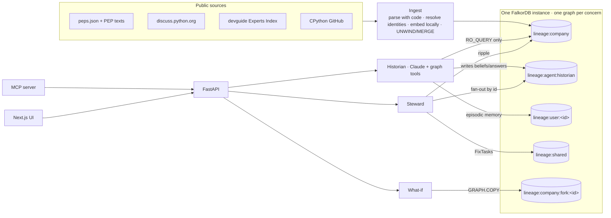

# Lineage

**A company brain that remembers *why* — and un-learns when the truth changes.**

Lineage turns a real organisation's public record into a FalkorDB graph of people, proposals, decisions, discussions and code, then puts agents on top of it:

- the **Historian** answers *why / who / when* questions with an evidence subgraph, never a bare paragraph;
- the **Steward** watches for change. When a decision is superseded, it walks the graph to find every document, agent belief, cached answer and queued action that rested on the old truth. It marks them stale, blocks the unsafe actions and opens review tasks.

The demo "company" is the **Python project**: 745 PEPs, the forum threads where they were argued, the people who decided them, and who actually maintains each module.

> **Tracks: Agent Memory and Coordination, Company Brain** — FalkorDB *Graph Hacks: Context for AI Agents* (WeMakeDevs, Oct 15–18 2026).

Glean tells you *what*. Lineage tells you *why, who, since when, and what breaks if they leave*.

---

## Live demo

The public deployment goes up on Oct 18 and its link will appear here. It runs the **graph-only** Historian: answers are composed straight from the evidence subgraph, with no LLM, because a personal Claude subscription can't power a public site. Everything else (ripple, gate, task board, what-if, drift) is identical. Run it locally (below) to get the Claude-powered Historian.

## Demo video

The 3½-minute walkthrough goes up on Oct 18 and its link will appear here. Storyboard:

1. **Ask:** *"How does Python handle annotations under PEP 563, and who decided it?"* Claude answers from the graph with cited ids and an evidence graph.
2. **Queue:** "add this answer to the onboarding FAQ" becomes a pending action derived from that answer.
3. **Change:** apply the real event *PEP 563 superseded by PEP 649 + 749 (2025-05-05)*. A bleach wave spreads from PEP 563 to the 8 proposals that cite it, the answer is struck through, and the beliefs go stale.
4. **Gate:** run the action. It is **blocked**, and the chain *action ← answer ← belief ← passage of PEP 563* lights up in red.
5. **What if Guido left?** The graph is copied with `GRAPH.COPY`, Guido is removed from the copy, and collaboration splits from 8 into 10 groups.

---

## How it works



**Key design decisions**

| Decision | Why |
|---|---|
| **One graph per concern** (company, each agent, each user, shared board, forks) | Isolation is enforced by FalkorDB itself. Writes are serialised *per graph*, so agents' memories never queue behind each other. |
| **Each agent logs in as its own database user** | The Historian may only `GRAPH.RO_QUERY` the company graph (Redis ACL *selector*), while writing its own memory. The Steward owns company, agents and shared, but **cannot touch user memory**. Tests prove the database refuses the writes. |
| **Lineage crosses graphs by id** | Cypher can't join graphs, so agent memory stores `Evidence {ref:"pep:563"}` stubs. A change fans out by id and walks `DERIVED_FROM` upwards inside each agent graph. |
| **Counterfactuals on a `GRAPH.COPY` fork** | Algorithm procedures (WCC, PageRank) run over whole label sets and can't skip a node. "What if X left" copies the graph (110 MB in ~4 s), deletes X *in the copy*, re-runs them and deletes the copy. |
| **Parse with code, use the LLM last** | Structured sources are parsed deterministically, so provenance is exact: who decided, in which post, on what date. Claude is only used to phrase answers from tool results, and **every citation is checked** against ids the tools actually returned. |
| **Replay events stay invisible until applied** | Otherwise the Historian would "know the future" in the demo (a bug the live run caught). |

---

## Graph data model

`lineage:company` currently holds **27,562 nodes and 46,495 relationships**.

| Node | Count | Example |
|---|---|---|
| `PEP` | 745 | `pep:649` — status, created, pagerank, `stale` |
| `Person` | 907 | `person:gpshead` (identities merged across PEP authors, GitHub, forum) |
| `Decision` | 672 | `decision:pep:649:accept` — kind, date |
| `Thread` / `Post` | 310 / 5,708 | forum discussions (posts carry 384-d embeddings) |
| `Chunk` | 18,906 | sections of PEP text with embeddings |
| `PR` | 160 | merged CPython PRs whose title names a PEP |
| `Area` | 152 | modules / interest areas from the Experts Index |
| `Event` | 1 | replayable real change: PEP 563 superseded (2025-05-05) |

| Relationship | Meaning |
|---|---|
| `(:Person)-[:AUTHORED]->(:PEP)` · `[:DELEGATE_FOR]` | wrote / was given authority to decide |
| `(:Decision)-[:DECIDES]->(:PEP)` | accept · reject · supersede · withdraw · defer |
| `(:Decision)-[:ANNOUNCED_BY]->(:Person)` · `[:RECORDED_IN]->(:Post)` | who announced it, in which exact post |
| `(:PEP)-[:SUPERSEDES]->(:PEP)` | new idea replaced old idea |
| `(:PEP)-[:REFERENCES {count}]->(:PEP)` · `[:REQUIRES]` | citations: **these carry the staleness ripple** |
| `(:PR)-[:IMPLEMENTS]->(:PEP)` | the code that made it real |
| `(:Person)-[:EXPERT_IN {assignable, inactive}]->(:Area)` | **declared** ownership (Experts Index) |
| `(:Person)-[:COMMITTED_TO {count, last_at}]->(:Area)` | **revealed** ownership (last 12 months of commits) |
| `(:Person)-[:COLLABORATED {weight}]->(:Person)` | derived: co-authorship, shared threads, shared modules |
| `(:PEP)-[:CONCERNS]->(:Area)` · `(:Chunk)-[:PART_OF]->(:PEP)` · `(:Post)-[:IN]->(:Thread)` | |

**Agent memory** (`lineage:agent:<name>`):

`(:Action)-[:DERIVED_FROM]->(:Answer)-[:DERIVED_FROM]->(:Belief)-[:DERIVED_FROM]->(:Evidence {ref})`

Belief status is `tentative | committed | stale`; action status is `pending | blocked | done`.

**User memory** (`lineage:user:<id>`): `(:Episode {question})-[:SUGGESTS]->(:Interest {area_ref, weight})`. Forgetting deletes the episode and decrements interests, and a test proves no path back remains.

**Shared board** (`lineage:shared`): `(:Agent)-[:CLAIMED {until}]->(:FixTask)`.

Full design: [docs/specs/2026-10-14-lineage-design.md](docs/specs/2026-10-14-lineage-design.md).

### How this memory model differs from Graphiti, Cognee, GraphRAG-SDK

| | Graphiti | Cognee / GraphRAG-SDK | **Lineage** |
|---|---|---|---|
| What is remembered | facts extracted from conversations, with valid-from/valid-to | a knowledge graph built from documents | company facts **and every agent's answers, beliefs and actions, linked to the evidence they rest on** |
| When a fact changes | old edge is invalidated | re-index | the change **walks `DERIVED_FROM` into every agent's memory**: beliefs and answers go stale, dependent actions are blocked, review tasks are opened |
| Writes | an LLM call per write | an LLM pipeline | deterministic parsing; exact provenance (announcing post, person, date) |
| Isolation | `group_id` filter in one graph | dataset filter | **a separate FalkorDB graph per agent and per user, enforced by per-agent database logins** |
| Multi-agent coordination | — | — | a shared board with atomic claims |
| Forgetting | invalidation | delete | user-driven, and **provable**: no path back remains |

Graphiti is more general, because it learns from unstructured chat. Lineage is built for an organisation's *record*, and trades that generality for exact provenance and un-learning.

---

## Cypher queries and algorithms

All 99 queries live in [`lineage/graph/queries.py`](lineage/graph/queries.py) and are documented, with FalkorDB execution plans, in **[docs/queries.md](docs/queries.md)** (generated by `uv run python -m scripts.gen_queries_doc --explain`). The ones that matter most:

**Hybrid retrieval.** Vector KNN (cosine, **score is a distance**: lower is closer), plus full-text, plus PageRank re-rank. The over-fetched hits are then expanded through the graph:

```cypher
CALL db.idx.vector.queryNodes('Chunk', 'emb', $k, vecf32($q)) YIELD node, score
MATCH (node)-[:PART_OF]->(p:PEP)
WHERE $as_of IS NULL OR p.created IS NULL OR p.created <= date($as_of)
RETURN node.id AS id, score AS dist, p.id AS pep_id, p.pagerank AS pagerank
```

**Decision provenance.** Where each decision was recorded and who announced it:

```cypher
MATCH (:PEP {id: $id})<-[:DECIDES]-(a:Decision)-[r:RECORDED_IN|ANNOUNCED_BY]->(b) RETURN ...
```

**Staleness ripple.** PEPs that cite or require a changed PEP. The hops are bounded, so it is safe on citation cycles, and the superseders are excluded:

```cypher
MATCH (x:PEP)-[:REFERENCES|REQUIRES*1..1]->(c:PEP)
WHERE c.id IN $changed AND NOT x.id IN $changed AND NOT x.id IN $exclude
RETURN DISTINCT x.id AS id
```

**Fan-out into an agent's memory.** Everything the agent built on the changed evidence:

```cypher
MATCH (e:Evidence) WHERE e.ref IN $refs
SET e.stale = true, e.stale_because = $reason
WITH e
MATCH (x)-[:DERIVED_FROM*1..5]->(e)
WHERE x:Belief OR x:Answer OR x:Action
RETURN DISTINCT x.id AS id, labels(x)[0] AS label
```

**Action gate.** The root cause first: the longest chain down to stale evidence.

```cypher
MATCH p = (a:Action {id: $id})-[:DERIVED_FROM*1..5]->(e:Evidence)
WHERE e.stale = true
RETURN [n IN nodes(p) | n.id] AS path ORDER BY length(p) DESC LIMIT 1
```

**Atomic task claim.** One query is one atomic unit, and FalkorDB serialises writes per graph, so two agents can never claim the same task. Tested with 20 concurrent claims.

```cypher
MATCH (t:FixTask)
WHERE t.status = 'open' OR (t.status = 'claimed' AND t.claim_until <= $now)
WITH t ORDER BY t.created_at, t.id LIMIT 1
SET t.status = 'claimed', t.claimed_by = $agent, t.claim_until = $until
MERGE (a:Agent {name: $agent}) MERGE (a)-[:CLAIMED {until: $until}]->(t)
```

**Algorithms used**

| Algorithm | Used for |
|---|---|
| `algo.pageRank('PEP','REFERENCES')` | PEP influence, stored and used to re-rank search and to name topic clusters |
| `shortestPath(...)` | the Historian's `connection` tool: *"How is Guido connected to PEP 695?"* returns the actual chain |
| `algo.betweenness` on `Person`/`TIE` | what-if: how much a person bridges otherwise separate groups (Guido ranks #2 of 907). `TIE` is a two-way copy of `COLLABORATED`, because betweenness follows edge direction and collaboration has none |
| `algo.labelPropagation` on the PEP citation graph | topic communities (Type Hints, modern packaging, the stable ABI…). On people it finds one giant core-developer community, so we cluster proposals instead |
| `algo.WCC` on `Person`/`COLLABORATED` | collaboration clusters before and after a departure (on the fork) |
| `GRAPH.COPY` / `GRAPH.DELETE` | counterfactual forks |
| Vector (HNSW, cosine) + full-text (RediSearch) indexes | hybrid retrieval over PEP text and forum posts |
| `GRAPH.MEMORY USAGE`, `GRAPH.LIST`, `GRAPH.SLOWLOG` | ops strip in the UI |

---

## Evaluation

20 questions with ground truth taken from the real graph ([eval/questions.yaml](eval/questions.yaml)): decision announcers and dates, authors, supersede chains, "who should I ask", an as-of question, and 3 out-of-corpus questions that must be refused. Scoring is **deterministic**: each fact has accepted phrasings, and citation recall is computed against expected graph ids. No LLM judge is involved.

| Backend | Correct | Citation recall | Correct abstentions | Ripple recall / precision |
|---|---|---|---|---|
| graph-only (no LLM) | **20/20** | **100%** | **3/3** | **100% / 100%** |
| Claude Opus 5.5 (via Claude Code) | **20/20** | **100%** | **3/3** | **100% / 100%** |

Claude answers take a median of **11.6 s** per question (1–2 graph tool calls each) — [eval/results-claude-code.md](eval/results-claude-code.md). Graph tool latency on the real graph: `decision_path` **p50 3.7 ms**, `search` p50 15 ms ([eval/results-graph-only.md](eval/results-graph-only.md)). A full what-if (copy 110 MB, delete, WCC twice, drop the fork) takes about 4.5 s.

The eval caught three real bugs, all fixed with regression tests:
- expert ranking by recency instead of volume;
- as-of status lost to the date filter;
- an event's date overwritten by its stored text form.

**Tests:** 125 passing (`uv run pytest -m "not slow"`). Every test that touches FalkorDB runs on its own throwaway graph.

---

## Setup

Requires Docker, [uv](https://docs.astral.sh/uv/) and Node 20+.

```bash
git clone https://github.com/Vaibhaav-Tiwari/lineage && cd lineage
docker volume create lineage-falkordb-data
docker compose up -d                                # FalkorDB 6.0.2 (pinned) on :6379, Browser on :3000
uv sync
cp .env.example .env                                # LLM_BACKEND=claude-code | graph-only | anthropic
uv run python -m lineage.ingest.run --offline --rewind-replays   # build the graph from the committed raw cache
uv run uvicorn lineage.api.main:app --port 8000
npm --prefix web install && npm --prefix web run dev -- -p 3001  # UI on http://localhost:3001
```

- `--offline` rebuilds from `data/raw/`, with no network needed. Drop it to refresh from the live sources; a GitHub token is needed for the CPython data.
- **LLM backends:**
  - `claude-code` uses your local Claude Code login through the Claude Agent SDK. All built-in tools are removed, so Claude can only call the graph tools.
  - `graph-only` uses no LLM.
  - `anthropic` uses an API key.
- **MCP:** `uv run python -m lineage.mcp_server` exposes `ask`, `decision_path`, `who_knows`, `ownership_drift` and `departure_impact` to Claude Desktop / Claude Code.
- **Evaluate:** `uv run python -m eval.run_eval --backend graph-only` (or `claude-code`).

Repository map:

| Path | What |
|---|---|
| `lineage/ingest/` | sources → graph (PEPs, text, experts, forum, GitHub, identities, derived edges, events) |
| `lineage/graph/` | queries, hybrid search, agent tools, ripple, ownership drift, what-if, ops |
| `lineage/memory/` | agent and user memory, action gate, shared task board |
| `lineage/agents/` | Historian, Steward, LLM backends |
| `lineage/api/`, `lineage/mcp_server.py` | HTTP API, MCP server |
| `web/` | Next.js UI (Cytoscape evidence graph) |
| `eval/`, `docs/` | evaluation, design spec, plan, research notes, generated query docs |

---

## Data sources and licenses

| Source | License / terms | How it's used |
|---|---|---|
| [peps.python.org/api/peps.json](https://peps.python.org/api/peps.json) and PEP texts ([python/peps](https://github.com/python/peps)) | Public domain / CC0-1.0 | PEPs, statuses, supersede chains, text |
| [discuss.python.org](https://discuss.python.org) topic JSON (anonymous) | Forum content, no explicit licence | metadata + short excerpts, always linked back to the source post |
| [python/devguide experts index](https://github.com/python/devguide/blob/main/core-team/experts.rst) | CC0-1.0 | declared ownership |
| [python/cpython](https://github.com/python/cpython) GitHub API | PSF licence; metadata only | commit counts per module, PEP-implementing PRs |

Only public data is used. Raw responses are cached in `data/raw/` so the graph can be rebuilt without the network.

**Privacy:** people appear by public handle and project role only. Ownership results are shown **per module**, never as a ranking of people.

---

## AI assistance disclosure

Built with **Claude Code** (Claude Opus) as a pair programmer, as the rules allow:
- research;
- the design spec and plan;
- test-first implementation;
- the UI.

Every task followed red → green testing against a real FalkorDB. Decisions and trade-offs are recorded as rulings in the development ledger. The live end-to-end runs are what caught the future-leak, ripple-width, link-noise and eval bugs listed above. At runtime, the Historian uses Claude Opus 5.5 (through the Claude Agent SDK) only to phrase answers from graph tool results. All embeddings are computed locally (BAAI/bge-small-en-v1.5).

## Limitations

- **Gaps in decision provenance:** 116 decisions are linked to the exact announcing post. Older PEPs were decided on mailing lists, which aren't ingested, so the Historian says it doesn't know who decided PEP 563 rather than guessing.
- **Ownership drift coverage:** drift is measured only for the 18 modules whose commit history was fetched.
- **Graph-only mode is strict:** it needs a PEP number or a module name in the question. The Claude backend handles open questions.
